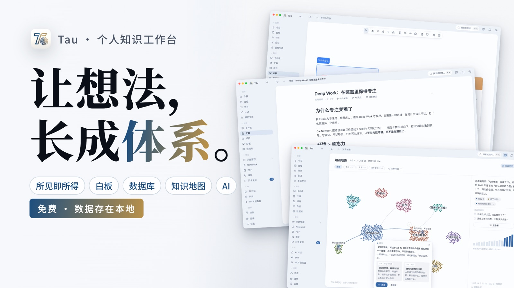

<div align="center">


# Tau

**让想法，长成体系。**

本地优先的个人知识工作台：写作、白板、数据库、知识地图与 AI，都在一个软件里。

[官网](https://taunote.app) · [下载](https://taunote.app/#download) · [使用文档](https://taunote.app/docs/) · [插件中心](https://plugins.taunote.app) · [反馈问题](https://github.com/LastKnightCoder/editor/issues)



</div>

## Tau 是什么

Tau 适合想把读到的、想到的东西攒成自己的知识，并且每天用它安排事情的人。读书划线、写卡片和文章、做闪卡复习、管待办和日程，内容之间可以互相引用。

- **免费，不用注册**：下载就能用。
- **数据在你手里**：资料库保存在自己的电脑上，没有网络也能写作和复习，随时导出 Markdown。
- **所见即所得**：熟悉的 Markdown 语法，敲下去就是排好的样子，不分编辑和预览。
- **全平台**：macOS（Apple 芯片 / Intel）、Windows、Android。

## 功能

### 写作

所见即所得的编辑器：敲 `## ` 是标题、`> ` 是引用、`**` 是加粗，当场成型。斜杠菜单里有表格、代码块、公式、待办、图片、音视频等十几种块。写短的用卡片，写长的用文章，成体系的放进项目。电脑上已有的 Markdown 文件也能直接打开编辑，不必导入。

### 白板

思维导图、形状、箭头、画框随手摆，支持手绘风格和多套配色，还能把文章卡片嵌进来。排好之后，按画框顺序直接演示。

### 数据库

一份数据，表格、看板、画廊、日历四种视图随时切换，适合书单、项目进度这类结构化内容。

### 知识闭环

一个想法从收进来到分享出去，都能在 Tau 里完成：

1. **输入**：在 PDF、网页、视频字幕上划线，Tau 记下出处。
2. **消化**：把资料放进 Notebook，读不懂就问 AI。
3. **输出**：用自己的话写成卡片，再展开成文章。
4. **复习**：做成闪卡，按遗忘规律安排复习。
5. **总览**：在知识地图上看清内容怎样连在一起；漫步把旧内容重新翻出来。
6. **分享**：勾选内容，一键发布成静态网站，或邀请别人实时协作编辑。

### 知识地图

敲 `[[` 就能连上写过的任何一条内容。所有笔记自动聚成主题，看得见谁连着谁，还能回放这张图是怎么一点点长出来的。

### AI

连接你自己的模型服务后，AI 认识你写过的一切：

- **小管家**：说一句话，它替你查资料、改写、安排待办。
- **洞见**：对照你的笔记查漏补缺，指出哪张卡片和哪篇旧文章相呼应、哪里矛盾。
- **创作模式**：写文章时不从一张白纸开始。
- **Skill 与 MCP**：把常用做法存成 Skill，或接入 MCP 服务器，让 AI 用上 Tau 之外的工具。

### 写作之外

番茄专注、待办、日程、日记，最后都汇进「今日」：今天的待办、日程、到期的闪卡和刚写过的内容都在这一页。

### 插件

在插件中心挑一个插件一键安装，比如同步微信读书的书架、划线与想法。插件可以添加页面、编辑器块、白板元素和同步存储。想自己写插件，见 [插件开发](docs/guides/plugin-development.md)。

## 下载

到 [官网下载区](https://taunote.app/#download) 选择你的系统。安装步骤和常见问题见 [下载与安装](https://taunote.app/docs/install/)。

Tau 的数据都放在个人目录下的 `.editor` 文件夹里（macOS 为 `~/.editor`，Windows 为 `C:\Users\你的用户名\.editor`）。备份与迁移见 [数据与备份](https://taunote.app/docs/data/)。

## 从源码运行

需要 Node.js（20.19+ 的 20.x，或 22.12+）和 [pnpm](https://pnpm.io/)。

```bash
pnpm install
pnpm dev
```

打包桌面安装包：

```bash
pnpm build
```

仓库使用 pnpm workspace：

| 目录        | 内容                                                                                                   |
| ----------- | ------------------------------------------------------------------------------------------------------ |
| `apps/`     | 各个应用：桌面端 `desktop`（Electron + React）、手机端 `mobile`（Tauri）、浏览器插件、官网、协作服务等 |
| `packages/` | 共享包：编辑器、白板、数据库 Schema、AI、主题、UI 组件等                                               |
| `plugins/`  | 官方插件                                                                                               |
| `docs/`     | 开发文档：架构、裁决规则与操作指南，入口见 [docs/README.md](docs/README.md)                            |

参与开发前，建议先读 [AGENTS.md](AGENTS.md) 里的协作约定和 [代码风格规范](docs/guides/dev-code-style.md)。

## 反馈

遇到问题、觉得哪里别扭，或者希望 Tau 能做什么，欢迎在软件内反馈，或提交 [GitHub Issue](https://github.com/LastKnightCoder/editor/issues)。
