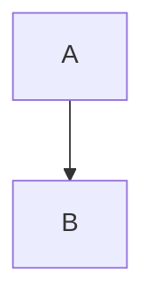

# Markdown 扩展语法

当用户需要**编辑已有文档**或**创建新文档**，且内容涉及编辑器扩展节点（不止标准 CommonMark）时，优先使用这里的语法。

## 使用原则

- 只使用下述已验证语法；不确定时优先复用文档内已有写法
- 尽量做局部修改，避免大段重排导致节点类型丢失
- 对 `smm=`、`metaInfo`、`data`、`config` 这类 Base64 字段，除非用户明确要求，否则不要手改内部编码内容

## 行内扩展（Text Directive）

```md
:color[文本]{color=#1f6feb darkColor=#7aa2f7}
:gradient[文本]{preset=sunset}
:highlight[文本]{color=yellow}
:underline[文本]{color=red lineType=solid}
:styled-text[文本]{color=blue}
:content-link[关联内容]{refId=1 contentId=2 contentType=card title="关联卡片"}
:time{start=12 end=42}
```

- `:gradient` 的 `preset` 可用值：`sunset`、`ocean`、`forest`、`violet`、`gold`、`rose`
- `:highlight` 常用颜色：`blue`、`yellow`、`green`、`red`、`purple`
- `:styled-text` 常用颜色：`red`、`green`、`yellow`、`blue`、`purple`、`gray`
- `:content-link` 字段说明（都可选）：
  - `refId`：关联记录 ID，用于定位一条关联关系
  - `contentId`：目标内容 ID
  - `contentType`：目标内容类型（例如 `card`）
  - `title`：目标标题文本；包含引号时会做转义与反转义处理

## 容器块（Container Directive）

```md
:::note{title="注意"}
这是 callout 内容
:::

:::tip{title="技巧"}
这是提示内容
:::

:::warning{title="警告"}
这是警告内容
:::

:::info{title="信息"}
这是信息内容
:::

:::danger{title="危险"}
这是危险内容
:::

:::detail{title="展开详情" open=true}
可折叠内容
:::

:::highlight-block{color=yellow}
强调块内容
:::

:::video{src="https://example.com/demo.mp4" playbackRate="1" width="640" align="center"}
:::

:::audio{src="https://example.com/demo.mp3" isFromGenerate="false" audioText="音频转写"}
:::

:::file-attachment{fileName="需求.pdf" filePath="/tmp/需求.pdf" isLocal=true uuid="your-uuid"}
:::
```

```md
:::chart{data="BASE64_JSON" config="BASE64_JSON"}
:::
```

## 代码块扩展

````md

````

````md
```js {1,3-4}
console.log("hello");
console.log("world");
```
````

- 支持的扩展代码块语言：`mermaid`、`abc`、`plantuml`、`tikz`、`typst`、`custom-block`
- 普通代码块支持高亮元信息（如 `{1,3-4}`）
- 进阶动画元信息使用 `smm=...`（Base64URL 编码），通常由系统生成，不建议手写

## 其它可用结构

```md
---
title: 示例文档
tags:
  - demo
---

这是脚注引用[^1]。

[^1]: 这是脚注内容

按 <kbd>Cmd</kbd> + <kbd>K</kbd> 打开命令面板
```

- 支持 YAML Front Matter（`---` 包裹）
- 脚注会映射为注释节点（`annotation`）
- `<kbd>...</kbd>` 会映射为快捷键节点
- 原生 HTML 会按块级/行内规则尽量保留

## 列表图标语法

```md
- 已完成项
- 自定义图标项
```

- 仅当图标位于列表项开头时，才会识别为列表图标

## 编辑技巧（推荐流程）

1. 先识别文档中已有扩展语法，再决定是否新增同类结构
2. 修改时优先保留外层包裹（如 `:::detail`、`:content-link[...]`），只改内部文本和必要属性
3. 新建文档时优先使用本页“示例”中的规范写法，避免混用旧格式
