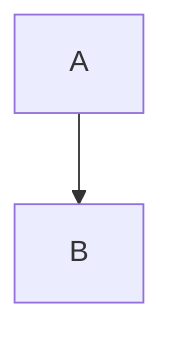

# Markdown 扩展语法

## 使用原则

- 只使用下述已验证语法；不确定时优先复用文档内已有写法
- 尽量做局部修改，避免大段重排导致节点类型丢失
- 对 `smm=`、`metaInfo`、`data`、`config` 这类 Base64 字段，除非用户明确要求，否则不要手改内部编码内容

## 行内扩展（Text Directive）

```md
:color[文本]{color=#1f6feb darkColor=#7aa2f7}
:gradient[文本]{preset=sunset}
:highlight[文本]{color=yellow}
:underline[文本]{color=red lineType=solid}
:styled-text[文本]{color=blue}
:content-link[关联内容]{refId=1 contentId=2 contentType=card title="关联卡片"}
:time{start=12 end=42}
```

- `:gradient` 的 `preset` 可用值：`sunset`、`ocean`、`forest`、`violet`、`gold`、`rose`
- `:highlight` 常用颜色：`blue`、`yellow`、`green`、`red`、`purple`
- `:styled-text` 常用颜色：`red`、`green`、`yellow`、`blue`、`purple`、`gray`
- `:content-link` 字段说明（都可选）：
  - `refId`：关联记录 ID，用于定位一条关联关系
  - `contentId`：目标内容 ID
  - `contentType`：目标内容类型（例如 `card`）
  - `title`：目标标题文本；包含引号时会做转义与反转义处理

## 容器块（Container Directive）

```md
:::note{title="注意"}
这是 callout 内容
:::

:::tip{title="技巧"}
这是提示内容
:::

:::warning{title="警告"}
这是警告内容
:::

:::info{title="信息"}
这是信息内容
:::

:::danger{title="危险"}
这是危险内容
:::

:::detail{title="展开详情" open=true}
可折叠内容
:::

:::highlight-block{color=yellow}
强调块内容
:::

:::video{src="https://example.com/demo.mp4" playbackRate="1" width="640" align="center"}
:::

:::audio{src="https://example.com/demo.mp3" isFromGenerate="false" audioText="音频转写"}
:::

:::file-attachment{fileName="需求.pdf" filePath="/tmp/需求.pdf" isLocal=true uuid="your-uuid"}
:::
```

```md
:::chart{data="BASE64_JSON" config="BASE64_JSON"}
:::
```

## 代码块扩展

````md

````

````md
```js {1,3-4}
console.log("hello");
console.log("world");
```
````

- 支持的扩展代码块语言：`mermaid`、`abc`、`plantuml`、`tikz`、`typst`、`custom-block`
- 普通代码块支持高亮元信息（如 `{1,3-4}`）
- 进阶动画元信息使用 `smm=...`（Base64URL 编码），通常由系统生成，不建议手写

### `custom-block` 使用规范（面向 AI 生成）

- `custom-block` 不是普通文章默认语法；只有用户明确要求交互式组件、自定义 React 组件、动态小部件时才使用
- 普通文章、教程、笔记、摘要、列表、表格、提示框等内容，优先使用标准 Markdown 和已有扩展语法，不要主动输出 `custom-block`
- `custom-block` 必须使用代码围栏，内容必须是单文件 TSX/JSX，并且必须定义名为 `Component` 的函数组件
- 不要写静态 `import ... from ...`、`export default`、多文件依赖或需要额外构建配置的代码；生成内容应尽量自包含
- 如需按需加载外部模块或远程组件库，可使用运行时支持的动态 `import()`，但应保持来源明确、用途简单，并优先保证降级可用

```custom-block
const Component = () => {
  return <div>Hello</div>;
};
```

### `custom-block` 可依赖能力

- 可直接使用 React JSX/TSX 基本语法和 React Hooks
- 可直接使用运行时注入的 `antd` 对象；常见写法是 `const { Button, Card, Space, Tag } = antd;`
- 可直接使用运行时注入的 `antdIcons` 对象；常见写法是 `const { SmileOutlined } = antdIcons;`
- 可直接使用运行时注入的 `hooks` 对象；常见写法是 `const { useTheme, useBoolean, useMemoizedFn } = hooks;`
- `hooks.useTheme()` 可用于读取当前主题，返回 `{ theme, isDark }`
- 可直接使用 Tailwind CSS 类名；运行时会编译所需样式
- 纯样式层面的深浅色适配，优先使用 Tailwind 的 `dark:` 变体；不要为简单的 className 分支滥用 `useTheme()`

### `custom-block` 禁止假设的能力

- 不要假设可以导入项目内部模块、业务组件、全局 store、数据库、Electron API 或后端服务
- 不要依赖额外 npm 包、外部文件、多文件协作或自定义 bundler 配置
- 只有在用户明确需要时，才使用动态 `import()` 加载远程模块或远程组件库；不要无故引入远程依赖
- 如果不确定某个能力是否存在，优先回退为普通 Markdown 或更简单的 `custom-block`

### `custom-block` 完整示例

最小示例：

```custom-block
const Component = () => {
  return <div>你好，世界</div>;
};
```

使用 Tailwind `dark:` 做主题样式适配：

```custom-block
const Component = () => {
  return (
    <div className="rounded-xl bg-white p-4 text-zinc-900 shadow-sm dark:bg-zinc-900 dark:text-zinc-100">
      当前主题会自动跟随编辑器切换
    </div>
  );
};
```

使用 `antd` 和 `ahooks`：

```custom-block
const { Card, Button, Space } = antd;
const { useBoolean } = hooks;

const Component = () => {
  const [visible, { toggle }] = useBoolean(false);

  return (
    <Card title="示例卡片">
      <Space direction="vertical">
        <Button type="primary" onClick={toggle}>
          切换内容
        </Button>
        {visible ? <div>已展开</div> : <div>未展开</div>}
      </Space>
    </Card>
  );
};
```

使用 `useTheme()` 做逻辑层主题感知：

```custom-block
const { Tag } = antd;
const { useTheme } = hooks;

const Component = () => {
  const { isDark, theme } = useTheme();

  return (
    <div className="rounded-xl bg-white p-4 dark:bg-zinc-900">
      <div className="mb-2 text-zinc-900 dark:text-zinc-100">当前主题：{theme}</div>
      <Tag color={isDark ? "blue" : "gold"}>{isDark ? "Dark" : "Light"}</Tag>
    </div>
  );
};
```

综合示例：Tailwind + `antd` + `antdIcons` + `hooks`

```custom-block
const { Card, Space, Button, Tag } = antd;
const { SmileOutlined } = antdIcons;
const { useTheme, useBoolean } = hooks;

const Component = () => {
  const { isDark } = useTheme();
  const [liked, { toggle }] = useBoolean(false);

  return (
    <Card className="rounded-2xl bg-white/90 shadow-sm dark:bg-zinc-900/90">
      <Space direction="vertical" size={12} className="w-full">
        <div className="flex items-center justify-between">
          <div className="flex items-center gap-2 text-zinc-900 dark:text-zinc-100">
            <SmileOutlined />
            <span className="font-medium">交互式卡片</span>
          </div>
          <Tag color={isDark ? "blue" : "gold"}>{isDark ? "Dark" : "Light"}</Tag>
        </div>

        <p className="m-0 text-sm text-zinc-600 dark:text-zinc-300">
          样式使用 Tailwind，交互使用 ahooks，组件使用 antd。
        </p>

        <Button type={liked ? "primary" : "default"} onClick={toggle}>
          {liked ? "已点赞" : "点赞"}
        </Button>
      </Space>
    </Card>
  );
};
```

使用动态 `import()` 加载远程模块：

```custom-block
const { useEffect, useState } = React;
const { Spin, Alert } = antd;

const Component = () => {
  const [RemoteComponent, setRemoteComponent] = useState(null);
  const [error, setError] = useState("");

  useEffect(() => {
    let disposed = false;

    (async () => {
      try {
        const mod = await import("https://esm.sh/some-remote-library");
        if (!disposed) {
          setRemoteComponent(() => mod.default || mod.Component || null);
        }
      } catch (err) {
        if (!disposed) {
          setError(err instanceof Error ? err.message : String(err));
        }
      }
    })();

    return () => {
      disposed = true;
    };
  }, []);

  if (error) {
    return <Alert type="error" message="远程组件加载失败" description={error} />;
  }

  if (!RemoteComponent) {
    return <Spin tip="加载远程组件中..." />;
  }

  return <RemoteComponent />;
};
```

## 其它可用结构

```md
---
title: 示例文档
tags:
  - demo
---

这是脚注引用[^1]。

[^1]: 这是脚注内容

按 <kbd>Cmd</kbd> + <kbd>K</kbd> 打开命令面板
```

- 支持 YAML Front Matter（`---` 包裹）
- 脚注会映射为注释节点（`annotation`）
- `<kbd>...</kbd>` 会映射为快捷键节点
- 原生 HTML 会按块级/行内规则尽量保留

## 列表图标语法

```md
- 已完成项
- 自定义图标项
```

- 仅当图标位于列表项开头时，才会识别为列表图标

## 编辑技巧（推荐流程）

1. 先识别文档中已有扩展语法，再决定是否新增同类结构
2. 修改时优先保留外层包裹（如 `:::detail`、`:content-link[...]`），只改内部文本和必要属性
3. 新建文档时优先使用本页“示例”中的规范写法，避免混用旧格式
