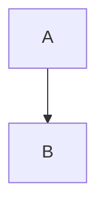

# 一级标题

## 二级标题

正文有 **粗体**、_斜体_、~~删除~~、`行内代码`、[链接](https://example.com) 和中文**加粗**标点。

:color[彩色]{color=red darkColor=pink} :gradient[渐变]{preset=ocean} :highlight[高亮]{color=yellow}

:underline[下划线]{color=red lineType=wavy} :kbd[Ctrl] :content-link[引用卡片]{refId=1 contentId=42 contentType=card title="卡片 &quot;标题&quot;"} :time{start=10 end=20}

- 无序一
- 无序二
  - 嵌套

1. 有序一
2. 有序二

- [ ] 待办
- [x] 已完成

> 引用一行
> 引用两行

```ts
const a = 1;
```



$$
E = mc^2
$$

行内公式 $a^2$ 与脚注[^1]。

| 表头 A | 表头 B |
| --- | --- |
| 单元格 1 | 单元格 2 |

:::tip{title="提示"}
提示内容
:::

:::detail{title="详情" open="true"}
折叠内容
:::

:::highlight-block{color=blue}
高亮块
:::


:::audio{src="a.mp3" title="播客"}
:::

:::video{src="v.mp4"}
:::

:::file-attachment{fileName="a.pdf" filePath="/tmp/a.pdf" isLocal=true uuid="u-1"}
:::

---

<div>HTML 块</div>

[^1]: 脚注内容
