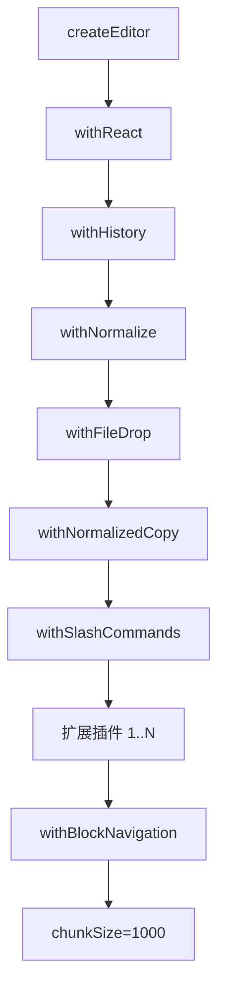

# 编辑器技术细节指南

> 在“地图版”基础上，深入描述编辑器的插件流水线、扩展行为、Markdown 解析、块导航、性能优化与调试策略。原始长文《编辑器技术文档.md》仍保留，可对照阅读。

---

## 目录

- [一、整体架构与组件流](#一整体架构与组件流)
- [二、类型系统与数据模型](#二类型系统与数据模型)
- [三、插件流水线与初始化](#三插件流水线与初始化)
- [四、扩展系统详解](#四扩展系统详解)
- [五、块导航与键盘行为](#五块导航与键盘行为)
- [六、Markdown 导入导出](#六markdown-导入导出)
- [七、服务注入与外部依赖](#七服务注入与外部依赖)
- [八、性能优化要点](#八性能优化要点)
- [九、开发与调试建议](#九开发与调试建议)
- [附录：关键文件索引](#附录关键文件索引)
- [附录B：常见需求/故障导航](#附录b常见需求故障导航)

---

## 一、整体架构与组件流

- **入口组件**：`packages/editor/src/index.tsx`
  1. 合并起始扩展与外部扩展，交给 `PluginOptimizer` 做缓存。
  2. `createEditor()` → `applyPlugin` 应用默认插件（withReact/withHistory/withNormalize/withFileDrop/withNormalizedCopy/withSlashCommands）；Markdown 粘贴导入由宿主按需注入。
  3. 应用扩展插件 → `withBlockNavigation` → 启用 chunkSize（content-visibility）。
  4. 渲染 `<Slate>`：`renderElement` 调用扩展 render，`renderLeaf` 使用 FormattedText，`renderChunk` 控制内容可见性；附带工具组件（悬浮栏/块面板/图片预览）。

- **状态回调**：`onChange` 透出 Slate 值；规范化首帧执行 `Editor.normalize` 确保节点合法。

---

## 二、类型系统与数据模型

- `CustomTypes`（`types/editor.ts`）：扩展 Slate Editor/Element/Text。
- `CustomElement` 联合（`types/custom-element.ts`）：内置类型由 `BuiltinElementMap` 映射组成，包含段落/标题/列表/代码/数学/图表/多媒体和布局；应用层可通过 `ExternalElementMap` 声明注入外部元素（如 desktop 的 database、whiteboard）。
- `FormattedText`（`types/text.ts`）：`type:"formatted"` + 富文本标记（bold/italic/underline/strike/code/color/highlight）。
- 块/内联划分：`InlineElement` vs `BlockElement`；Void 元素需有零宽字符辅助光标。

---

## 三、插件流水线与初始化

- `applyPlugin`：函数式 reduce 应用插件。
- 默认插件职责：
  - **withNormalize**：保证节点合法、补零宽、修复格式化文本。
  - **withFileDrop**：处理文件拖放。
  - **withNormalizedCopy**：复制内容规范化。
  - **Markdown 粘贴导入扩展**：由宿主按需注入，使用宿主的 Markdown 解析策略。
  - **withSlashCommands**：处理斜杠命令插入元素。
  - **withBlockNavigation**：见下一节。
- 扩展插件来源：`PluginOptimizer.optimizeExtensions` 输出 `plugins/renderers/hotkeys/blockPanel/hoveringBar` 等缓存，避免每次渲染计算。

---

## 四、扩展系统详解

- **接口**：`extensions/types.ts` IExtension：`type/getPlugins/render/getHotkeyConfigs/getBlockPanelItems/getHoveringBarElements`。
- **基类**：`extensions/base.ts` 提供空实现，可按需覆盖。
- **注册**：`extensions/index.ts` 创建实例并导出，type 必须与 `CustomElement` 对齐。
- **渲染**：`renderElement` 通过 `pluginOptimizer.getExtension(type)` 找到扩展并调用 render。
- **热键**：`getHotkeyConfigs` 返回快捷键 → withSlashCommands / 全局注册处理。
- **UI 集成**：块面板项（`/` 搜索）、悬浮工具栏按钮通过扩展配置注入。

---

## 五、块导航与键盘行为

- **核心文件**：`utils/blockNavigation.ts` + `plugins/withBlockNavigation.ts`。
- **流程**：拦截 deleteBackward/deleteForward/insertBreak → 检查光标是否在块首/尾 → 找到前/后兄弟块 → 调用 `focusElementByNavigator`。
- **自定义处理**：元素可注册 `registerBlockNavigation(element, {focusStart, focusEnd})`（如 CodeBlock 聚焦到 CodeMirror 起止位置）。
- **默认行为**：非 void 聚焦 start/end；void 元素需自定义，否则无法聚焦。

---

## 六、Markdown 导入导出

- **导出**：`apps/desktop/src/utils/markdown-helper.ts`
  1. 重置脚注计数 → 2) 遍历顶级元素调用 `elementToMarkdown`（由 `markdownSerializerRegistry` 注册）→ 3) 追加脚注定义。
- **导入**：`apps/desktop/src/utils/markdown.ts`
  - unified + remark-parse/gfm/math/directive/frontmatter → 解析树 → `dfs` 转 Slate 节点 → `normalizeEditorContent`。
  - 支持容器指令 `:::name{attrs}`、文本指令 `:name[content]{attrs}`、特殊代码块（mermaid/tikz/plantuml 等）。
  - 忽略类型列表可通过参数扩展。
- **序列化注册中心**：`markdownSerializerRegistry.ts` 维护 `serializers`、`blockTypes`、脚注映射；`registerDefaultSerializers` 包含内置元素。

---

## 七、服务注入与外部依赖

- **ServiceRegistry**（`services/registry.ts` + `services/tokens.ts`）：内核定义服务协议 token，实现由宿主应用经 `createServiceRegistry` 注册，并通过 `<EditorProvider registry>` 注入。
- **使用**：React 组件内 `useService(token)`；插件等非 React 代码 `editor.getService(token)` / `editor.tryGetService(token)`。
- 场景：上传资源、媒体解析、编译预览等均通过服务接口解耦；业务能力（白板、数据库等）不出现在内核类型中。

---

## 八、性能优化要点

- **Chunking**：`editor.getChunkSize = node => Editor.isEditor(node)?1000:null` + `renderChunk` 应用 content-visibility，分块渲染大文档。
- **缓存**：`PluginOptimizer` 避免重复计算扩展信息。
- **记忆化**：大量使用 `useMemoizedFn/useMemo` 防止回调/渲染抖动。
- **重型扩展**：渲染内尽量避免创建新函数/对象；需要时使用 React.memo。
- **Markdown**：导入导出前后可在调用侧分片处理，避免一次性大字符串阻塞。

---

## 九、开发与调试建议

- **未识别元素**：检查扩展是否注册（内置看 `extensions/index.ts`，业务扩展看是否经 `<Editor extensions={...}>` 注入），元素类型是否经 `ExternalElementMap` 声明合并。
- **插件不生效**：确认 `getPlugins` 返回的插件已被优化器收集；插件顺序是否依赖。
- **快捷键冲突**：核查 `getHotkeyConfigs` 与外层快捷键绑定。
- **块导航异常**：确认元素是否注册 navigator；void 元素需自定义 focus。
- **Markdown 差异**：对照 serializer/导入解析分支，检查自定义指令/代码块是否覆盖。
- **性能问题**：调整 chunkSize；剔除 render 中的重计算；避免在 `onChange` 做深度计算。

---

## 附录：关键文件索引

- 入口与渲染：`packages/editor/src/index.tsx`
- 扩展接口/注册：`packages/editor/src/extensions/types.ts`、`extensions/index.ts`
- 类型：`packages/editor/src/types/custom-element.ts`、`types/text.ts`
- 插件管道：`packages/editor/src/utils/plugin.ts`
- 块导航：`packages/editor/src/utils/blockNavigation.ts`、`plugins/withBlockNavigation.ts`
- 插入工具：`packages/editor/src/utils/insertElement.ts`
- Markdown：`apps/desktop/src/utils/markdown.ts`、`markdown-helper.ts`、`markdownSerializerRegistry.ts`
- 服务注入：`packages/editor/src/services/`（tokens.ts、registry.ts、hooks.ts）、`contexts/EditorProvider.tsx`、`types/services.ts`

---

如需进一步逐行对照，可与《编辑器技术文档.md》同时阅读。

---

## 附录B：常见需求/故障导航

> 按需求直达入口，便于 AI / 开发者快速落地。

- **新增块/行内扩展**
  - 通用扩展（核心包）：实现 `packages/editor/src/extensions/<name>/index.tsx`（继承 Base，实现 render/hotkeys/blockPanel/hoveringBar/getPlugins），在 `extensions/index.ts` 注册实例；若需 Markdown 支持，同步调整导入/导出（下文）；插入入口在 `packages/editor/src/utils/insertElement.ts` 增加插入函数和 mapping。
  - 业务扩展（应用层，推荐用于白板/数据库这类业务块）：实现放 `apps/desktop/src/editor-extensions/<name>/`，类型定义在扩展目录内并经 `augmentations.d.ts` 对 `ExternalElementMap` 做声明合并，经 `<Editor extensions={...}>` prop 注入，不改动核心包。

- **渲染/样式问题（某类型显示异常）**
  - 找扩展 render：`extensions/<name>/components/*` 或 `index.tsx`。
  - 检查 CustomElement 字段是否与 render 逻辑对齐；void 元素是否处理零宽字符（withNormalize）。

- **块导航/光标跳转异常**
  - 通用逻辑：`packages/editor/src/utils/blockNavigation.ts`、`plugins/withBlockNavigation.ts`。
  - 特定元素（如 code-block）：对应扩展组件中 `registerBlockNavigation` 调用（例如 `extensions/code-block/components/CodeBlock/index.tsx`）。
  - 若 void 元素无法聚焦，需自定义 focusStart/focusEnd。

- **斜杠命令/块面板**
  - 配置来源：扩展 `getBlockPanelItems`。
  - 入口：`packages/editor/src/plugins/withSlashCommands.ts`（hotkey `/` 触发）。

- **悬浮工具栏按钮**
  - 扩展 `getHoveringBarElements` 返回按钮配置；组件位于 `packages/editor/src/components/HoveringToolbar`。

- **Markdown 导出不含新元素 / 导入失败**
  - 导出：`apps/desktop/src/utils/markdownSerializerRegistry.ts` 注册 `toMarkdown`；`markdown-helper.ts` 遍历顶层元素。
  - 导入：`apps/desktop/src/utils/markdown.ts` 中 `dfs/markdownToDescendant` 处理新节点或 directive/代码块；如为容器指令，匹配 `containerDirective`。
  - 自定义指令示例：在 import 中匹配 node.name，在 export 中生成 `:::name{attrs}` 或 `:name[content]{attrs}`。

- **规范化/节点结构问题（数据损坏、光标异常）**
  - 检查 `packages/editor/src/plugins/withNormalize.ts` 的规则（文本必须 `type:"formatted"`，void 末尾零宽等）。
  - 如新增元素需特殊 normalize，添加相应规则。

- **性能瓶颈（大文档卡顿）**
  - 调整 `chunkSize`：`index.tsx` 中 `editor.getChunkSize`。
  - 优化扩展 render：使用 React.memo/ahooks useMemoizedFn；避免大对象/函数每次重建。
  - PluginOptimizer：确认扩展列表经 `optimizeExtensions` 缓存。
  - Markdown 导入大型文本：考虑分批或在调用方做切片处理。

- **服务依赖与外部能力**
  - 接入上传/媒体解析等：`packages/editor/src/services/`（token 定义 + 注册表）；React 组件调用 `useService(token)`，插件调用 `editor.getService(token)`。
  - 调试：在 render/command 处打印服务获取结果或提供 mock 注册表。

- **热键冲突或失效**
  - 扩展 `getHotkeyConfigs` 定义；全局注册在 `index.tsx` 或插件内；确认 isHotkey 的组合与浏览器保留热键是否冲突。
  - 斜杠命令与输入法：withSlashCommands 内判断 selection/上下文，必要时调整触发条件。
