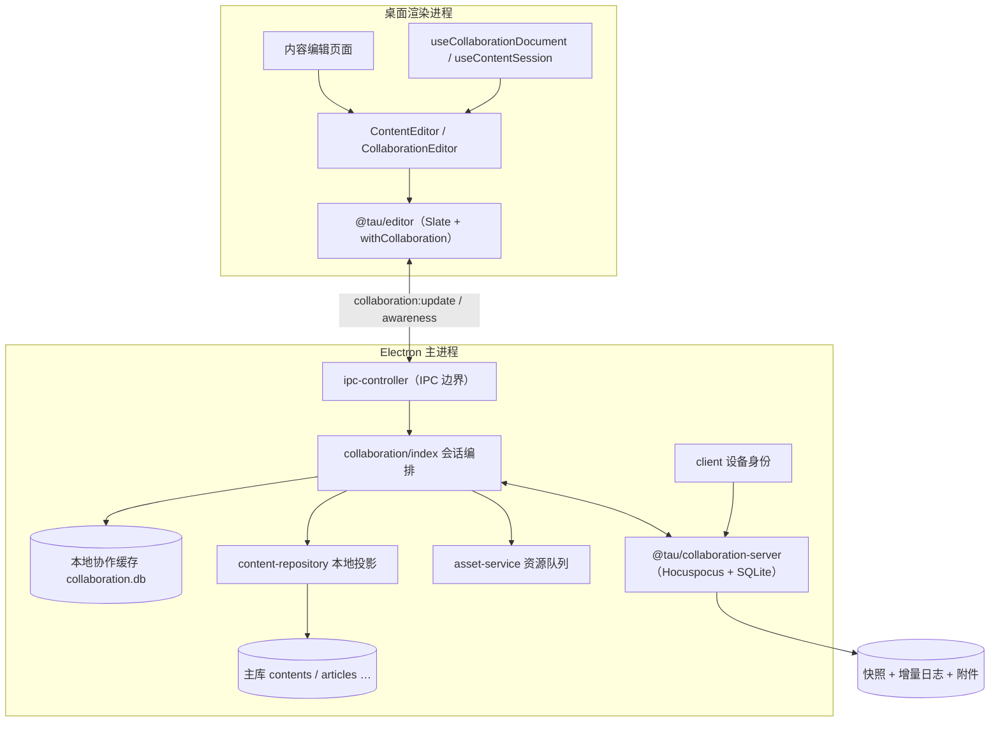

# Tau 实时内容协作 — 功能与架构报告

更新日期：2026-09-06。本文是实时协作功能的完整报告：功能描述、架构、涉及文件、产品入口与使用指南，并记录本轮代码审查与修复的结论。

## 1. 功能概述

Tau 桌面端的实时协作让两台（或多台）设备基于同一份 `contents` 记录共同编辑富文本：

- **以内容为中心**：任何持久化的 content（卡片、文章、项目项、知识库文档、日记、回答、任务描述、音视频笔记，或独立内容）都可以发起共享，协作对象是 content 本身而非上层实体。
- **实时同步**：正文、标题、源码块（代码 / 公式 / 图表 DSL）、标签页内容、图片音视频附件，均在字符级实时合并；多设备光标与选区互相可见。
- **无需账号**：首版双方均使用 Tau 桌面端。首次使用自动生成设备身份（设备 ID + 密钥），密钥用系统钥匙串加密保存；授权以设备身份为准，昵称只用于展示。
- **审批制加入**：通过 12 位协作码申请，创建者批准后参与者取得正文快照与实时连接权限。
- **本地优先**：会话由 Electron 主进程托管，切换页面 / 关闭标签不销毁；断网时改动保存在本机，恢复后自动交换缺失增量。

## 2. 架构



分层职责：

| 层           | 模块                                                    | 职责                                                                                                                                                                                                       |
| ------------ | ------------------------------------------------------- | ---------------------------------------------------------------------------------------------------------------------------------------------------------------------------------------------------------- |
| 共享协议包   | `packages/collaboration`                                | 协议类型、Slate 树 ↔ Y.Doc 双向投影（结构走 Y.XmlText，源码等重字段按 `collabId` 外置到 Y.Map 获得字符级合并）、文档校验（大小 / 深度 / 资源地址 / 原型污染）                                              |
| 编辑器协作层 | `packages/editor/src/collaboration`                     | `withCollaboration` 在 @slate-yjs 插件链上拦截 split/merge/insert/set 操作维护块身份；hydrate 把字段变化投影回 Slate；远端光标 overlay；共享标签页；不可信内容的安全渲染                                   |
| 渲染进程接入 | `ContentEditor` / `CollaborativeTitle` / hooks / stores | 按 contentId 自动接入本机或远端会话；视图级 Y.Doc 副本经 IPC 与主进程同步；协作文档的读写不再走节流整篇落库                                                                                                |
| 主进程会话   | `apps/desktop/src-electron/main/modules/collaboration`  | 会话注册与生命周期、冻结/解冻编排、整篇替换的乐观锁（`expectedRevision`）、标题回写、本地投影与资源上传下载                                                                                                |
| 协作服务端   | `apps/collaboration-server`                             | Fastify + Hocuspocus + SQLite；设备凭据（仅存 SHA-256 摘要）、60 秒短期票据 WebSocket 鉴权、每条消息先鉴权后落盘、快照 + 按内容哈希去重的增量日志、附件按内容哈希寻址、Presence 按文档合并通知、配额与限流 |

关键设计决策：

- **唯一写入路径**：绑定协作后，`contents` 表由主进程投影写入（`writeContentProjection`），渲染层不再直接 `updateContent`；整篇程序化替换必须携带读取时返回的 `revision`，版本不符返回 `CONTENT_VERSION_CONFLICT`，冻结期间返回 `CONTENT_SESSION_LOCKED`。
- **块身份（collabId）**：每个结构块持有稳定 ID；`split_node` 为新块分配新身份（防止两块共享同一份源码字段），`merge_node` 剥离被合并块的身份（幸存块保持自己的字段）。
- **私有块隔离**：白板、数据库、问答、项目卡片等依赖本地实体的块替换为占位符进入共享文档，原始数据按设备保存在 `session.privateNodes` 并随本地投影回写，不递归暴露给其他设备；插入与整篇替换两条链路都会保留私有数据。数据持有端（作者）复用原扩展组件渲染真身（只读控制沿用组件自身的 `useReadOnly`），占位块的属性编辑（如白板高度）经 `set_node` 拦截只更新 `privateNodes` 不进入共享文档；远端无数据仍显示占位说明。`content-link` 不再剥离：节点（链接文字与引用元信息）随文档共享，所有端只读渲染，hover 预览与点击跳转仅在 `binding.role === "owner"` 的本机启用。
- **资源间接寻址**：正文中的附件以 `tau-collab-asset:<id>` 引用，路径与设备密钥不进入共享文档；服务端校验资源归属，写回本地内容时转换为独立资源文件。
- **撤权即断**：服务端在 `beforeHandleMessage` / `beforeSync` / `beforeHandleAwareness` 三个钩子重新校验成员资格（短 TTL 缓存 + 撤权立即失效），移除成员后其连接被立即关闭。

## 3. 涉及文件

新增（协作功能主体）：

```
packages/collaboration/                     协议与文档投影（protocol.ts / document.ts + 测试）
packages/editor/src/collaboration/          withCollaboration / Cursors / SafeElement / SharedTabs / context / types
apps/desktop/src-electron/main/modules/collaboration/
  index.ts                                  会话编排、连接、冻结、投影、退出
  ipc-controller.ts                         全部 collaboration:* IPC 通道
  content-sessions.ts                       会话注册、乐观锁替换、标题投影
  content-repository.ts                     绑定迁移、私有块恢复、本地投影、内容检索
  local-store.ts / client.ts / asset-service.ts / types.ts
apps/desktop/src-electron/main/modules/collaboration-guard.ts   绑定查询与直写守卫
apps/collaboration-server/                  服务端（server / store / content-routes / asset-routes /
                                            presence-scheduler / admin + 测试 + Docker 部署文件）
apps/desktop/src/components/
  ContentEditor/                            统一内容编辑器（按 contentId 接入会话）
  CollaborationEditor/  CollaborationPanel/  CollaborativeTitle/
  ContentCollaborationControl/              状态栏协作入口 + 分享弹窗
  CollaborationUI/                          协作 UI 原语（头像 / 状态徽标 / 图标按钮）
apps/desktop/src/pages/CollaborationView/   协作工作台（侧栏 / 编辑区 / 设置 / 内容选择器）
apps/desktop/src/hooks/                     useCollaborationDocument / useCollaborationPresence / useContentSession
apps/desktop/src/stores/                    useCollaborationStore / useContentSessionStore
apps/desktop/e2e/                           Electron 端到端测试（生产编辑器 + 真实 WebSocket）
```

对存量文件的修改要点：

- `packages/editor/src/index.tsx`：`collaboration` / `previewBlocks` props；协作模式剔除 `withHistory`（撤销交给 Yjs）；挂载 `SafeCollaborationElement` / `SharedTabs` / `CollaborationCursors`；数据持有端对私有占位块按原扩展渲染真身。
- `src-electron/main/modules/tables/{content,article,document,project}.ts`：content 读写经会话与乐观锁；标题以协作标题为权威（空标题不覆盖调用方）；协作内容禁止直写 / 删除。
- `modules/database.ts` + `packages/db-schema`（`main.sql` / `main/10_core.sql`）：新增 `collaboration_bindings` 表（表计数 79，`check-schema-parity.mjs` 已同步）；打开数据库时迁移旧文章绑定。
- `hooks/useEditContent.ts` / `useEditDailyNote.ts` / `useItemUpdateListener.ts`：会话存在时内容由会话驱动，跳过节流落库；标签页标题联动。
- `services/content-editing/*`：`expectedRevision` 贯穿 AI 编辑提案与检查点。
- 30+ 页面与组件：`Editor → ContentEditor`、标题组件替换、状态栏协作入口、只读预览 `previewBlocks` 截断。
- 工程化：`.prettierrc.json`（原 `.prettier.json` 文件名不生效）、`scripts/quality.mjs`（增量 lint/format）、根 `package.json` 命令。

## 4. 产品功能入口

| 入口                   | 位置                                                | 功能                                                                                                  |
| ---------------------- | --------------------------------------------------- | ----------------------------------------------------------------------------------------------------- |
| 状态栏「发起协作」     | 卡片 / 文章 / 项目文档 / 知识库文档编辑页底部状态栏 | 一键共享当前内容，原地展示协作码、成员、申请审批，无需离开编辑页                                      |
| 右侧栏「协作共享」     | 小组件侧边栏                                        | 已共享 / 参与内容列表、编辑人数、待审批数；钥匙图标输入协作码加入；点击条目跳回原内容                 |
| 全局侧栏「协作」工作台 | 主导航（Tab）                                       | 内容搜索编辑器、共享本地内容、协作码加入、待审批处理、成员管理                                        |
| 协作设置               | 工作台右上角齿轮                                    | 昵称、服务器地址（默认 `https://collab.xiongtao.life`，支持自托管 HTTPS / 本机 HTTP）、身份导出与恢复 |
| 编辑器内               | 任意接入会话的编辑器                                | 远端光标与昵称标签、共享标签页、源码块安全编辑、HTML 沙箱预览                                         |

## 5. 使用指南

### 本地开发与多窗口测试

在仓库根目录执行：

```bash
pnpm dev:collaboration
```

命令自动启动本地协作服务，健康检查通过后启动桌面端。服务默认地址为
`http://127.0.0.1:3210`；桌面端本次运行自动使用此地址，无需修改协作设置，
也不会覆盖平时保存的服务器地址。发行版忽略该开发环境变量。

启动前先退出已有的 Tau/dev 进程，避免单实例锁和端口冲突。默认使用现有的本机
数据与设备身份；服务数据保存在已被 Git 忽略的 `apps/collaboration-server/data/`，
退出后保留，便于重启测试。按 `Ctrl+C` 会关闭本命令启动的服务和桌面端进程。

打开一篇测试文章并切换到编辑模式，再点击「在新窗口中打开」，将两个窗口并排。
先检查正文、标题、光标、撤销重做与空段落，再点击「发起协作」检查协作码、成员
和连接状态。同一应用的多个窗口共用设备身份，不代表两个独立协作者。

需要修改协作服务端口或数据目录时，可以在启动前设置 `COLLAB_PORT`、
`COLLAB_DATA_DIR`；相对数据路径以仓库根目录为基准。例如 macOS/Linux：

```bash
COLLAB_PORT=3211 pnpm dev:collaboration
```

第二身份申请、审批与真实 WebSocket 同步可运行已有隔离端到端测试：

```bash
pnpm --filter desktop test:collaboration:e2e
```

**发起共享**：打开一篇内容（例如文章）→ 状态栏点击「发起协作」→ 自动冻结本地编辑、上传引用资源、发布文档 → 弹窗展示协作码（复制给对方）。文章 / 项目文档 / 知识库文档共享标题并回写；卡片不参与标题同步。

**加入**：对方在右侧栏「协作共享」或工作台输入 12 位协作码 → 提交申请 → 创建者在分享弹窗 / 侧边栏 / 工作台批准 → 参与者取得实时连接。协作码默认 7 天过期，可轮换（只影响后续申请）。

**编辑**：双方像平常一样编辑；光标、选区、字数、目录实时更新。断网时状态栏显示「离线，改动已存本机」，恢复后自动合并。整篇程序化替换（AI 提案等）带版本校验，冲突时提示重新读取。

**管理**：分享弹窗可查看成员与活动状态、移除成员、批准 / 拒绝申请。如需更换关联内容，应结束当前共享后重新发起共享。

**退出**：成员退出需先同步或明确丢弃改动；创建者「结束共享」会确认所有视图已提交且远端同步完成，服务器随即清理该文档的正文、增量与附件（本地内容保留），双方回到本机编辑。

**部署自托管服务端**：见 `apps/collaboration-server/README.md`。Docker 部署时 `COLLAB_TRUST_PROXY=true` 让限流按真实客户端 IP 生效（端口仅绑定本机、由反代转发时使用）；默认配额：每设备 5 份共享、单份 10 名成员、文档 8 MB、单附件 25 MB、全站 5 GB。

## 6. 本轮审查与修复记录

本轮对整个工作区做了全面 review（代码逻辑 / 规范 / 架构 / 可读性 / 扩展性 / 安全），并完成修复与 UI 重设计。要点：

**正确性（P0/P1）**

- `split_node` 复制 `collabId` 导致两块共享同一份源码字段（编辑 A 块 B 块跟着变）→ 拆分时为 新块分配新身份；`merge_node` 剥离被合并块身份。已补回归测试。
- 共享模式插入白板 / 数据库等私有块时原始数据丢失 → binding 持有 `privateNodes`，新增 `collaboration:private-node` 通道持久化到主进程，插入与整篇替换两条链路都保留数据；`restorePrivateNodes` 改为只补缺失项，避免旧投影覆盖新数据。已补回归测试。
- 协作标题为空串时 `??` 不回退，可能清空调用方标题 → `canonicalContentTitle` 空串返回 `undefined`。
- 渲染端私有块数据发送失败静默丢失 → 增加重试队列与卸载补发；卸载重试加上限（30 次）。
- `SharedTabs` 使用 `window.prompt/confirm` → 行内重命名（双击或 Enter）、单键删除（可撤销）。

**服务端**

- `trustProxy` 固定 `127.0.0.1`，Docker 部署下全站共享同一限流桶 → 改为 `COLLAB_TRUST_PROXY` 配置并在 compose 中给出正确默认。
- 心跳只 ping 不查 pong，僵尸连接占满连接配额 → 跟踪 pong，45 秒无响应强制断开。
- 结束共享不回收存储，可循环耗尽 5GB 配额 → 关闭时清理正文、增量与附件（保留文档行与审计）。
- 并发 publish 主键冲突返回 500 → 状态检查移入事务，幂等处理；`x-asset-id` 冲突返回 409；创建幂等键不再复活已关闭文档。
- 每条消息 6 次鉴权查询 + 每消息 statfs → 鉴权结果短 TTL 缓存（撤权 / 关闭 / 封禁立即失效），磁盘检查 30 秒缓存，存储配额写入同步记账；资源归属校验改为每文档 Set 缓存。
- `timingSafeEqual` 长度不等抛异常、设备存在性时序泄露、签名密钥文件截断静默使用、`unhandledRejection` 无兜底 → 均已修复。

**编辑器层质量**

- `hydrate` 每批远端事件做两次全树扫描 → 微任务合并 + 按事件路径定向同步；纯文本输入不再触发全树扫描。
- `setSharedValue` 用 `JSON.stringify` 做键序敏感比较 → 键序无关的 `sharedValueEquals`。
- `isSafeResource` 误伤 CSS 渐变 bannerBg → 带协议头的值必须 http(s)，其余只校验 `url(...)` 引用；`file://` 仍被拒绝。
- 原型污染检查发生在物化之后 → 物化与校验双侧拦截 `__proto__` / `constructor` / `prototype`。
- `SafeElement` tikz/typst 字段选择命中空字符串（编辑写入错误字段）→ 优先非空字段且与渲染组件读取的 `content` 对齐；DOMPurify 增加 `style/svg/math` 等标签与 `style` 属性黑名单；源码输入采用 IME 组合安全模式。
- `sourceType` 魔法字符串散落 30+ 文件 → `SOURCE_TYPES` / `SourceType` 常量联合类型，IPC 边界校验。
- yjs / @slate-yjs 系列依赖从库包 `dependencies` 移到 `peerDependencies`（防双实例）。

**UI 重设计**

- 协作 UI 全部改用项目 `--th-*` 主题令牌（oklch、明暗主题、accent 预设自动适配），替换硬编码颜色。
- 移除 antd Modal/Button/Input/Tooltip/Alert/Spin（按约定仅保留 `App.useApp().message`），统一改用 `CustomModal` 与自定义控件；`CustomModal` 补充 `aria-label="Close"`、dialog 可访问名称、children 可选。
- 新增 `CollaborationUI` 原语：设备派生色头像（同成员跨界面颜色一致）、状态徽标（live/syncing/offline/error 语义色）、图标按钮；`session-status` 输出 label+tone。
- 重设计：状态栏触发器（圆点脉冲 + 待审批徽标）、分享弹窗（协作码展示卡 / 成员列表 / 审批行）、右侧栏协作面板（空状态 / 列表）、协作工作台（侧栏 + 工具栏 + 成员条 + 文档区 + 设置弹窗 + 内容选择器）。
- 消融实验：去掉工作台侧栏装饰性图标底块、精简空状态与提示文案；保留头像堆叠与状态徽标（有信息量）。多窗口光标按窗口分色（远端设备以设备色 + 窗口标签区分）。
- 全部交互路径补 `aria-label` / 键盘操作（标签重命名支持 Enter）。

## 7. 验证状态

- 单元 / 集成：`@tau/collaboration` 4/4、`@tau/collaboration-server` 17/17、`@tau/editor` 协作层 3/3（含拆分身份与私有块回归）；类型检查（desktop 渲染 + 主进程、editor、collaboration、server）全部通过。
- 端到端：`pnpm --filter desktop test:collaboration:e2e` 通过——同窗口双视图、跨窗口光标、标题实时统一、同号不同数据库隔离、原地发起共享、第二身份申请 + 审批、远端标题修改、人数去重、结束共享后继续编辑、窗口关闭。
- 质量门：`pnpm lint` 0 错误；`pnpm format:check` 通过；`pnpm db:schema:check` 通过（79 表 / 127 索引）。
- 已知无关失败：`packages/editor` 的 `custom-block renderTemplate` 主题测试（与本功能无关，模块与 HEAD 一致，时序敏感的既有问题）。
- 尚未覆盖：完整双桌面真机回归、中文输入法全插件组合、嵌套源码编辑器远端选区（见上文边界说明）；服务端上线前需配置 DNS / 证书并验收公网 WSS。
