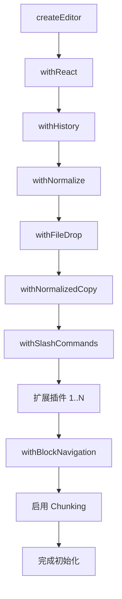
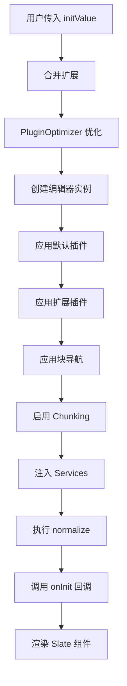

# 02 - 核心架构

> 本文档详细介绍编辑器的核心架构，包括 Slate.js 实现、插件管道模式、数据模型和渲染流程。

[← 返回总览](../README-编辑器架构.md) | [← 上一章：项目概述](./01-项目概述.md) | [下一章：扩展系统 →](./03-扩展系统.md)

---

## 2.1 基于 Slate.js 的实现

### Slate.js 核心概念

Slate.js 是一个完全可定制的富文本编辑器框架,采用不可变数据模型，编辑器内容表示为一棵树：

```
Editor (根节点)
  └─ Element (块级或内联元素)
      └─ Text (叶子节点，包含格式化信息)
```

**自定义类型扩展** (`packages/editor/src/types/editor.ts:22`):

```typescript
export type CustomEditor = BaseEditor & ReactEditor & HistoryEditor & CustomField;

declare module "slate" {
  interface CustomTypes {
    Editor: CustomEditor; // 自定义编辑器类型
    Element: CustomElement; // 内置元素类型 + 应用扩展注入的业务元素
    Text: CustomText; // 格式化文本类型
  }
}

// 自定义编辑器字段
export interface CustomField {
  getService: <T>(id: ServiceIdentifier<T>) => T; // 非 React 代码获取必选服务，未注册时抛错
  tryGetService: <T>(id: ServiceIdentifier<T>) => T | undefined; // 获取可选服务
  handleDrop?: (files: FileList, point: Point) => Promise<void>; // 文件拖放
  getChunkSize?: (node: Node) => number | null; // Chunking 配置
}
```

---

## 2.2 插件管道模式

### 插件类型定义

**文件位置**: `packages/editor/src/utils/plugin.ts:5`

```typescript
export type Plugin = (editor: Editor) => Editor;

export const applyPlugin = (editor: Editor, plugins: Plugin[]) => {
  return plugins.reduce((acc, plugin) => plugin(acc), editor);
};
```

插件是一个高阶函数，接收一个编辑器实例，返回增强后的编辑器实例。通过函数组合的方式，可以链式应用多个插件。

### 编辑器初始化流程

**文件位置**: `packages/editor/src/index.tsx:150-165`

```typescript
// 1. 合并扩展
const finalExtensions: IExtension[] = useMemo(() => {
  if (!extensions) return disableStartExtensions ? [] : startExtensions;
  return disableStartExtensions ? extensions : [...startExtensions, ...extensions];
}, [extensions, disableStartExtensions]);

// 2. 优化扩展数据 (通过 PluginOptimizer 缓存)
const optimizedExtensionData = useMemo(() => {
  return pluginOptimizer.optimizeExtensions(finalExtensions);
}, [finalExtensions]);

// 3. 创建编辑器实例并应用插件
const editor = useCreation(() => {
  // 3.1 应用默认插件
  const processedEditor = applyPlugin(createEditor(), defaultPlugins);

  // 3.2 应用扩展插件
  const finalEditor = applyPlugin(processedEditor, optimizedExtensionData.plugins);

  // 3.3 应用块导航增强
  const enhancedEditor = withBlockNavigation(finalEditor);

  // 3.4 启用 Chunking 优化
  enhancedEditor.getChunkSize = node => (Editor.isEditor(node) ? 1000 : null);

  return enhancedEditor;
}, [optimizedExtensionData.plugins]);
```

**默认插件列表** (`packages/editor/src/index.tsx:110`):

```typescript
const defaultPlugins: Plugin[] = [
  withReact, // React 适配层
  withHistory, // 历史记录 (撤销/重做)
  withNormalize, // 数据规范化
  withFileDrop, // 文件拖放
  withNormalizedCopy, // 复制规范化
  withSlashCommands, // 斜杠命令处理
];
```

**流程图**:



---

## 2.3 数据模型（CustomElement 类型系统）

### BuiltinElementMap 与 ExternalElementMap

**文件位置**: `packages/editor/src/types/custom-element.ts`

元素类型由两个键值映射交叉组成：核心包通过 `BuiltinElementMap`（46 种内置元素类型）定义通用元素；业务元素（白板、数据库、对话引用、闪卡填空等）由宿主应用通过模块声明合并（declaration merging）注入开放的 `ExternalElementMap`，核心包对业务元素类型零依赖。

```typescript
export interface BuiltinElementMap {
  // 基础文本元素
  paragraph: ParagraphElement; // 段落
  header: HeaderElement; // 标题 (h1-h6)
  blockquote: BlockquoteElement; // 引用块

  // 列表元素
  "bulleted-list": BulletedListElement; // 无序列表
  "numbered-list": NumberedListElement; // 有序列表
  "list-item": ListItemElement; // 列表项
  "check-list": CheckListElement; // 待办清单
  "check-list-item": CheckListItemElement; // 待办项

  // 代码和技术内容
  "code-block": CodeBlockElement; // 代码块
  "html-block": HTMLBlockElement; // HTML 块
  "html-inline": HTMLInlineElement; // 行内 HTML
  "custom-block": CustomBlockElement; // 自定义 React 组件块

  // 数学和图表
  "inline-math": InlineMathElement; // 行内数学公式
  "block-math": BlockMathElement; // 块级数学公式
  mermaid: MermaidElement; // Mermaid 图表
  tikz: TikzElement; // TikZ 图形
  typst: TypstElement; // Typst 排版
  abc: AbcElement; // ABC 音乐记谱
  plantuml: PlantUMLElement; // PlantUML 图

  // 多媒体
  image: ImageElement; // 块级图片
  "inline-image": InlineImageElement; // 行内图片
  "image-gallery": ImageGalleryElement; // 图片画廊
  audio: AudioElement; // 音频
  video: VideoElement; // 视频

  // 布局和容器
  table: TableElement; // 表格
  "table-row": TableRowElement; // 表格行
  "table-cell": TableCellElement; // 表格单元格
  detail: DetailElement; // 折叠详情
  callout: CalloutElement; // 提示框
  "highlight-block": HighlightBlockElement; // 高亮块
  tabs: TabsElement; // 标签页
  "tab-pane": TabPaneElement; // 标签页面板

  // 富文本
  link: LinkElement; // 链接
  underline: UnderlineElement; // 下划线
  "styled-text": StyledTextElement; // 样式文本
  comment: CommentElement; // 注释
  annotation: AnnotationElement; // 注解
  emoji: EmojiElement; // 表情符号
  kbd: KbdElement; // 键盘按键

  // 特殊功能
  "divide-line": DivideLineElement; // 分割线
  "front-matter": FrontMatterElement; // Front Matter
}

// 开放插槽：宿主应用通过 declaration merging 注入业务元素类型
export interface ExternalElementMap {
  [__externalElementMapBrand]: never;
}

export type CustomElement = (BuiltinElementMap & ExternalElementMap)[keyof (BuiltinElementMap &
  ExternalElementMap)];
```

**业务元素类型注入示例**（应用层，`apps/desktop/src/editor-extensions/augmentations.d.ts`）:

```typescript
import type { WhiteboardElement } from "./whiteboard/types";
import type { DatabaseElement } from "./database/types";

declare module "@tau/editor/src/types/custom-element" {
  interface ExternalElementMap {
    whiteboard: WhiteboardElement; // 白板
    database: DatabaseElement; // 数据库视图
  }
}
```

### InlineElement 行内元素

```typescript
export interface BuiltinInlineElementMap {
  link: LinkElement;
  "inline-math": InlineMathElement;
  underline: UnderlineElement;
  "styled-text": StyledTextElement;
  "html-inline": HTMLInlineElement;
  "inline-image": InlineImageElement;
  kbd: KbdElement;
  emoji: EmojiElement;
  annotation: AnnotationElement;
}

export interface ExternalInlineElementMap {
  [__externalInlineElementMapBrand]: never;
}

export type InlineElement = (BuiltinInlineElementMap &
  ExternalInlineElementMap)[keyof (BuiltinInlineElementMap & ExternalInlineElementMap)];

// 块级元素
export type BlockElement = Exclude<CustomElement, InlineElement>;
```

### FormattedText 格式化文本

**文件位置**: `packages/editor/src/types/text.ts:5`

```typescript
export interface FormattedText {
  type: "formatted";
  text: string;

  // 基础格式
  bold?: boolean; // 粗体
  italic?: boolean; // 斜体
  underline?: boolean; // 下划线
  strikethrough?: boolean; // 删除线
  code?: boolean; // 行内代码

  // 颜色和高亮
  color?: string; // 浅色模式文字颜色
  darkColor?: string; // 深色模式文字颜色
  highlight?: boolean | HighlightColor; // 高亮背景
}

type HighlightColor = "blue" | "yellow" | "green" | "red" | "purple";
```

### 元素示例

**段落元素** (`packages/editor/src/types/element/paragraph.ts:3`):

```typescript
export interface ParagraphElement {
  type: "paragraph";
  disableDrag?: boolean; // 禁用拖拽
  children: (FormattedText | InlineElement)[];
}
```

**代码块元素** (`packages/editor/src/types/element/code-block.ts:4`):

```typescript
export interface CodeBlockElement {
  type: "code-block";
  code: string; // 代码内容
  language: string; // 语言标识 (JAVASCRIPT, PYTHON 等)
  uuid: string; // 唯一标识 (用于 CodeMirror 实例映射)
  children: FormattedText[];
}
```

**标题元素** (`packages/editor/src/types/element/header.ts:5`):

```typescript
export interface HeaderElement {
  type: "header";
  level: 1 | 2 | 3 | 4 | 5 | 6;
  collapsed?: boolean; // 是否折叠子内容
  children: (FormattedText | InlineElement)[];
}
```

**音频元素** (`packages/editor/src/types/element/audio.ts:3`):

```typescript
export interface AudioElement {
  type: "audio";
  src: string; // 音频 URL
  uploading?: boolean; // 是否正在上传
  isFromGenerate?: boolean; // 是否由 AI 生成
  audioText?: string; // 音频对应的文本
  children: FormattedText[];
}
```

---

## 2.4 初始化和渲染流程

### 完整初始化流程



### 渲染流程

**Slate 组件结构** (`packages/editor/src/index.tsx:350-360`):

```tsx
<Slate editor={editor} initialValue={initValue} onChange={handleOnChange}>
  <Editable
    renderElement={renderElement} // 渲染块级/内联元素
    renderLeaf={renderLeaf} // 渲染文本叶子节点
    renderChunk={renderChunk} // 渲染 chunk 容器 (性能优化)
    onKeyDown={registerHotKey} // 快捷键处理
    readOnly={readonly}
    spellCheck={false}
  />
  <ImagesOverview /> {/* 图片预览组件 */}
  <HoveringToolbar /> {/* 悬浮工具栏 */}
  <BlockPanel /> {/* 块面板 (/) */}
</Slate>
```

**renderElement 实现** (`packages/editor/src/index.tsx:280`):

```typescript
const renderElement = useMemoizedFn((props: RenderElementProps) => {
  const { type } = props.element;
  const extension = pluginOptimizer.getExtension(type);

  if (extension) {
    return extension.render(props);  // 调用扩展的 render 方法
  }

  return <span>无法识别的类型 {type}</span>;
});
```

**renderLeaf 实现** (`packages/editor/src/index.tsx:290`):

```typescript
const renderLeaf = useMemoizedFn((props: RenderLeafProps) => {
  return (
    <FormattedText leaf={props.leaf} attributes={props.attributes}>
      {props.children}
    </FormattedText>
  );
});
```

**renderChunk 实现** (`packages/editor/src/index.tsx:300`):

```typescript
const renderChunk = ({ attributes, children, lowest }: RenderChunkProps) => {
  const style: CSSProperties = {
    // 仅对最底层 chunk 应用 content-visibility
    contentVisibility: lowest ? "auto" : undefined,
  };
  return <div {...attributes} style={style}>{children}</div>;
};
```

### 规范化处理

**文件位置**: `packages/editor/src/index.tsx:195`

```typescript
useEffect(() => {
  if (!isNormalized) {
    Editor.normalize(editor, { force: true });
    setIsNormalized(true);
  }
}, [isNormalized, editor]);
```

规范化确保编辑器内容符合 Slate 的数据约束，例如：

- 所有文本节点必须有 `type: "formatted"` 属性
- void 元素后必须有零宽字符以支持光标定位
- 空的块级元素会被清理或添加默认子节点

---

[← 返回总览](../README-编辑器架构.md) | [← 上一章：项目概述](./01-项目概述.md) | [下一章：扩展系统 →](./03-扩展系统.md)
