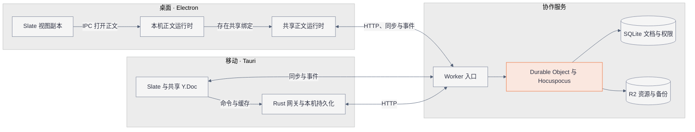
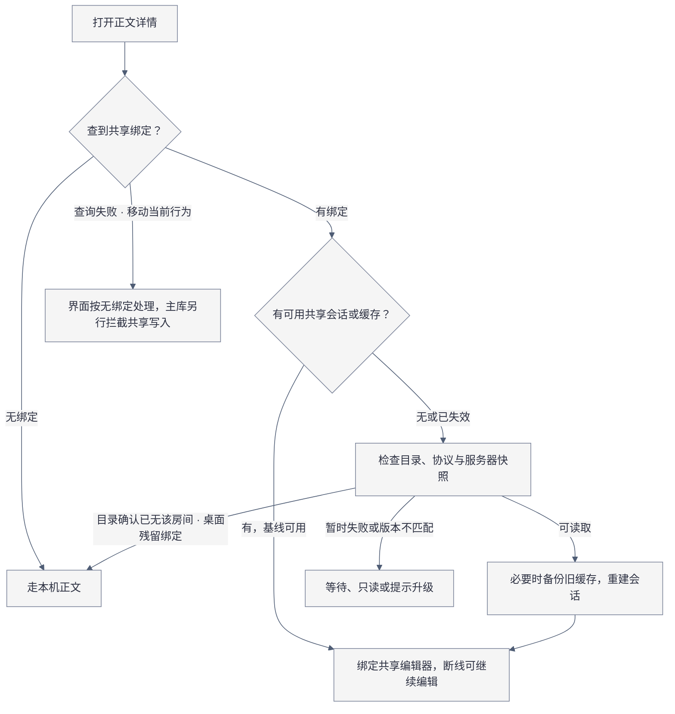
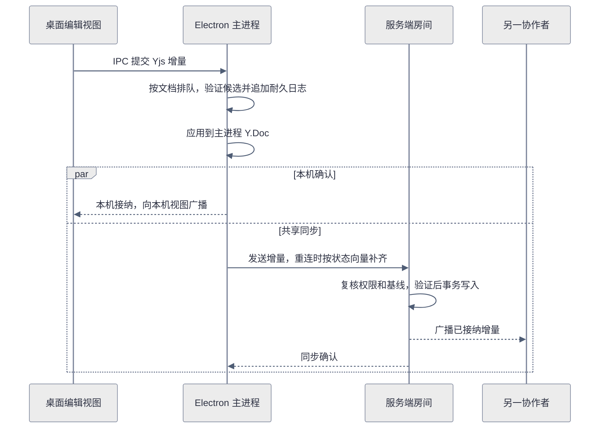
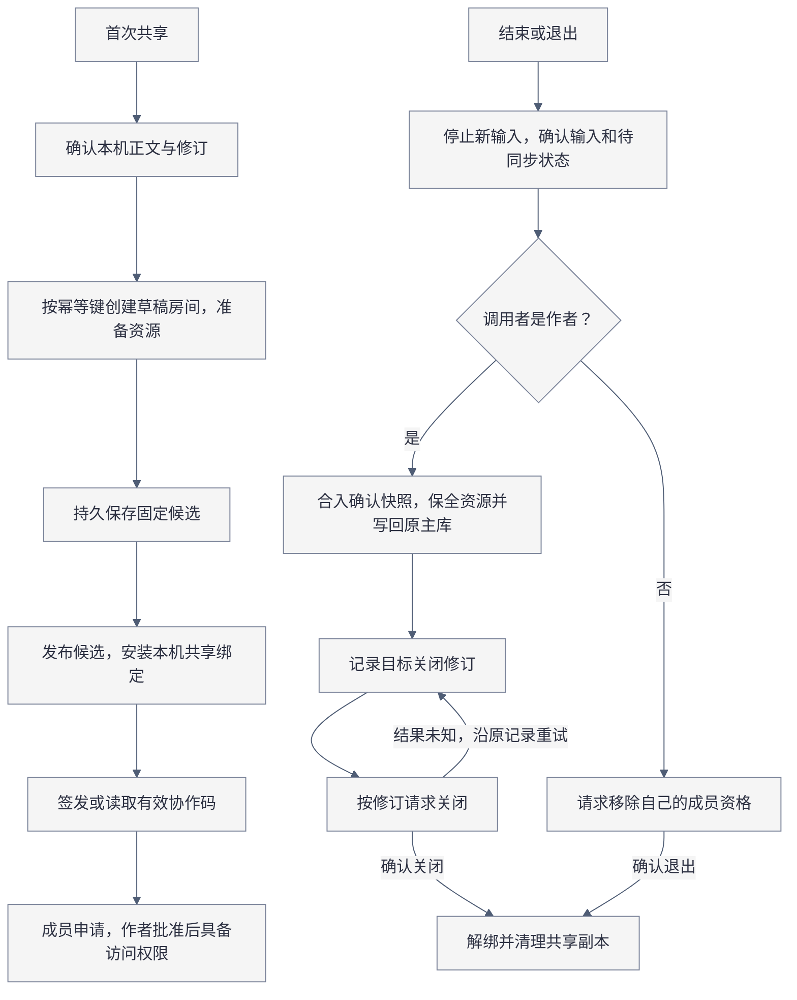

# 文档协作架构与接口审查

基准为 2026-11-14 仓库提交 `1be79e6f7`。覆盖桌面、移动、共享协议、正式 Worker 实现及 Node 开发服务。白板只追到两者共用的房间与服务端协议入口。Agent 只追到正文范围提交。代码与本地环境的验证范围见文末。

**结论：保留正文模型、编辑器绑定、实时增量和条件提交的分层。优先收紧房间目录、绑定查询和退出协作三个接口。** 目前能明确归因的补丁集中在宿主编排层。目录接口缺少文档类型，客户端用下载失败来识别白板。绑定查询把读取失败折叠成无绑定，依赖数据库拒绝误入的写入。服务端两套实现也已出现退出重试语义差异。11 月 13 日的桌面拆分已把普通正文的启动与耐久存储从联网协作剥离，下一步适合收窄运行时之间的依赖。[协作架构](/docs/architecture/collaboration.md) · [正文持久化](/docs/architecture/content-storage.md) · [11 月 1 日拆分笔记](/docs/notes/2026-11-01-collaboration-architecture-split.md)

## 1. 架构与模块职责



| 模块                 | 负责什么                                                                                                                                         | 边界判断                                                                                                 |
| -------------------- | ------------------------------------------------------------------------------------------------------------------------------------------------ | -------------------------------------------------------------------------------------------------------- |
| `@tau/collaboration` | `NodeTree` 节点、位置、文字片段和契约，协议身份、文档候选校验、范围编辑、写队列与操作回执。`document-adapter` 在服务端按版本选择正文或白板模型。 | 值得保留。稳定身份服务于并发移动、拆段、格式与撤销。正文协议 2 和白板协议 3 确实共用权限与接纳管线。     |
| `@tau/editor-collab` | 把 Slate 操作映射到 `NodeTree`，管理选区、源码字段、视图历史及正文投影。                                                                         | 值得保留。宿主传入编辑能力和文档，绑定层处理编辑语义。                                                   |
| 桌面正文宿主         | 渲染进程持每视图副本。主进程持会话、耐久增量和投影。本机正文写 `local-content/content.db`，共享正文写协作库，并按绑定投影到原主库。              | 本机不依赖联网启动的方向合理。现在的继承、双向回调和近似相同的 IPC 声明仍有整理空间。                    |
| 移动正文宿主         | WebView 持共享 Y.Doc、provider 和资源任务。Rust 管设备身份、HTTP、缓存、草稿、共享绑定与主库写入守卫。                                           | 平台边界合理。`core/manager.ts` 同时管理目录、连接、编辑、发布、关闭与资源，状态和恢复分支容易互相影响。 |
| Worker 与 Node       | Worker 是仓库配置的产品入口。Node 面向开发、自托管参考与旧库导出。两者共享协议原语，保留各自路由、存储与资源实现。                               | 平台适配有必要。当前相同业务规则散落在各自的路由和 Store，已经有重试行为漂移。                           |

源码入口：[协议模型](/packages/collaboration/src/node-document.ts#L94) · [协议分派](/packages/collaboration/src/document-adapter.ts#L18) · [Slate 绑定](/packages/editor-collab/src/withNodeTree.ts#L107) · [桌面正文运行时](/apps/desktop/src-electron/main/modules/content-runtime/index.ts#L81) · [移动管理器](/apps/mobile/src/features/collaboration/core/manager.ts#L88) · [Worker 入口](/apps/collaboration-cloudflare/src/index.ts#L647) · [Node 路由](/apps/collaboration-server/src/content-routes.ts#L36)

### 三份状态各自回答什么

| 状态                                     | 用途                                                                                                     |
| ---------------------------------------- | -------------------------------------------------------------------------------------------------------- |
| 主库正文和 `collaboration_bindings`      | 业务实体读取、索引、关联和整库同步。共享时保存投影，往回投影需要核对原库、正文身份、绑定和上次投影修订。 |
| 会话 Y.Doc、增量日志和输入草稿           | 编辑即时状态和本机恢复。共享缓存可能包含服务器尚未确认的输入，缓存坏了或远端换代时先保全原字节。         |
| 服务端协议记录、Yjs 快照与增量、操作回执 | 确认共享房间的权限、基线和已接纳内容。普通增量经 WebSocket 接纳，条件操作可以按原 `operationId` 查回执。 |

本机 `contentId`、主库稳定 `contentDocumentId`、共享房间 ID、`baselineId` 与 `epoch` 分别标识不同对象或代次。主库投影修订和服务器 CRDT `revision/sequence` 也服务于不同写入。状态栏里的「已同步」不能替代本机耐久确认或投影成功。[共享类型](/packages/collaboration/src/protocol.ts#L48) · [协议记录](/packages/collaboration/src/document-protocol.ts#L4) · [正文写入](/docs/architecture/content-storage.md)

## 2. 打开与编辑

### 打开流程



桌面渲染端通过 `local-content:open-content` 进入主进程，主进程按绑定转交。共享方确认可清理残留绑定后走 `resumeLocalOpen`，避开等待同一打开请求造成的循环。移动端已有共享会话时直接绑定 WebView 内的 Y.Doc，共享未建立时由详情页的协作编辑路径等待会话。目录请求失败与明确返回不存在，在移动 `openDocument` 中已有不同分支。图里「查询失败按无绑定」发生在更上游的**本机绑定查询**。[桌面打开](/apps/desktop/src/stores/useContentSessionStore.ts#L76) · [桌面共享转交](/apps/desktop/src-electron/main/modules/collaboration/index.ts#L90) · [移动绑定查询](/apps/mobile/src/features/collaboration/useContentCollabBinding.ts#L8) · [移动会话打开](/apps/mobile/src/features/collaboration/core/manager.ts#L282)

### 普通增量如何确认



桌面的视图接纳与发起网络同步都依赖主进程 Y.Doc 的应用，两条后续通知之间没有固定先后保证。主库投影按脏标记和保存屏障处理，服务器接纳与本机投影成功可以发生在不同时间。移动的 provider 直接监听 WebView Y.Doc。同一次更新触发本机异步 `persist()` 和网络发送，Rust 缓存确认失败时暂停 provider，当前分支并未建立桌面式「每笔先耐久，再交给 provider」的屏障。[桌面增量队列](/apps/desktop/src-electron/main/modules/collaboration/node-session-updates.ts#L71) · [桌面 provider](/apps/desktop/src-electron/main/modules/collaboration/index.ts#L233) · [移动落盘](/apps/mobile/src/features/collaboration/core/manager.ts#L970) · [移动文档监听](/apps/mobile/src/features/collaboration/core/manager.ts#L1250) · [服务端 beforeSync](/apps/collaboration-cloudflare/src/index.ts#L179)

```text
桌面_接纳视图更新(文档身份, 视图身份, 增量):
  在该文档写队列中校验视图、冻结状态与当前代次
  在隔离 Y.Doc 上应用增量并校验正文结构与契约
  如果验证期间基线内容变化，重新取当前状态校验，最多尝试 3 次
  事务追加有效增量和实体持有记录
  把已耐久增量应用到主进程 Y.Doc 并广播变化，确认同代草稿
  共享会话的 provider 处理网络同步
  自动保存或保存屏障后按观察修订投影主库

服务端_接纳普通增量(连接身份, 票据基线, 增量):
  进入逐文档有界队列，重查成员资格与基线
  从持久存储加载最新状态，在隔离候选上应用增量并验证
  在事务内复核权限、基线、资源与配额
  若状态有变化，写实际差量、标题、摘要、序号与资产持有记录
  把已接纳状态交给在线 Y.Doc，同步给其他副本
```

### 程序化修改

整篇写回检查全文 `revision + sequence`。Agent 范围修改提交稳定锚点和原文前提，服务器允许两处互不相交的修改先后成功。二者共享操作回执、候选校验和事务边界。`DocumentSyncSession` 的持久分支与补偿队列由桌面白板使用，常规正文输入没有经过该类。[桌面整篇替换](/apps/desktop/src-electron/main/modules/content-runtime/index.ts#L937) · [移动插件条件写入](/apps/mobile/src/services/pluginContentSession.ts#L71) · [操作账本](/packages/collaboration/src/document-operations.ts#L188) · [白板客户端](/apps/desktop/src-electron/main/modules/whiteboard-documents/remote.ts#L225)

```text
客户端_提交条件修改(操作身份, 基线, 请求):
  固定请求载荷、摘要和操作身份
  POST operations/{operationId}
  如果结果未知，GET 同一 operationId 查询回执
  收到 COMMITTED 且本机会话仍是原基线时接纳结果并投影
  其余状态按冲突、拒绝或未确认处理

服务端_提交条件修改(调用设备, 操作身份, 基线, 请求):
  按操作指纹登记或返回已有终态
  取得逐文档队列，从持久存储加载最新正文
  范围编辑按最新正文验证目标文字、格式和边界，生成增量与逆操作
  整篇替换使用请求提供的候选增量，在提交事务内核对全文摘要和序号
  事务写入差量、修订和成功回执，提交后同步在线副本
  缺 Yjs 依赖时保留 PENDING，条件冲突时记录 ABORTED
```

## 3. 发起协作与结束共享



桌面发布前冻结并排空窗口，固定候选后提交，随后在主库事务中安装投影及绑定。移动先校验详情正文和修订，固定缓存候选、发布、用预期身份及修订绑定，再打开并投影。发布幂等键由客户端生成，服务端只对同设备同键去重。作者关闭前先保全图片和最终投影，关闭回执未知时用原修订续做。桌面关闭后建一个新身份的本机 Y.Doc，移动在 Rust 恢复记录里确认关闭后再解绑。其他本地化资源及关闭冲突分支见两端实现。[桌面发布](/apps/desktop/src-electron/main/modules/collaboration/index.ts#L531) · [移动发布](/apps/mobile/src/features/collaboration/core/manager.ts#L609) · [发布幂等边界](/packages/collaboration/src/protocol.ts#L83) · [桌面收尾](/apps/desktop/src-electron/main/modules/collaboration/index.ts#L1078) · [移动收尾](/apps/mobile/src/features/collaboration/core/manager.ts#L442)

```text
作者_结束共享(房间):
  冻结编辑并排空输入，确认同步与资源队列已清空
  取得服务端快照与对应修订，确认同一基线
  保存最终正文投影和作者资源副本
  保存待关闭记录，固定 expectedRevision
  若关闭结果未知，保留记录并以同一修订重试
  若服务端确认房间仍活动且修订已变，重新从最终快照开始
  确认关闭后完成解绑与本机安装，再释放恢复记录
```

## 4. 接口清单与设计判断

| 接口                                                                                                | 当前主要语义                                                                                                                              | 判断                                                                                            |
| --------------------------------------------------------------------------------------------------- | ----------------------------------------------------------------------------------------------------------------------------------------- | ----------------------------------------------------------------------------------------------- |
| `POST /v1/devices`、`PATCH /v1/devices/me`                                                          | 按实际服务器地址管理设备身份和昵称。                                                                                                      | 身份隔离清晰。                                                                                  |
| `GET/POST /v1/documents`、`POST /v1/documents/{id}/publish`                                         | 列举有权访问的已发布房间、按 `idempotencyKey` 建草稿、提交固定快照。另有 `GET publication` 与 `POST publication/cancel`，白板发布有调用。 | 创建和发布分开有资源准备、候选固定和恢复需求。列表缺少类型。                                    |
| `GET /v1/documents/{id}/state`、`GET /v1/documents/{id}/protocol`                                   | `state` 校验请求的文档版本，响应含快照及协议摘要。`protocol` 返回代次、基线、摘要和序号等轻量元数据。                                     | 两个读取粒度都有消费者。拿快照后紧接着查协议的调用可以先核对快照已携带的元数据。                |
| `POST /v1/tickets`、`/ws`、`/events`                                                                | 文档短期票据绑定协议基线。`/ws` 双向交换正文和 Awareness，`/events` 推送目录刷新、成员活动、撤权和房间关闭。                              | 分工合理。目录订阅和正文会话的启动时机可以分开。                                                |
| `GET/POST /v1/documents/{id}/operations/{operationId}`、`POST …/cancel`                             | 查终态、按原指纹提交、取消未完成操作。二进制增量可带全文修订前提，`scoped-edit` 带范围前提。                                              | 保留回执。请求入口可用可辨识联合收紧字段组合，避免让调用方凭可选字段猜操作类别。                |
| `POST …/invitation`、`GET/POST /v1/join-requests`、`POST …/decision`、`DELETE …/members/{deviceId}` | 签发协作码、申请与审批、作者移除成员。票据及同步时继续检查成员资格。                                                                      | 审批和实时写入权限边界清晰。                                                                    |
| `POST …/leave`、`POST …/close`                                                                      | 成员退出与作者按修订结束整个房间。后者按所关闭修订返回成功回执。                                                                          | 角色分开合理。两服务的 `leave` 幂等语义有具体差异。                                             |
| `GET/POST …/assets` 及文档作用域资源路由                                                            | 上传、读取附件，作者查询需保全的资产集合。                                                                                                | 保留文档作用域和作者持久副本。                                                                  |
| 桌面 `local-content:*` 与 `collaboration:*`                                                         | `open`、`subscribe/update`、草稿、freeze ack、Awareness、片段及资源命令。共享代码调用相同的内容 IPC 注册实现。                            | 维持一套 typed IPC 契约与运行时校验。可以先收口重复声明和没有消费者的包装，再决定是否合并通道。 |
| 移动 Tauri `collab_request`、`collab_cache_*`、`collab_*_content`                                   | REST 经 Rust 附带设备凭据，正文缓存和主库投影通过独立命令落盘。                                                                           | 网关和缓存责任合理。绑定及请求错误需要更精确的结果类型。                                        |

接口证据见 [Worker 路由](/apps/collaboration-cloudflare/src/index.ts#L323) · [Node 内容路由](/apps/collaboration-server/src/content-routes.ts#L36) · [桌面命令契约](/apps/desktop/src/commands/contracts/collaboration.ts#L41) · [移动 REST](/apps/mobile/src/features/collaboration/core/rest.ts#L19) · [移动主库命令](/apps/mobile/src-tauri/src/database/collaboration.rs#L198)

## 5. 优先处理的发现

### 1. 成员退出的失败重试在 Node 和 Worker 行为不同

**高优先。** Node 的 `/leave` 将已非成员或房间已关闭时的 `403/410` 视为退出完成。Worker 的 `/leave` 调用 `remove()`，先要求当前仍为活动成员。首次退出如果已经提交但客户端没有收到响应，下一次请求会在校验成员资格时失败。两端客户端都把本机收尾排在请求成功之后，因而可能把一个已发生的退出报告为失败，之后再依赖刷新收敛。建议在两种服务共用的业务规则中定义「本人已退出也返回成功」，继续区分作者误用和无法识别的房间。验收覆盖首次请求完成、响应丢失、同设备重试、客户端完成清理。[Node 路由](/apps/collaboration-server/src/content-routes.ts#L135) · [Worker 路由](/apps/collaboration-cloudflare/src/index.ts#L545) · [Worker 成员校验](/apps/collaboration-cloudflare/src/store.ts#L796) · [桌面清理顺序](/apps/desktop/src-electron/main/modules/collaboration/index.ts#L1111) · [移动清理顺序](/apps/mobile/src/features/collaboration/core/manager.ts#L528)

### 2. 房间列表与正文加载耦合，类型靠错误探测

**高优先。** `SharedDocumentInfo` 没有种类或版本。桌面冷开共享列表时顺序遍历房间，对白板先请求协议 2 的 `/state`，收到 `CLIENT_UPGRADE_REQUIRED` 再查 `/protocol`，并同时维护 `nonContentRooms` 和 `whiteboardRooms`。移动刷新会并行打开列表中的全部房间。单机存在多个房间时，目录刷新会触发多篇协议查询或完整快照加载，尚无实测数据量和耗时。建议目录响应增加来自当前协议记录的类型与版本，客户端据此筛选和分流。进一步把正文冷开移到实际打开文档，已有会话、未同步输入及作者资源补存继续按各自生命周期运行。验收用一份正文和一份白板打开目录，验证正文只按需取快照、白板无需失败探测、撤权识别仍生效。[目录类型](/packages/collaboration/src/protocol.ts#L48) · [桌面刷新与分流](/apps/desktop/src-electron/main/modules/collaboration/index.ts#L400) · [移动刷新](/apps/mobile/src/features/collaboration/core/manager.ts#L339)

### 3. 移动绑定查询吞错后进入本机编辑分支

**高优先。** `useContentCollabBinding` 初始为 `null`，查询失败也设成 `null`，宿主再把它转换为没有 `collaboration` 属性。Rust 守卫会阻止真正写坏已绑定正文，但界面可能先进入错误的编辑路径，到保存时才知道正文受协作约束。建议查询区分 `loading / unbound / bound / error`，仅确认 `unbound` 后启用本机写入。`loadState` 另有对所有错误统一尝试三次的逻辑，`createSession` 有缓存时吞掉远端加载异常。建议仅对网络、限流和暂时性服务失败走离线重试，明确撤权、关闭与当前协议不兼容交给现有状态处理。保留可用缓存的正常离线编辑。验收覆盖绑定查询失败、明确无绑定、已有缓存断网和明确版本拒绝。[移动绑定查询](/apps/mobile/src/features/collaboration/useContentCollabBinding.ts#L8) · [宿主装配](/apps/mobile/src/features/collaboration/useContentCollabEntry.tsx#L39) · [Rust 写入守卫](/apps/mobile/src-tauri/src/database/collaboration.rs#L198) · [移动快照加载](/apps/mobile/src/features/collaboration/core/manager.ts#L1171) · [有限重试](/apps/mobile/src/features/collaboration/core/manager.ts#L1283)

### 4. 结束共享的读协议和回执处理可收口

**中优先。** Node 和 Worker 的 `/state` 均返回 `state + protocol`，Worker 还返回 `title`。桌面和移动作者关闭都只取 `state`，再查一次 `/protocol` 并比较摘要。两次请求之间只要有协作者继续编辑就会提前中止。可以让共用的快照响应类型暴露 `protocol`，以同一读取返回的修订校验快照，最终仍由 `close(expectedRevision)` 拦截后续并发。桌面 `finishLeave` 只要遇到 `REVISION_CONFLICT` 就清理关闭标记并尝试重挂 provider。这个响应也可能表示房间已经被另一修订关闭，移动已有「先查协议确认房间仍活动，再恢复编辑」的分支。建议桌面跟齐，并显式验关闭响应的 `revision`。桌面三个关闭设置键与移动独立恢复记录承载相似业务阶段，先统一行为，再判断存储形态是否有合并收益。[Worker 快照](/apps/collaboration-cloudflare/src/store.ts#L896) · [Node 快照](/apps/collaboration-server/src/content-routes.ts#L92) · [同一错误的两种服务端含义](/apps/collaboration-cloudflare/src/store.ts#L808) · [桌面关闭前读取](/apps/desktop/src-electron/main/modules/collaboration/index.ts#L295) · [桌面回执分支](/apps/desktop/src-electron/main/modules/collaboration/index.ts#L1082) · [移动回执分支](/apps/mobile/src/features/collaboration/core/manager.ts#L550)

### 5. 桌面运行时拆分后还保留旧入口与双重就绪重试

**中优先。** `collaboration` 声明依赖 `local-content`，初始化时必然为生产路径设置 `localRuntime = localContent`。多处 `localRuntime ?? this` 同时容纳了由测试直接实例化的共享管理器和生产宿主。基类还带共享代理、可空回调和空方法，IPC 控制器又拿到会话表、视图表、存储、资产与生命周期操作。建议先让测试显式提供本机运行时，移除生产已保证的回退，再逐个缩小控制器和继承钩子的输入。另一个确定候选是 `openCollaborationContentSession` 包装及其 `collaboration:open-content` 命令，仓内生产入口已用 `local-content:open-content`。同文件形似重复的更新命令仍由动态选择的命令表调用，应区分死包装与在用通道。渲染层匹配 `COLLABORATION_UNAVAILABLE` 再启动一次共享模块，主进程也会等待模块就绪，删除前应核对初始化真实失败后的重试行为。[模块依赖](/apps/desktop/src-electron/main/module-init/module-config.ts#L139) · [基类与代理](/apps/desktop/src-electron/main/modules/content-runtime/index.ts#L100) · [共享组装](/apps/desktop/src-electron/main/modules/collaboration/index.ts#L1167) · [渲染打开](/apps/desktop/src/stores/useContentSessionStore.ts#L76) · [命令包装](/apps/desktop/src/commands/collaboration.ts#L74) · [实际内容通道选择](/apps/desktop/src/hooks/useCollaborationDocument.ts#L35)

### 6. 条件写入的时钟和返回类型已经出现端侧漂移

**中优先。** 桌面条件替换从 HTTP 响应 `Date` 取得服务器时间。移动插件条件替换用 `Date.now()` 生成四分钟期限。服务端要求期限不超过服务器时间五分钟，并可能将过期请求直接记录为 `EXPIRED`。设备时钟偏差能使相同写入在两端结果不同。建议先统一协议时间来源，再用可辨识请求类型表达「增量」「全文条件增量」「范围编辑」，由公共编解码入口核对字段组合。Worker 和 Node 共享 `DocumentOperationLedger`，可先把合同用例跑在两个服务实现上，确认重复 ID、冲突、超时和退出规则一致，再决定是否抽取更多服务端实现。[桌面期限来源](/apps/desktop/src-electron/main/modules/collaboration/index.ts#L171) · [移动期限来源](/apps/mobile/src/services/pluginContentSession.ts#L101) · [服务端操作期限](/packages/collaboration/src/document-operations.ts#L121)

## 6. 哪些兜底值得保留

| 分支                                                 | 理由与处理方向                                                                                       |
| ---------------------------------------------------- | ---------------------------------------------------------------------------------------------------- |
| 发布按原候选、关闭按原修订、条件编辑按原操作 ID 确认 | HTTP 响应丢失时，动作可能已经落盘。需要固定原请求并且可恢复。                                        |
| 本机缓存先备份再重建，当前协议校验失败则保留权威数据 | 同时防止缓存坏掉卡死和把旧基线套进新房间。本机可恢复副本与主库、服务器的权威校验应继续使用各自口径。 |
| 保存屏障、草稿序号、逐文档写队列及提交前复核         | 解决窗口关闭、切库、迟到回执和并发写入，对进程内重试和跨进程恢复都有实际用途。                       |
| 单房间加载失败时保留其他房间和成员管理               | 隔离真正的局部失败。目录与会话解耦后，这部分可由单房间状态承担。                                     |
| 资源上传完成后才允许引用发送，关闭前保全作者资源     | 正文里的引用和附件文件分两个存储边界提交，需要确认顺序。                                             |
| `/events` 重连与少量目录对账                         | 实时事件丢失后还需要发现撤权和成员变化。目录对账没有必要承担每次完整正文加载。                       |

较早接口和常量应按消费者验证后移除。`DocumentSyncSession`、发布状态与发布取消仍有白板消费者。`identity_merges` 和 `collaboration_migrations` 作为备份里的历史账本保留，已有代码不再注册旧迁移或合并业务接口。[运行时裁决](/docs/decisions.md) · [白板发布状态消费者](/apps/desktop/src-electron/main/modules/whiteboard-documents/transitions.ts#L252) · [当前协议与备份](/docs/architecture/collaboration.md)

## 7. 整理顺序

1. **先补外部语义。** 统一 `/leave` 的重试结果，移动区分查询失败与未绑定，桌面核对关闭冲突终态。改动可分别验证，直接消除已有补丁依赖。
2. **再减联网和装配复杂度。** 给房间目录增加类型与协议版本，按需打开正文。共用快照响应类型，收口快照重复请求，并删除证实无消费者的 IPC 包装。
3. **最后拆状态所有权。** 客户端目录管理、正文会话和发布／关闭协调分别持有自己的状态，连接池以实际服务器地址为边界。桌面先移除共享管理器对本机运行时的生产回退，移动先把资源和收尾状态从目录刷新中卸下，再看是否有两端都需要的纯协议工具。服务端先统一合同测试，平台存储和生命周期适配保持独立。

仅把两个管理器拆文件，改动面小，但不会解决退出协议漂移或错误状态折叠。一次性抽成跨平台大运行时，会把 Electron 多窗口和 Tauri WebView 生命周期差异重新塞进扩展钩子。按上面三步做，前两步可以独立验收，第三步由实际重复的状态转换决定抽象范围。

## 8. 验证记录

- 4 个 Mermaid 图通过仓库现有解析器的语法校验，文档链接与引用行号已检查，`pnpm check:docs` 通过。
- 移动 42 项、Node 服务 14 项、Worker 3 项相关现有用例通过。Worker 正式配置通过 dry-run 构建，回归使用本地 Miniflare。
- 桌面首轮 17 项通过，1 项旧格式正文修复用例触及 5 秒超时。单用例以 15 秒时限重跑通过，耗时约 5.36 秒，测试夹具同时输出 `content_suggestions` 表缺失的异步日志。
- 接口差异来自源码对读。测试范围为上述本地用例，未覆盖生产流量与新发现的完整故障场景。本次交付为一次性审查笔记，业务实现未改动。
