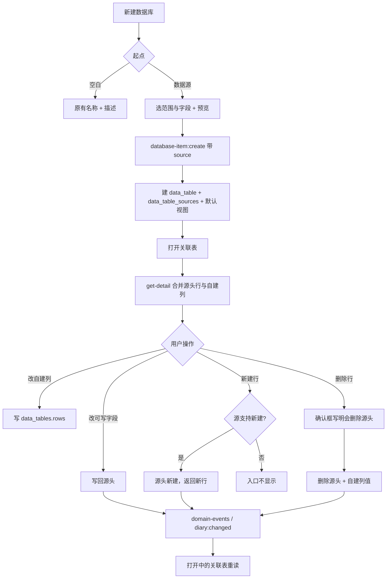

# 数据库关联数据源

状态：实现完成，待视觉与交互验收
目标：新建数据库时可以选择应用内已有的数据作为数据源，表格实时跟随源头，能改的字段写回源头。

## 需求

- 第一期只接「笔记与写作」：卡片、文章、项目文档、日记。插件数据、微信读书不接。
- 只做「保持关联」，不做「复制一份」。以后如果要独立副本，走「转为普通表」。
- 新建行会在源头新建：卡片、文章新建一篇空白；项目文档建在所选项目的根目录；日记按日期生成，不支持新建。
- 删除行会同时删除源头，菜单和确认框里写明。
- 打开行详情，正文就是源头的正文，和在卡片页、文章页编辑的是同一份。
- 关联表仍是普通数据库：视图、筛选、排序、分组、看板、日历、表尾汇总照常可用；可以另加只属于这张表的列。
- 设计稿：`apps/desktop/mockups/database-source/index.html`（第三屏的数据源标记、锁定列、右键菜单）。

## 每个源的范围与字段

| 源       | 范围                       | 字段（★ 可写回）                                            | 新建行               | 删除行         |
| -------- | -------------------------- | ----------------------------------------------------------- | -------------------- | -------------- |
| 卡片     | 全部 / 按标签              | 开头（主列，只读）、标签★、置顶★、创建时间、更新时间、字数  | 新建空白卡片         | 删除卡片       |
| 文章     | 全部 / 按标签              | 标题★（主列）、作者、标签★、置顶★、创建时间、更新时间、字数 | 新建空白文章         | 删除文章       |
| 项目文档 | 选择一个项目，可选含子文档 | 标题★（主列）、上级、标签★、创建时间、更新时间、字数        | 在项目根目录新建文档 | 删除文档       |
| 日记     | 本月 / 今年 / 全部         | 日期（主列）、天气、心情、标签、字数                        | 不支持               | 删除当天的日记 |

- 「作者」目前只在文章创建时写入，主进程没有改作者的入口，第一期作为只读列。
- 日记的天气、心情是表情或图片，标签挂在每一条片段上，一天可能有多条。所以日记第一期全部只读，只显示当天各条片段标签的并集。
- 字段与范围在新建弹窗里选，建好后可以从工具栏的数据源标记里调整。

## 现有架构

- 数据库条目 `database_item` 通过 `data_table_id` 指向 `data_tables`，列和行都以 JSON 存在 `columns` / `rows` 里；视图在 `data_table_views`。
- 渲染端 `useEditDatabase`（`packages/shared`）读写一张表，`DatabaseWorkspace` 装配 `DesktopDatabase`；行详情正文由 `RowDetailBody` 插槽按 `row.detailContentId` 打开。
- 列已有 `readonly` 标记，表头、单元格、行详情属性栏都会照它禁止编辑。
- 卡片、文章、项目文档的增删改由 `domain-events` 的临时触发器广播；日记写入广播 `diary:changed`。
- 插件数据层 `plugin-data.ts` 已经封装了卡片、文章、项目文档的标签、置顶、标题改写（含协作标题同步）和删除，可以照它的调用方式写。

## 方案

### 存储：关联表仍是一张 data_table

关联表照常建一张 `data_tables`，自建列和自建列的值存在里面；源头字段的值每次打开时由主进程从源头读出来，合并进行里返回，不落库。这样视图、筛选、汇总、行详情都不用改，数据也不会和源头出现两份。

新增一张表记录关联（只新增表，按手册不升主库版本）：

```sql
CREATE TABLE IF NOT EXISTS data_table_sources (
  table_id INTEGER PRIMARY KEY,      -- data_tables.id
  kind TEXT NOT NULL,                -- card | article | document | diary
  scope TEXT NOT NULL DEFAULT '{}',  -- 范围，如 {"tags":["读书"]}、{"projectId":3,"deep":true}
  fields TEXT NOT NULL DEFAULT '[]', -- 选中的源头字段 key，顺序即列序
  create_time INTEGER NOT NULL,
  update_time INTEGER NOT NULL
);
```

- 行 id 用 `源:实体 id`（如 `card:12`），自建列的值按这个 id 存在 `data_tables.rows` 里，源头条目删除后对应行在下次读取时清理。
- 源头字段的列定义固定一个 id（如 `src:tags`），列标题、宽度、隐藏可以照常改，列类型不能改；只读字段列带 `readonly`。
- 主列（标题或开头）的 `detailContentId` 指向源头正文，行详情直接打开它。这些正文属于源头，不计入数据表的正文引用：`collectTableRefs` 跳过源头行的 `detailContentId`。

### 模块

| 模块       | 位置                                               | 职责                                                                                  |
| ---------- | -------------------------------------------------- | ------------------------------------------------------------------------------------- |
| 数据源定义 | `src-electron/main/modules/data-sources/<kind>.ts` | 每个源一个文件：字段清单、按范围读取、写回、新建、删除                                |
| 数据源注册 | `data-sources/index.ts`                            | 收集四个源；按 kind 取定义                                                            |
| 关联表读写 | `tables/data-table-source.ts`                      | `data_table_sources` 的读写；合并源头行与自建列；把一次表格改动拆成写回源头和写自建列 |
| 新建入口   | `tables/database-item.ts`                          | `create` 接受可选的 `source`，同一事务建表、建关联、写默认视图                        |
| 新建弹窗   | `features/databases/`                              | 第一步选空白或数据源；第二步选范围与字段，右侧实时预览                                |
| 数据源标记 | `features/shared/database/`                        | 工具栏显示来源，点开可调整范围与字段、去源头打开；源头变化时重读                      |

数据源定义的接口：

```ts
interface DataSourceDefinition {
  kind: "card" | "article" | "document" | "diary";
  label: string;
  fields: SourceField[]; // key、标题、列类型、是否可写、是否默认选中
  scopeOptions(db): ScopeOption[]; // 弹窗里的范围选项（标签列表、项目列表）
  list(db, scope): SourceRow[]; // 每行：实体 id、正文 id、各字段值
  write?(db, id, patch, ctx): void; // 只含可写字段
  create?(db, scope, ctx): SourceRow; // 不支持新建的源不实现
  remove(db, id, ctx): void;
}
```

### 主流程

```
打开关联表
  data-table:get-detail(tableId)
    source = DataTableSource.get(tableId)
    若无 source → 原逻辑
    sourceRows = definition.list(db, source.scope)
    rows = 按 sourceRows 顺序合并 data_tables.rows 里同 id 的自建列值
    清理已不存在的源头行的自建列值
    columns = 源头字段列（带 readonly）+ 自建列
    返回 { table: { ...table, columns, rows, source }, views }

表格改动 data-table:apply-changes(tableId, changes)
  事务内：
    对每个 upsert 行：
      源头字段有变化 → 只读字段被改：拒绝；可写字段：definition.write
      自建列有变化 → 写 data_tables.rows
    对每个 inserted 行：definition.create（不支持则拒绝），新行 id 替换为源头 id
    对每个 remove 行：definition.remove，同时清掉它的自建列值
  事务后：发布协作标题（文章、项目文档改标题时）
  返回重新合并后的表

源头变化（domain-events 的 card/article/document，或 diary:changed）
  渲染端对打开中的关联表重新 get-detail，经 rows.receive 回填
```



### 失败与边界

- 写回失败（条目已被删、协作正文不可写等）：整次改动回滚，提示原因，表格回到确认快照，用户可以重试。
- 只读字段被改：主进程拒绝，不静默丢弃，避免界面和源头不一致。
- 范围内条目很多：读取一次全量合并。卡片在数千条量级时读取是一次带正文预览的查询，第一期按全量做，同时不把正文全文带回，只取开头文本。
- 数据库被移动端或旧版本打开：`data_table_sources` 是新表，旧代码看不到它，会把关联表当成只有自建列的普通表打开，不会写坏数据。移动端第一期不支持关联表，打开时显示普通列。
- 删除关联表：删 `database_item` 时同时删 `data_table_sources` 记录，源头不受影响。
- 「转为普通表」第一期不做（设计稿里有入口，先不渲染）。

## 验证

- `pnpm db:schema:build / check / prepare`，`pnpm --filter desktop exec tsc --noEmit`。
- 运行 `pnpm --filter desktop exec vitest run DataTableEditor.integration.test data-source-operations.test data-source-merge.test`。操作链路覆盖表格按钮、标签编辑器、数据源设置、删除确认、撤销和 IPC 乱序回执。
- 运行 `TAU_DATA_SOURCE_STRESS=1 pnpm --filter desktop exec vitest run data-source-operations.test`。用临时 SQLite 验证批量新增、移出范围、混合操作回滚、跨表交错编辑与正文回收。
- 视觉与交互由你验收。

## 进度

- [x] 方案确认
- [x] 主进程：数据源定义、关联表读写、新建入口、schema
- [x] 渲染端：新建弹窗、数据源标记、源头变化重读
- [x] 使用文档与架构文档（`apps/website/content/docs/database.md`、`docs/architecture/desktop/overview.md`「关联数据源」）
- [x] 生产 Electron 实例实测新建、标签、调整字段、确认删除与撤销。两个窗口并发提交 64 次新增后，过期批量删除整批拒绝。
- [x] SQLite 压测覆盖 3,000 条文章、1,000 条移出范围、1,000 条删除和 200 次交错编辑，结果通过内容与引用核对、完整性和外键检查。
- [ ] 用户视觉与交互验收
- [ ] 收尾：删除本文件与 `apps/desktop/mockups/database-source/`，更新 docs/README

实现与方案的差异：

- 项目文档的有子文档的条目拒绝在表里删除，避免连带删掉整棵子树。
- 日记行详情仍是这张表自己的正文（日记一天多条片段，没有单一正文），去日记页用数据源标记里的「在日记中打开」。
- 删除确认只接管了表格、画廊、看板、日历四个视图里经 `onRowDelete` 的删除入口；行详情里的「删除此行」同样走这里。
