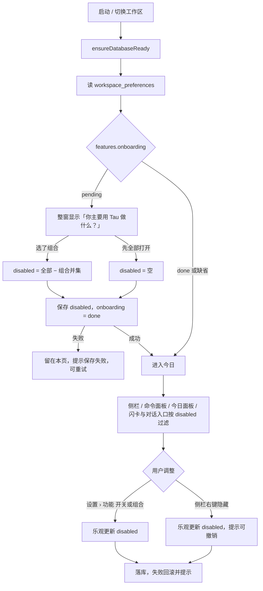

# 功能开关与首次启动选用途

状态：实现完成，待视觉与交互验收
目标：让用户只留下用得上的功能，新用户第一次打开时侧栏就只有自己需要的入口。

## 需求

- 设置「通用」组里，「外观」下面新增「功能」页。每个内置功能一个开关，按侧栏同样的分组排列，改了即刻生效。
- 关掉的是入口，不删内容。关闭后，这个功能在侧栏、今日面板、命令面板（⌘K）的页面跳转里都不再出现。已有内容照常能从链接、搜索结果里打开。
- 今日、插件、设置、反馈始终显示，不出现在开关列表里。插件自己的侧栏入口仍在插件页里停用。
- Skill、MCP 服务器依附于 AI 对话：缩进排在 AI 对话下面；AI 对话关掉时一起收起，开关变灰不可点；AI 对话开着时可以单独关。
- 闪卡复习是通用能力，单独一行，不依附任何功能。关掉后，卡片、文章、项目、漫步里的「生成闪卡」入口一起收起。
- 侧栏内置条目右键：打开 / 从侧栏隐藏「X」/ 管理侧栏功能…。隐藏后顶部提示「已隐藏「X」，内容都还在」，带「撤销」，5 秒后消失（提示只能带一个按钮，「管理侧栏功能…」留在右键菜单里）。AI 对话的隐藏项写明「连同 Skill、MCP 服务器」。
- 常用组合四个，可多选，首次启动与设置页共用：

| 组合       | 打开的功能                             |
| ---------- | -------------------------------------- |
| 写作与笔记 | 日记、卡片库、文章、项目、白板、数据库 |
| 学习       | 卡片库、PDF、Notebook、闪卡复习、漫步  |
| 日程与专注 | 日程、待办、番茄专注、日记             |
| AI 助手    | AI 对话、Skill、MCP 服务器             |

- 设置页的组合勾选状态由开关推出：一组功能全开即勾上。勾上一个组合 = 打开它的功能；取消 = 只关掉其他已勾组合用不到的功能。没有「自定义」档。
- 首次启动（新建的工作区）在进入今日之前问「你主要用 Tau 做什么？」，可多选。主按钮写「进入 Tau · 打开 N 项功能」；一个都不选时主按钮变成「先全部打开」。协作、发布不属于任何组合，新工作区默认关。
- 已有工作区升级后不看这一步，全部功能保持打开。从云端恢复的工作区用它自带的开关状态，也不看这一步。
- 设计稿：`apps/desktop/mockups/feature-toggles/index.html`（1 首次启动、2 设置 › 功能、3 侧栏就地隐藏、4 关掉之后）。

## 决策

- 开关放设置，不放插件页。
- 闪卡复习不依附卡片库，是通用能力。
- 不做侧栏顶部的搜索框和新建按钮。
- 新用户默认开哪些由首次启动的用途回答决定；常用组合要做，数据库归入「写作与笔记」。

## 现有架构

- 侧栏条目是 `apps/desktop/src/app/navigation.ts` 的 `NAV_SECTIONS`（5 组 19 项）与 `NAV_FOOTER`；`Sidebar.tsx` 经 `composeNavSections` 合并插件入口后渲染，分组折叠状态在 `shellStore.navSectionCollapsed`。内置条目（`NavItemButton`）目前没有右键菜单，插件条目（`PluginNavEntry`）有。
- 命令面板的页面命令由 `features/search/searchMeta.ts` 的 `paletteCommands()` 从 `NAV_SECTIONS` 生成，并缓存在模块变量里。
- 今日面板登记在 `features/home/panels.ts`；复习、待办、日程、今日漫步四个面板各对应一个功能。布局（顺序与用户手动隐藏）存主库 `home_panel_layout`，随工作区保存与同步。
- 「生成闪卡」入口在 `CardDetailView`、`ArticleDetailView`、`WalkView`、`useProjectItemMoreActions`，均经 `services/flashcard-creation.ts`。插件的闪卡写入 API 在 `app/plugins/flashcards.ts`。
- AI 对话的常驻入口：侧栏条目、右侧辅助栏的对话视图（`features/chat/assist/`）、`ChatShortcuts` 的快速提问快捷键。
- 设置分区清单是 `features/settings/sections.tsx` 的 `SETTINGS_GROUPS`。
- 工作区由主进程 `create-or-connect-database` 打开，不存在时静默新建；渲染端 `ensureDatabaseReady` 连接成功后壳层才渲染。代码里还没有首次启动引导（工作区引导只有设计稿 `mockups/workspace-onboarding/`）。

## 方案

### 存储：随工作区保存

开关状态和首次启动是否已完成都属于工作区：换一台设备从云端恢复，侧栏和原来一样。主库新增一张小表，整份读写，做法与 `home_panel_layout` 相同：

```sql
CREATE TABLE IF NOT EXISTS workspace_preferences (
  key TEXT PRIMARY KEY,
  value TEXT NOT NULL,
  update_time INTEGER NOT NULL
);
```

| key                   | value                            | 缺省含义     |
| --------------------- | -------------------------------- | ------------ |
| `features.disabled`   | 关掉的功能 ID 的 JSON 数组       | 全部打开     |
| `features.onboarding` | `pending`（等待选用途）或 `done` | 不需要选用途 |

- 记录「关掉了哪些」而不是「开了哪些」：已有工作区没有这一行，全部打开；以后新增的内置功能默认出现，不会被老的开启清单漏掉。
- 只新增表，不改既有结构，主库版本不变；按数据库变更手册更新表数量常量和 AI Schema 文档。
- 新工作区的判定放在 `ensureMainSchema`：开库时一张用户表都没有（真正的空库），在建库事务里写入 `features.onboarding = pending`。已有工作区升级、从云端下载替换的工作区都已有表，不写这一行，所以不会看到选用途。移动端新建的工作区没有这一行，在桌面打开时全部打开，不补问。

### 模块

| 模块       | 位置                                                        | 职责                                                                                                                                                                                         |
| ---------- | ----------------------------------------------------------- | -------------------------------------------------------------------------------------------------------------------------------------------------------------------------------------------- |
| 功能清单   | `apps/desktop/src/app/features.ts`                          | 可开关的功能（ID 沿用侧栏 key）、依附关系（`skills`、`mcp` → `chat`）、四个常用组合；纯函数 `isFeatureEnabled`、`setFeatureEnabled`、`isPresetChecked`、`togglePreset`、`disabledForPresets` |
| 主进程表   | `src-electron/main/modules/tables/workspace-preferences.ts` | `workspace-preferences:get` / `workspace-preferences:save`，校验 key 白名单与 JSON 格式                                                                                                      |
| 渲染端数据 | `apps/desktop/src/app/featureQueries.ts`                    | `useFeatures()` 读一次、缓存；`setDisabled` 先写缓存再落库，失败回滚并提示「功能设置保存失败」                                                                                               |
| 设置页     | `features/settings/sections/FeaturesSection.tsx`            | 常用组合与分组开关列表，登记进 `SETTINGS_GROUPS` 的「通用」组                                                                                                                                |
| 侧栏右键   | `app/NavItemMenu.tsx`                                       | 内置条目包 `ContextMenu`，隐藏后弹可撤销的提示                                                                                                                                               |
| 首次启动   | `app/FeatureOnboarding.tsx`                                 | `features.onboarding = pending` 时整窗显示，选完写入关掉的功能并把 onboarding 置为 `done`                                                                                                    |

### 接入点（读 `useFeatures().isEnabled(id)`）

- 侧栏：`composeNavSections` 多接一个参数 `isEnabled`，过滤内置条目；组内条目全被过滤时整组不显示。插件条目不经过这里。
- 命令面板：`paletteCommands()` 去掉模块级缓存里的页面部分，改为每次按开关过滤（条目只有十几个，不需要缓存）。
- 今日面板：`HomePanelDefinition` 加可选 `feature` 字段，复习 → `review`、待办 → `todos`、日程 → `schedule`、今日漫步 → `walk`；`HomePanels` 先滤掉关闭功能的面板再排布。用户的手动隐藏和顺序不动，功能重新打开时面板回到原位。
- 生成闪卡：`review` 关闭时，卡片、文章、项目、漫步里的「生成闪卡」菜单项不渲染。插件的闪卡写入 API 不受影响。
- AI 对话：`chat` 关闭时，右侧辅助栏不登记对话视图、`ChatShortcuts` 的快速提问快捷键不响应。编辑器里的 AI 改写、AI 标题等能力只看模型是否配置，不受开关影响。
- 页面本身不拦：关掉的功能页面仍可通过内容链接、搜索结果打开，只是不常驻入口。

### 主流程



常用组合的运算：

```text
isPresetChecked(preset, disabled) = preset.features 全部不在 disabled 中
togglePreset(preset, checked, disabled):
  勾上  → disabled − preset.features
  取消  → disabled ∪ (preset.features − 其他已勾组合的功能)
setFeatureEnabled(id, false) → disabled ∪ {id}  （依附项不必单独写入，isFeatureEnabled 先看父功能）
isFeatureEnabled(id) = id 不在 disabled 且 (无父功能 或 父功能 isEnabled)
```

### 失败与边界

- 读失败：按全部打开渲染，不挡住主界面；onboarding 读不到时不显示引导。
- 写失败：缓存回滚到操作前，提示保存失败，用户可再点一次；不自动重试。
- 两个窗口同时打开同一工作区：沿用 query 的窗口聚焦重读，另一个窗口回到前台时同步。
- 关掉当前所在页面的功能：当前页不跳走，侧栏选中态消失；离开后从入口进不来。
- `features.disabled` 里出现已不存在的功能 ID：读时忽略，下次保存时自然丢弃。

## 用户文档

功能上线时同一提交更新 `apps/website/content/docs/`：`quick-start.md` 写首次启动选用途与设置 › 功能；`today.md` 写关掉功能后对应面板不显示；`flashcards.md`、`ai.md` 各补一句关掉后哪些入口会收起。

## 验证

- `pnpm db:schema:build`、`pnpm db:schema:check`、`pnpm db:schema:prepare`
- `pnpm --filter desktop exec tsc --noEmit`，桌面 lint
- `features.ts` 的组合运算属于纯函数边界（多组合重叠时取消一个不误关共有功能、依附项随父功能），补一份针对性单测；其余只跑直接相关的现有测试（侧栏、命令面板、今日面板、设置页）。
- 视觉与交互由用户验收：新建工作区走一遍选用途；已有工作区升级后全部打开；侧栏右键隐藏与撤销。

## 进度

- [x] 设计稿与需求确认
- [x] 方案确认
- [x] 存储与主进程表
- [x] 功能清单与渲染端数据
- [x] 侧栏、命令面板、今日面板、闪卡与对话入口接入
- [x] 设置 › 功能页与侧栏右键
- [x] 首次启动选用途
- [x] 用户文档、架构文档同步，检查通过
- [ ] 用户验收：新建工作区走一遍选用途；已有工作区升级后全部打开；侧栏右键隐藏与撤销；设置 › 功能的组合与依附项
