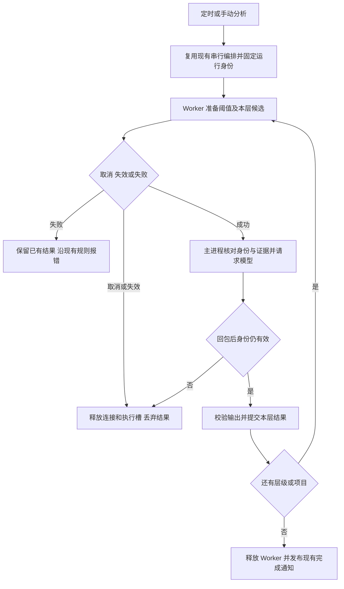

# 知识洞察后台计算与白板输入响应

状态：代码与功能验证完成，性能验收部分通过；未达标场景保留待验收。

目标：消除知识洞察候选计算对 Electron 主进程的秒级阻塞，并以真实候选计算与白板输入并发验证功能和响应。

## 需求与已确认范围

- 用户先要求分析白板输入卡顿，随后要求实施方案和保障功能的压测方案。用户已确认方案并授权实施，必要时可使用已安装软件的模型完成测试。
- 保留候选筛选、排序、分组、引用、分析频率、模型调用和分层落库语义；不通过减少提问窗口、减少检索量或关闭后台洞察换取性能。
- 覆盖取消、切库、同名库替换、索引换模型和 Worker 失败；性能验证与普通契约测试分开。
- 不改变白板文字本地编辑与耐久保存协议。所有自动化在隔离资料库进行，视觉与真实系统输入法体验由用户验收。

## 调研结论

### 事故证据

输入为本机 `perf-snapshot-1795794310073.json`，版本 0.68.0，buildId 为 `abcc1761-dc66-429e-822d-22b6c8997cec`。使用完全匹配的归档映射；归档中的候选模块和调度模块源码与当前文件一致。

- 北京时间 2026-11-27 23:44:30 至 23:45:03，主进程多次达到单核口径约 95%–99%，事件循环最长阻塞 1561ms。
- 5 秒有效 CPU 采样中，4704ms（94.1%）位于 `askedCandidates` 下方的原生调用；代码中相应重活是同步数据库与向量检索。
- 同期 7 次白板保存确认耗时 1216–1566ms，中位数 1360ms；异常前样本中位数 18.5ms，之后样本中位数约 19ms。11 字节与 29 字节增量也出现秒级等待。
- 普通日志在 23:45:13 记录后台知识洞察本轮完成，整轮约 63.4 秒，包含模型等待等时间，不能解释成全部 CPU 时间。
- 已证实主进程阻塞与白板保存延迟；原始快照缺少同一时段逐键显示测量，不能将保存延迟等同于全部落字延迟。

### 实现与消费者盘点

| 当前位置                                                  | 事实与处理边界                                                                                                                                                            |
| --------------------------------------------------------- | ------------------------------------------------------------------------------------------------------------------------------------------------------------------------- |
| `modules/knowledge-insights-module.ts`                    | 定时与手动入口共用串行链；已有 generation、AbortController 与后台失败规则，保留编排职责。                                                                                 |
| `modules/topic-insights.ts`                               | 子主题、主题、全局逐层分析和保存；`runGlobal` 在主进程等待候选，`runSubtopic` 还会加载整个分组向量并两两比较。                                                            |
| `modules/topic-insights-candidates.ts`                    | `askedCandidates` 最多检查最近 2000 条提问，每 50 次同步 KNN 才让出；`bridgeCandidates` 也执行同步 KNN；分组、配对、片段选择同属候选计算。                                |
| `modules/project-review.ts`                               | 同一后台模块随后可能执行项目回顾，也消费 `loadNoteVectors`、余弦相似度与同步 KNN；纳入同一个候选 Worker 的项目作业，避免只修全局阶段。                                    |
| `modules/entity-context/context-related.ts`               | `buildContext` 当前会通过 `ensureRelatedThreshold` 同步补算阈值；知识洞察的缓存缺失路径也需异步化。该函数还被脉络、正文洞察与创作等消费者使用，不整体删除或迁移这些业务。 |
| `modules/chat-prompt-index.ts`、`tables/knowledge-map.ts` | 提问 key 解析和向量均值被候选使用，但文件还包含会话/表层依赖；按真实依赖抽取叶子工具，Worker 不导入整个 Electron 模块图。                                                 |
| `modules/main-content-index-db.ts`                        | 索引使用 WAL；主进程负责初始化、迁移与写入。Worker 不调用 `getDatabase`/`ensureReady`，避免只读任务意外建库或迁移。                                                       |
| `workers/whiteboard-compact.worker.ts`、`vite.config.mts` | 已有 Worker 自开只读 SQLite 的先例和显式构建入口；沿用原生模块与打包方式。                                                                                                |
| `e2e/whiteboard-typing-desktop.spec.ts`                   | 已有混合白板、真实编辑、输入法事件和重读保存的基准；目前短样本、无洞察并发、延迟仅输出，不足以作为本次放行门槛。                                                          |

## 推荐方案

### 模块职责

1. **现有编排模块**保留主库元信息读取、分析层级/重算判断、模型请求、输出校验、引用校验与结果落库。后台与手动分析使用同一路径。
2. **新增候选任务客户端**负责单 Worker 的启动、作业身份、取消、结果核对、异常和资源释放。一个分析运行期最多一个候选 Worker，不建设通用线程池；模型等待期间不持有索引读事务或连接。
3. **新增候选 Worker**自行打开已存在的索引文件（`readonly`、`fileMustExist`），加载现有路径解析规则指定的 sqlite-vec 扩展。完成一个作业后关闭读事务和连接；主库写入、Schema、模型请求均不进入 Worker。
4. **候选核心与叶子工具**保留一份真实算法。移动必要的提问 key 解析、均值、相似度与阈值采样纯逻辑，消费者改为引用同一实现；不新增近似检索、不改精度与阈值。`loadNoteVectors` 等仍有活消费者的工具不按“旧实现”误删。
5. **构建与诊断**在现有 Vite Worker entry 中增加入口，验证安装包中的原生依赖路径；接入现有性能操作/阶段记录，不增加逐向量日志。

建议文件落点是 `modules/topic-insights-candidate-client.ts` 与 `workers/topic-insights-candidate.worker.ts`；协议随领域模块放置，只有确需双端运行时导入的无副作用类型/工具才拆叶子文件。最终按真实 import 图确定拆分，避免为了 Worker 再复制一套算法。

### 输入、输出与调用时机

所有作业携带 `jobId`、分析 generation、资料库连接身份、可信索引文件路径、嵌入指纹/维度和共享取消标志。数据库对象、函数、模型配置和密钥不跨线程；链接/概念/分组用最小可序列化数据传入。

| 作业       | 输入                                                         | 输出                                     | 调用时机                                                      |
| ---------- | ------------------------------------------------------------ | ---------------------------------------- | ------------------------------------------------------------- |
| 阈值准备   | 当前索引身份、阈值缓存及既有采样参数                         | 当前阈值；必要时附带待持久化的阈值元数据 | 一轮分析首次需要阈值时；缓存缺失/失效的采样在 Worker 内执行。 |
| 子主题候选 | 成员 key、链接关系、阈值、增量成员集合和既有限额             | 配对与对应证据片段                       | 子主题模型请求前。                                            |
| 全局候选   | 主题成员、更新时间、链接/概念、阈值和既有限额                | 呼应配对、对应证据片段、“问了但没写”分组 | 全局模型请求前。                                              |
| 项目候选   | 主进程已读取的项目树最小投影、链接排除集、其他项目成员和阈值 | 现有“可能属于这里”与项目归属候选         | 项目回顾模型请求前。                                          |

只返回被挑选候选和所需片段，不把全库向量发回主进程。主进程据原实体、成员与内容版本组装提示词；对应内容已删除或版本不符时舍弃该证据，不把旧片段定位到新正文。

`buildContext` 的只读展示路径只读取合法缓存，不隐式执行冷阈值采样；真实分析入口等待阈值准备。Worker 返回的新阈值仅在连接身份、模型指纹和重采样有效性仍符合原规则时由主进程写回现有键。不改其他业务调用阈值服务的语义，不新增平行缓存。

### 快照、并发与生命周期

- 每个候选作业在 Worker 内使用显式只读事务，首个读取固定索引快照；全部查询在同一快照内完成。事务提交/回滚、关闭连接后才返回结果，绝不跨模型请求持有读事务。不能把异步函数直接塞进 better-sqlite3 的同步 transaction 包装器。
- 普通索引追加允许当前作业基于开始时的快照完成，下轮反映新数据；不因每次白板保存或普通索引写入不断重启分析。模型指纹变化、索引表重建、资料库替换使旧任务失效。
- WAL 下长读事务可能推迟检查点回收。压测同时观测写入等待、检查点与 WAL 残留；若出现主进程等待锁或持续膨胀，该方案尚未通过，需缩短作业读事务范围或调整快照获取方式，不能只看 Worker 是否启动成功。
- 取消时主进程立即使作业失效，设置共享取消标志。Worker 在 SQL 之间与计算循环内检查；同步原生查询在执行期间不依赖 message 事件来处理取消。不能承诺中断正在执行的单条原生查询，也不能将 `terminate()` 调用视为连接已经关闭。
- Worker 退出并释放句柄后才释放执行槽；不因取消而产生多个残留计算。用户切库可以立即放弃旧结果，同名文件替换/删除必须等待实际读任务释放。
- 在现有资料库维护、同步重连、索引重置和退出入口增加该领域任务的取消/排空步骤。不得只在 `onDatabaseConnected` 之后取消：Windows 上旧文件句柄可能已经影响替换。实施时逐个复核 `closeDatabase`/重建/替换消费者，覆盖真实维护入口。
- 每个 Worker 回包、模型调用前、模型返回后与落库前复核 generation、原连接对象/身份和模型指纹。名称相同不等于同一个库；迟到结果不能写入新库或覆盖后续运行。
- 保留既有逐层提交语义：取消前已成功完成的子主题结果可以保留；未完成层级不写，不将整轮改成原子事务。

### 失败行为

- Worker 启动、原生扩展加载、数据库读取或计算失败：明确返回失败；后台沿用现有失败计数与停止规则，手动分析沿用错误提示。已有有效洞察保留。
- 取消/身份失效与计算错误区分；取消结果不作为成功，也不将故障伪装成“没有候选”。
- 不在 Worker 失败时退回主进程重跑，不引入自动无限重试。后续既有定时检查或用户重试仍可启动新任务。
- 预计仍可能有一个后台 CPU 核心忙碌；本次目标是主进程响应和功能正确，不承诺算法总工作量或模型时长大幅减少。

### 主流程



```text
固定本轮身份并准备上下文
try:
  按既有顺序遍历需要分析的层级:
    检查取消与身份
    candidates = await candidateClient.run(最小输入, signal)
    检查身份与候选证据
    result = await 既有模型调用与输出校验(candidates)
    再次检查取消与身份
    按既有事务保存本层结果
finally:
  await candidateClient.dispose()  # 实际退出与连接释放
```

## 功能验证

### 独立契约与结果对账

- 保留并运行现有 `topic-insights.test.ts`、`topic-insights-prompt.test.ts`、`tables/__tests__/knowledge-ai-insights.test.ts` 及项目回顾相关测试。现有内存 SQLite 夹具不能跨线程共享；核心测试可继续使用内存库，真实 Worker 集成测试使用临时文件库。不得给生产代码加测试用主进程回退。
- 为本次事故补必要的真实 SQLite + sqlite-vec 候选契约：已有关联排除、阈值两侧、跨主题与概念重合过滤、同一提问聚合、增量涉及集合、对应正文片段。小维度夹具用能独立推导的向量，写明确语义期望；不对整份提示词或结果做快照。
- 对同一冻结夹具记录改前候选，和 Worker 结果比对成员、排序、引用、分组及相似度容差；浮点容差只用于分数，不放宽成员/筛选。并列情况按既有规则处理，不趁机另定排序。新旧对账只作迁移证据，不能代替独立期望，也不把旧生产实现留作兼容层。
- 模型网络可以使用确定性测试传输，真实 SQL、候选算法、Worker、IPC、白板编辑和保存都不能被 mock。最终另做一次配置模型的人工功能复核，耗时不混入本地候选性能。

### 生命周期与故障

以下均使用可观测屏障进入确定阶段后再注入，普通测试不用真实 sleep 争抢时序：

| 场景                                        | 必须满足的契约                                                                 |
| ------------------------------------------- | ------------------------------------------------------------------------------ |
| 运行中取消、随后重试                        | 取消后无新模型请求或未完成层级写入；新任务可完成；旧结果迟到也不覆盖。         |
| A 库切到 B 库；同名 A 库替换                | 新库无旧候选/旧洞察写入；替换实际成功，旧 Worker 与文件句柄被释放。            |
| 索引追加、删除、换模型、重建                | 同作业不混读不同快照；普通追加不会反复饿死任务；结构/身份失效结果不落库。      |
| Worker 抛错、异常退出、扩展缺失、读取锁等待 | 本轮有明确失败，旧洞察仍在；不返回伪造空候选、不切回主进程；资源释放后可重试。 |
| 分层分析中途取消或失败                      | 已提交层级保留，未完成层级不写；不遗留 running 状态或占用执行槽。              |
| 持续白板编辑、撤销重做、离开、关窗、重启    | 独立预期文本与持久化重读一致；无丢字、重复、覆盖、损坏或意外阻止保存。         |

## 压测设计与放行标准

以下为建议初始门槛，尚未跑出结果；在相同目标机器建立改前基线后冻结。失败必须归因，不能事后放宽门槛宣称通过。

### 隔离环境与负载

- 使用现有生产 Electron 隔离 harness、真实构建 Worker 和临时资料库；不在正在使用的 `~/.editor/data.db` 上压测。需要真实分布时通过 SQLite 一致性备份取得隔离副本，不直接复制运行中的单个 `.db` 文件忽略 WAL。
- 向量默认 1024 维；提问与笔记分开，固定随机种子构造近邻/非近邻/重复组，并加入独立已知结果样本。每份报告记录向量条数、实体数、块数、提问数、维度、最大分组规模和候选上限。

| 档位     | 笔记向量 | 历史提问 | 用途                                                          |
| -------- | -------- | -------- | ------------------------------------------------------------- |
| 小型     | 1000     | 200      | 功能与正常开销。                                              |
| 代表负载 | 10000    | 2000     | 覆盖本次约数千至上万条向量的规模及完整提问窗口。              |
| 余量负载 | 50000    | 20000    | 检查历史增长后的全量扫描/内存开销；仍按原规则只处理最近窗口。 |

增加“单一大子主题”“多主题、多项目”“阈值缓存缺失”“正常索引写入并发”场景，避免只测 `askedCandidates` 而漏掉其他阶段。

### 对照与测量

1. 改前构建保留基线；同机、同数据、同配置顺序运行：空闲打字、旧同步候选并发打字、新 Worker 候选并发打字。不同方案和构建/其他压力任务不并行。
2. 正常速度与 renderer 4× CPU 降速分别测量。CDP 的 renderer 降速不代表主进程或 Worker 同样慢 4 倍；主进程在实际机器另测，不能混淆口径。
3. 复用混合白板夹具：普通文字、长文本/分组、英文连续输入、中文组合输入事件、退格、撤销重做、粘贴。先测稳定输入，再测短突发；自动化组合事件不能替代用户的 Windows 真实输入法验收。
4. 正式测量期间持续执行真实候选作业，记录作业处理量与起止，证明与采样窗口重叠；不得测到缓存命中、六小时频率限制导致的空跑，或把 Worker 已结束后的空闲输入计入并发样本。候选客户端可用于重复负载；另以正式手动/后台编排入口验证完整闭环，明确两者边界。
5. 每轮预热与正式样本分开；正式每场景至少 2000 次有效输入测 P99，预热 1 轮后正式 3 轮。记录自动化计划发键、实际发送、renderer 收到输入和可观察文本更新后的帧边界，分开报告注入端等待；不因驱动等待而漏计卡顿，也不把帧回调称为物理屏幕已显示。
6. 主进程使用高分辨率事件循环延迟采集及 IPC 往返探针；renderer 记录按键处理、文本更新后帧边界、长任务与帧间隔。保存单独记录 append 确认，并在离开/关闭后重新读取真实文档对账，必要时重启再读。
7. 候选耗时分解为排队、Worker 启动/开库、查询、配对分组、片段、传输、关闭；记录主/Worker CPU、RSS、JS heap、作业并发数、索引写等待、WAL 与检查点。性能数字进入环境门控 benchmark，不写成普通单测时钟或内存断言。

### 建议门槛

| 指标                       | 正常速度                                                 | renderer 4×                                                |
| -------------------------- | -------------------------------------------------------- | ---------------------------------------------------------- |
| 收到输入至文本更新后帧边界 | P95 ≤50ms，P99 ≤100ms                                    | P95 ≤100ms，P99 ≤200ms                                     |
| 主进程事件循环延迟         | P99 ≤50ms，最大值 <200ms；正常与冷阈值路径都测           | 独立按主进程实际速度测量，仍要求无候选计算导致的秒级阻塞   |
| 白板 append 确认           | P95 ≤100ms，P99 ≤200ms，最大值 <500ms                    | 记录 renderer 降速的额外开销，要求无候选计算导致的秒级排队 |
| 功能完整性                 | 每轮独立预期与重读结果一致；无错误、丢字、重复和跨库写入 | 相同                                                       |

同时对照空闲输入：报告绝对值、相对退化和三轮最差值，不能用平均 CPU 或总体平均帧率遮住尖峰。若空闲基线也不达标，要定位 renderer 的独立瓶颈，不能仅据主进程修复宣称白板输入已达标。

候选结果必须与契约相符；代表负载本地候选总耗时建议不超过旧基线 `1.2 倍 + 500ms`（排除模型网络），超过需解释并优化。移出线程不应导致任务永远不完成；所有档位均须实际完成，余量负载耗时与峰值单列，作为容量边界而非隐藏超时。

### 长稳与资源释放

- 独立跑至少 30 分钟实际候选作业与白板编辑/索引更新，间歇注入取消、切库与重试；计时对照与故障轮次分开。
- Worker 活跃计算数始终至多一个；取消后无遗留运行任务。停止负载、正常关闭后，用文件重命名/删除及重新开库验证句柄释放。
- 比较暖机后多个等长窗口的 RSS/heap、连接数与 WAL 趋势；允许缓存形成后平台，不用一次 GC 或单次负增长宣称无泄漏。持续无界增长或检查点始终无法推进为失败。
- 保留每轮 JSON、环境、buildId/源码修订、场景、样本覆盖、失败详情与 CPU 栈；不要记录正文、提问文本或向量内容。

## 实施顺序与验证入口

1. 冻结改前候选/输入基线，补事故契约，抽取无副作用叶子工具；确认原生 Worker 在生产构建里可开只读索引。
2. 接入单 Worker 的阈值、子主题、全局与项目候选；补异步边界身份检查、取消和维护释放，删除已清零的主进程直接候选路径，不保留同步回退。
3. 运行直接相关契约与生命周期测试；顺序执行并发输入对照、余量和长稳压测，只有实际通过才报告修复。

已有命令示例（按变更范围执行，不跑全量）：

```powershell
pnpm --filter desktop exec vitest run src-electron/main/modules/__tests__/topic-insights.test.ts src-electron/main/modules/__tests__/topic-insights-prompt.test.ts src-electron/main/modules/tables/__tests__/knowledge-ai-insights.test.ts
pnpm --filter desktop exec tsc --noEmit
pnpm --filter desktop exec vite build --configLoader runner
node apps/desktop/scripts/verify-renderer-startup.mjs
pnpm check:desktop-startup
pnpm check:docs
```

白板基准已有入口为设置 `WHITEBOARD_TYPING_DESKTOP=1` 后运行 `e2e/whiteboard-typing-desktop.spec.ts`；当前入口尚不包含本文的洞察并发与门槛。实施时扩展已有门控入口并补生产 Worker/安装产物运行校验；新增命令须在脚本落地后记录，不把计划命令冒充可执行结果。

架构事实随实现更新桌面 `home-features.md`、`main-process.md` 和 `performance.md` 的对应内容；操作与长期压测步骤归开发验证指南。若改变用户入口、运行/错误交互，同一提交同步官网使用文档；本方案不预设新增入口。

## 本轮进度与验证

- [x] Investigate/Triage/Understand the problem：完成日志、调用方、Worker、数据库维护入口与既有测试调查。
- [x] 完成模块方案、失败边界与压力验收设计。
- [x] 核对文档与索引，运行文档检查：新增索引指向存在的任务文档，文档无尾随空格，围栏闭合；`git diff --check -- docs/README.md` 通过。

`pnpm check:docs` 已运行，但被 `packages/plugins/README.md` 中三处指向 `/plugins/tau-plugin-template/docs/task-data.md`（含两个锚点）的死链阻断。这些位置未在本次修改范围内，本轮不修改；不能将全仓文档检查记为通过。

## 实施进度

- [x] 调查与改前基线：相关 4 个测试文件、33 个用例通过；源码基线保留在忽略的 output 中。
- [x] 候选核心、Worker 与异步接入：包含阈值、子主题、全局、项目和库维护边界。
- [x] 生命周期、契约与故障验证：桌面 97 个用例通过（2 个既有环境门控跳过）；白板容量和并发 34 个用例通过；真实 Windows 运行时的 ASAR 内原生候选 Worker 探针通过。
- [x] 完成并发输入、真实保存 IPC、容量、30 分钟故障长稳、确定性模型回包与冷重开验证；性能失败原样保留。
- [x] 已沉淀架构事实和验证指南；因性能门槛未全部达到，任务保留待验收，不作完成退役。
- [ ] 剩余性能验收：4× 稳定输入尾部、极限突发完整性与复杂白板保存目标。

## 生命周期

本文件是本任务方案、任务内决策和验证记录的唯一位置。实施完成或放弃后，按沉淀、删除任务目录、更新文档索引的顺序收尾；期限 90 天。

## 实施中补充证据与修正

真实混合白板输入采样发现 `tryLocalBodyEdit` 在容量证明仍有效时也会准备整板结构；已让字符准入复用现有证明，结构操作继续准备当前结构。新增连续输入后几何操作、同步与撤销的行为回归，容量校验不变。

大白板原来每次保存都新建校验 Worker；改为会话内复用，仍对每批确认状态执行完整候选校验，所有会话驱逐路径释放线程。新增真实线程的多次提交、串行约束、错误后重试和关闭契约。

混合场景（240 条笔迹和 12 组文字/图形）小样本：修正后输入 P99 约 18–21ms；后台候选计算时保存 P95 仍约 348ms、主线程事件循环 P99 约 74ms，尚未达到原定保存与事件循环门槛。此结果不是正式样本或全面通过的结论，保留未达标项继续验证。

## 已完成的正式验证记录

- 普通白板 1× 突发：3 轮，每轮 2000 次输入；输入 P99 最差 17.8ms，输入期间主线程最长延迟约 29.4ms。自动保存只有 9 个批次，单列最大值 40ms，不据此宣称高置信度保存 P99。
- 生产 IPC 保存：1000 次真实 append，P95 37.2ms、P99 49.3ms、最大 53.3ms，最终冷重开与组合输入通过。
- renderer 4× 稳定输入：三轮内容与冷重开一致，但第三轮 P95 109.4ms 超过 100ms 门槛；不记为全面达标。
- 原始 4× 长突发曾出现输入完整性断言失败，保留原始日志；后续改用精确原生窗口身份的诊断与稳定场景未复现，但不以它们替代原负载的通过结论。
- 30 分钟混合白板长稳：77 轮、15400 次输入、294 次正常候选作业、77 次取消恢复、8524 次索引写入；无计算错误，全部轮次耐久读取、WAL 释放与最终冷重开通过，候选最大并发 1。故障长稳不作为性能计时放行。

代表规模主线程/Worker 对照与容量作业仍在执行；复杂白板保存和 4× 渲染门槛未全部通过，不报告全面修复或无条件性能保证。

## 最终对照与容量结果

同算法、同冻结输入、真实 Electron 原生运行时：主线程计算 124472.7ms，Worker 计算 130111.0ms，结果摘要完全一致，总耗时增加约 4.5%，通过 `1.2 倍 + 500ms` 门槛。主线程事件循环最大阻塞从 3317.7ms 降为 42.6ms，Worker 运行时主线程 P99 16.4ms。

容量：50000 条笔记向量、20000 条历史提问、1024 维；生产规则仍处理最近 2000 条提问。整批 Worker 作业实际完成，耗时 730260.1ms，主线程 P99 16.3ms、最大 72.5ms；无计算错误、候选最大并发 1、结束后为零、WAL 检查点无忙读者。

30.4 分钟混合场景长稳累计 77 轮、15400 次输入、294 次正常候选作业、77 次取消恢复、8524 次并发索引写入；全部内容与最终冷重开一致。最近 20 轮的主进程 RSS 中位数约 488.4MB、JS heap 中位数约 59.5MB，未观察到持续上升趋势；仅代表该负载与时长，不宣称无条件无泄漏。

验证中模型传输使用确定性回答，真实候选 SQL、原生线程、编辑、IPC、持久化均未被替换。没有读取用户模型密钥或发送用户资料库内容；未因本任务产生模型调用费用。Windows ASAR 探针使用已有发行运行时验证原生加载，不替换已安装软件。

复现命令已落到 `apps/desktop/package.json`：`bench:insight-typing`、`bench:insight-candidates`、`test:insight-worker`。步骤与判据见 [知识洞察与白板输入性能验证](/docs/guides/dev-insight-performance.md)。原始 JSON、日志、CPU profile 和冻结构建位于忽略的 `apps/desktop/output/knowledge-insights-performance/`。

未达标项不降级为通过：原始长突发 4× 一轮完整性断言失败；后续精确原生窗口的诊断及稳定场景均完整，但不替代原负载通过结论。无 profiler 的 4× 稳定输入第三轮 P95 109.4ms 超过目标；混合场景保存约数百毫秒及事件循环尾部也未满足目标。当前结论是主要主线程阻塞源与普通白板输入已改善，不能报告所有白板规模、机器和输入速率全面达标。
