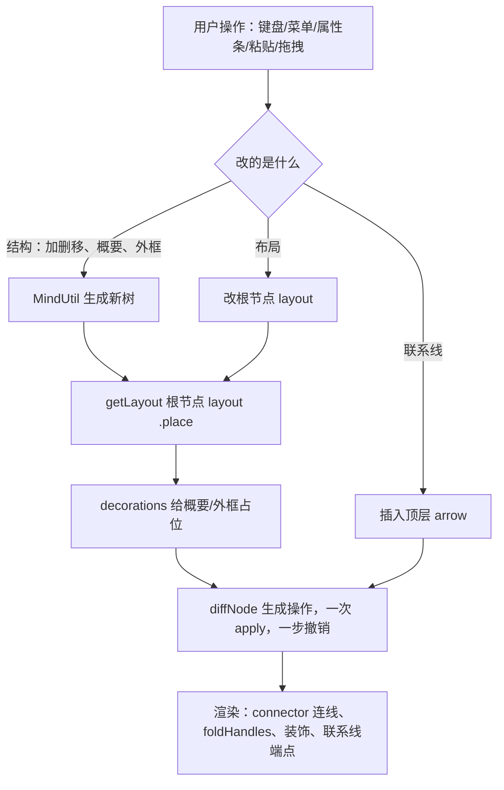

# 白板思维导图增强

状态：进行中
目标：把白板思维导图补到主流导图软件的常用水平：多种布局、成熟的键盘与剪贴板操作、概要/外框/联系线，关联笔记能在节点上直接预览。

## 需求

范围是两档改进，分批交付，每批可独立验收：

- 基础：多种布局、按层折叠、补齐快捷键、子树复制粘贴、Markdown 列表与导图互转。
- 结构：概要、外框、联系线、关联笔记预览、画布上的文本拖进导图。

不在本期：节点标记、节点标签、节点图片（图片继续用画布上的图片元素）、大纲视图、AI 扩展节点、OPML/XMind 导入导出。

验收标准：

- 现有导图打开后外观和布局不变（缺省布局即现在的左右对称）。
- 每项操作都能一步撤销；协作文档模式下远端看到的结构一致。
- 新功能在官网「白板 › 思维导图」和「快捷键」两篇有落点。

## 现状

| 模块     | 位置                                                         | 现在做什么                                                                                          |
| -------- | ------------------------------------------------------------ | --------------------------------------------------------------------------------------------------- |
| 数据     | `packages/whiteboard/src/types/mind.ts`                      | 节点即树：`children` 嵌套，根节点存 `themeId/themeStyle`，每个节点有 `direction` 和左右两个折叠标记 |
| 布局     | `utils/MindUtil.ts` `layout`                                 | 唯一算法：二级节点按 `direction` 分左右，层级越深沿同侧展开，纵向按子树高度堆叠                     |
| 渲染     | `components/MindNode/index.tsx`                              | 节点底板 + Slate 正文 + 到子节点的 `CurveArrow` 曲线 + 两侧折叠圆点（折叠时显示子孙数）             |
| 交互     | `plugins/MindPlugin.tsx`                                     | 右键菜单（加节点、重新布局、收起一侧、关联笔记），拖拽改父节点，按住 Alt 拖出成为独立导图           |
| 键盘     | `MindNode/hooks/useMindNodeKeyboardNavigation.ts`            | Tab/Enter/Shift+Enter 加节点，方向键导航，Mod+方向键 移动与换边，Space 编辑                         |
| 主题     | `AttributeSetter/MindMapSetter` + `constants/mind-themes.ts` | 配色 × 风格，浮动属性条「导图主题」                                                                 |
| 协作契约 | `collaboration/builtins.ts` `"mind-node"`                    | 声明哪些字段随文档持久化、哪些只是本机投影                                                          |
| 剪贴板   | `plugins/CopyPastePlugin.ts`                                 | 复制把白板 JSON 同时写进 `application/json` 和 `text/plain`；粘贴 JSON 一律插到画布顶层             |

由此得出的约束：

- 布局只是投影：`x/y/level/childrenHeight` 等由布局算出，协作层只存用户意图字段。新布局只需新增意图字段，不需要存坐标。
- `prepareWhiteboardContract` 的哈希只包含 `collaboration/resources/structure`，不含 `data` 字段清单。本期新增的都是普通 data 字段，不改变契约身份，不需要升 `dataVersion`。
- 复制到其他应用时现在得到一段 JSON，这是现有缺陷，Markdown 互转顺带修掉。
- Alt 拖出独立导图已经存在，「自由主题」只缺反方向（画布元素拖进导图）。

## 方案

### 数据模型

新增字段全部可选，缺省即现有行为，存量数据不迁移。

```ts
interface MindNodeElement {
  // ……现有字段

  /** 只在根节点：布局，缺省 "mind" */
  layout?: MindLayoutId;
  /** 本节点为概要：括住父节点下 [startId, endId] 这段兄弟 */
  summaryRange?: { startId: string; endId: string };
  /** 外框：括住本节点下 [startId, endId] 这段子节点 */
  boundaries?: Array<{ id: string; startId: string; endId: string; title?: string }>;
}

type MindLayoutId = "mind" | "logic" | "org" | "tree"; // 第 4 批加 "timeline" | "fishbone"
```

建模取舍：

- **概要是一个带 `summaryRange` 的子节点**，不是父节点上的附属字段。这样概要直接复用节点的正文编辑、主题着色、协作正文槽，也能继续往下挂子节点（XMind 同样允许）。布局把它排在所括兄弟的外侧，不参与普通兄弟堆叠；键盘导航跳过它，用专门的按键进入。
- **外框存在父节点上**，因为它没有正文，只有可选的短标题（纯字符串，并发编辑后写者胜）。
- **联系线复用现有 `arrow` 元素**，放在画布顶层，`source/target` 绑定到导图节点 id。箭头的样式、标签、中间点拖拽都现成。
- **折叠沿用 `isLeftFold/isRightFold`**：单侧布局里所有子节点在同一侧，只读写对应那一侧的标记，不新增字段。

### 模块划分

```text
utils/mind-layout/
  index.ts        getMindLayout(root) → MindLayout，未知值回落 "mind"
  types.ts        MindLayout 接口
  tree-shape.ts   可见子节点、level / direction 规范化、单向布局折叠标记合一
  horizontal.ts   思维导图（双向）与逻辑图（单向向右）
  indented.ts     缩进列：树状图与组织结构图三级以下共用
  org.ts / tree.ts
  score.ts        拖拽候选的屏幕距离评分
utils/mind-markdown.ts   MindNode ⇄ Markdown 列表，纯函数（第 2 批）
```

`MindLayout` 接口（`utils/mind-layout/types.ts`）：

```ts
interface MindLayout {
  id: MindLayoutId;
  sides: readonly ("left" | "right")[]; // 单向布局只有 "right"
  place(root): void; // 在 immer 草稿上写坐标与高度投影
  connector(parent, child): { kind: "curve"; from; to } | { kind: "path"; d };
  foldHandle(node, side): { at: Point; from: Point };
  navigate(node, key): "child" | "parent" | "prev" | "next" | null;
  siblingAxis(parentLevel): "x" | "y"; // 拖拽插入位置按哪条轴比较
  dropDistance(dragged, parent, side, zoom): MindDropDistance | null;
}
```

调用关系：

| 调用方                    | 改为                                                           |
| ------------------------- | -------------------------------------------------------------- |
| `MindUtil.layout(root)`   | `normalizeTree` 后 `getMindLayout(root).place(root)`           |
| `MindNode` 连线与折叠按钮 | `layout.connector` / `layout.foldHandle`，悬停预览时读预览坐标 |
| 键盘导航                  | `layout.navigate` 给出语义，再按同组兄弟、父节点取目标         |
| 拖拽候选与插入位置        | `layout.dropDistance`、`layout.siblingAxis`                    |
| 右键菜单                  | 单向布局不分左右子节点、只有一项「收起节点」                   |
| 示意图 `schematic.ts`     | 连线取 `layout.connector`                                      |

单向布局不改写 `direction`，只是不参与排布，切回思维导图恢复原来的左右分配。单向布局下 `isLeftFold/isRightFold` 合一：都收起才算收起，切换时两个一起写。

布局切换只改根节点的 `layout` 字段，然后整树重排，一次提交、一步撤销。

### 剪贴板与 Markdown

```text
onCopy(selection):
  payload = 白板 JSON
  写 application/json = payload
  if 选中的全是导图节点:
    写 text/plain = toMarkdown(选中子树)      // 粘到笔记、聊天里是缩进列表
  else:
    写 text/plain = payload                   // 保持现状

onPaste(clipboard):
  target = 当前选中的唯一导图节点
  if 是白板 JSON 且全是导图子树:
    if target: 作为 target 的子节点挂入，重排          // 新行为
    else:      作为独立导图插到画布                     // 现状
  elif 是纯文本:
    tree = fromMarkdown(text)                           // 认「- 」「* 」「1. 」、Tab/空格缩进、# 标题层级
    if target 且 tree 非空: 挂为 target 的子节点
    elif tree 有两层以上: 生成新导图（待定，见决策 2）
    else: 现状（富文本框）
```

Markdown 只转结构和正文的行内格式（加粗、斜体、链接），概要和外框不导出。

### 快捷键

非编辑状态新增（编辑状态只加 Esc）：

| 按键          | 动作                              |
| ------------- | --------------------------------- |
| Esc（编辑中） | 结束编辑并选中节点，与 Enter 一致 |
| Mod+.         | 折叠 / 展开选中节点               |
| Mod+Shift+.   | 展开到选中节点下全部层级          |
| Alt+1…5       | 整张导图展开到第 N 层             |
| Shift+Tab     | 升级：变成父节点的下一个兄弟      |
| Mod+D         | 复制子树，作为下一个兄弟插入      |
| Mod+Shift+S   | 给选中的连续兄弟加概要            |
| Mod+Shift+B   | 给选中的连续兄弟加外框            |
| Mod+L         | 进入联系线模式，点另一个节点完成  |

已核对：宿主保留键（`mod+k/p/j`、`mod+shift+j`、`alt+←/→`、`escape`）与白板内置键都不含以上组合，桌面端菜单没有注册 `⌘D / ⌘. / ⌥数字`。编辑中的 `Esc` 由节点自己的按键处理先消费，编辑器浮层已消费的 `Esc` 不结束编辑。

### 关联笔记预览

节点右上角表示已关联笔记的小圆点改成笔记图标，占固定位置。悬停图标浮出笔记标题和开头几行，点击打开。不改数据，只改 `MindNode` 渲染。

### 联系线

```text
进入联系线模式(sourceNode):
  画一条从 sourceNode 到指针的临时虚线
  点击另一个导图节点 → 插入 arrow { source: sourceNode.id, target: node.id, lineType: curve, dashed: true }
  点击空白或 Esc → 取消
渲染:
  端点取所绑节点当前投影位置（复用绑定箭头的端点计算）
  任一端所在分支被折叠 → 端点退到最近的可见祖先，线变淡
删除导图节点:
  同一提交里删除绑定它的联系线
```

需要核实：箭头端点查找目前是否能找到嵌套在导图树里的节点（导图节点不在画布顶层）。不能的话，在 `MindPlugin.getCapabilities` 补 `connectable.getConnectPoints/getBindPoint`。

### 画布元素拖进导图

拖动文本框或便签经过导图节点时，复用现有拖拽落点预览（`calculateDragTargetDistance`）。松手后：

```text
删除原元素，新建导图节点 { text: 原正文 }，挂到落点
原元素有 contentId 引用 → 新节点关联同一篇笔记
一步撤销恢复原元素
```

图片等其他元素不能拖进导图。Alt 拖出独立导图保持现状，在官网补上说明。

### 主流程



### 失败与边界

- 未知 `layout` 值回落 `"mind"`。
- `summaryRange` / `boundaries` 的端点节点被删除或移走：重排时收缩到仍存在的连续区间，区间为空则删掉该概要/外框（同一提交）。
- 概要节点所括兄弟被拖走，概要留在原父节点下并按上一条收缩。
- 协作冲突：两人同时改同一段兄弟顺序，概要区间以重排时实际相邻关系为准，不会出现交叉的括号。
- 粘贴超过 32MB 的预算沿用现有提示。Markdown 解析出 2000 个以上节点时提示并只取前 2000 个。

## 分批

| 批次 | 内容                                                                           | 契约                         |
| ---- | ------------------------------------------------------------------------------ | ---------------------------- |
| 1    | 布局策略抽出（行为不变）+ 逻辑图 / 组织结构图 / 树状图 + 属性条布局入口        | 加 `layout`                  |
| 2    | 折叠与展开到第 N 层、快捷键、子树复制粘贴到节点下、Markdown 互转、关联笔记预览 | 无                           |
| 3    | 概要、外框、联系线                                                             | 加 `summaryRange/boundaries` |
| 4    | 文本拖进导图、时间轴、鱼骨图                                                   | 无                           |

每批同一提交更新官网 `apps/website/content/docs/whiteboard.md` 与 `shortcuts.md`。

## 决策

- 首批布局：思维导图（现状）、逻辑图向右、组织结构图、树状图；时间轴和鱼骨图在第 4 批。
- 空画布粘贴多级列表保持粘成文本框，右键菜单另给「粘贴为思维导图」，不改变现有粘贴文本的习惯。
- 布局入口并入现有「导图主题」浮层，改名「导图样式」，布局用缩略图网格。
- 节点图片、标记、标签都不做。图片用画布上已有的图片元素，放在导图旁边即可。
- 动手前先出设计稿给用户确认：`apps/desktop/mockups/whiteboard-mindmap/`。

## 进度

- [x] 方案评审
- [x] 设计稿评审
- [x] 第 1 批：`utils/mind-layout/` 布局策略（思维导图 / 逻辑图 / 组织结构图 / 树状图），节点连线、折叠、方向键、拖拽落点、右键菜单、示意图按布局走；「导图样式」浮层加布局一栏，悬停预览、设为默认同时记住布局
- [x] 第 2 批：`⌘.` 收起展开、`⌘⇧.` 展开全部子级、`⌥1…5 / ⌥0` 展开到第 N 层（根节点右键「展开到」）、`⇧Tab` 升级、`⌘D` 复制分支、编辑中 `Esc` 结束；复制导图节点写缩进列表，选中节点粘贴挂成子节点，空白处右键「粘贴为思维导图」；关联笔记圆点改为图标，悬停预览标题与开头几行。剪贴板走新增的 `clipboard` 能力声明（`CopyPastePlugin` 不直接引用 `MindUtil`）
- [x] 第 3 批：概要、外框（含标题）、联系线；区间收缩纯函数有单测
- [ ] 第 4 批

验证：每批跑 `pnpm --filter @tau/whiteboard check`、白板包内与导图相关的现有测试（`MindUtil.drag`、`MindPlugin.drag`、`MindMap.creation`、`CopyPastePlugin.*`）、`pnpm --filter @tau/website test`。新增测试只覆盖白名单内的：Markdown round-trip（外部格式解析）、概要/外框区间在删除移动后的收缩（纯函数边界）、旧导图在新布局入口下坐标不变（回归）。

## 审查修复与提交验证

本轮修复协作模式升级的身份复用、拖拽提交布局不一致、深层 Markdown 导入栈溢出、原型属性名误判布局，以及行内代码导出删除反引号。补验四布局下真实快捷键升级的正文身份、撤销重做和远端一致；画框内外的层级边界；组织图与单向布局排序。官网说明已同步，后续第 3、4 批继续保留在本任务。

白板类型检查、相关行为测试、5000 节点压力、80 轮导图协作及 8 轮生产浏览器输入验证通过。整体白板复跑的七项范围外失败已交独立会话处理；本任务不把它们标记为通过。
