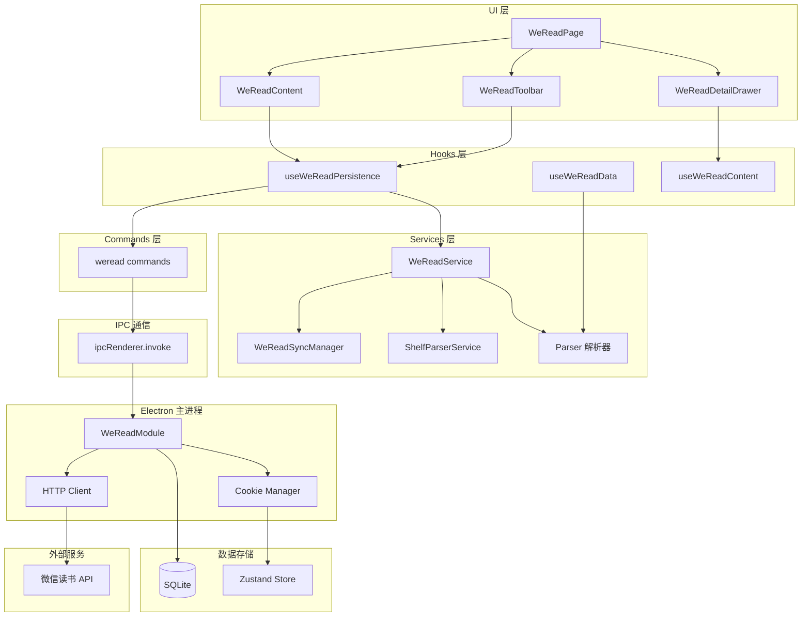
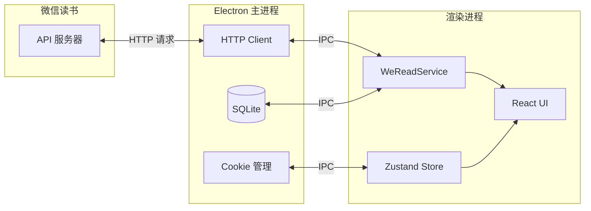
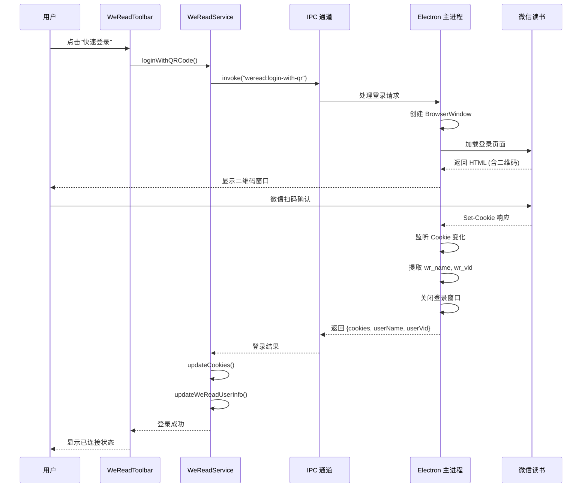
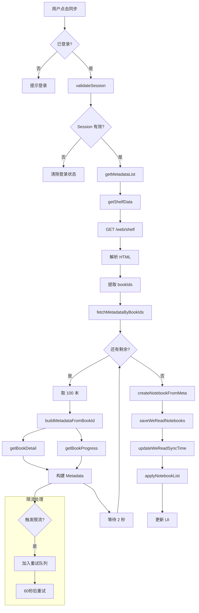
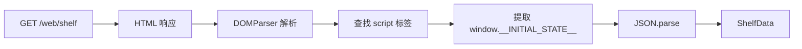
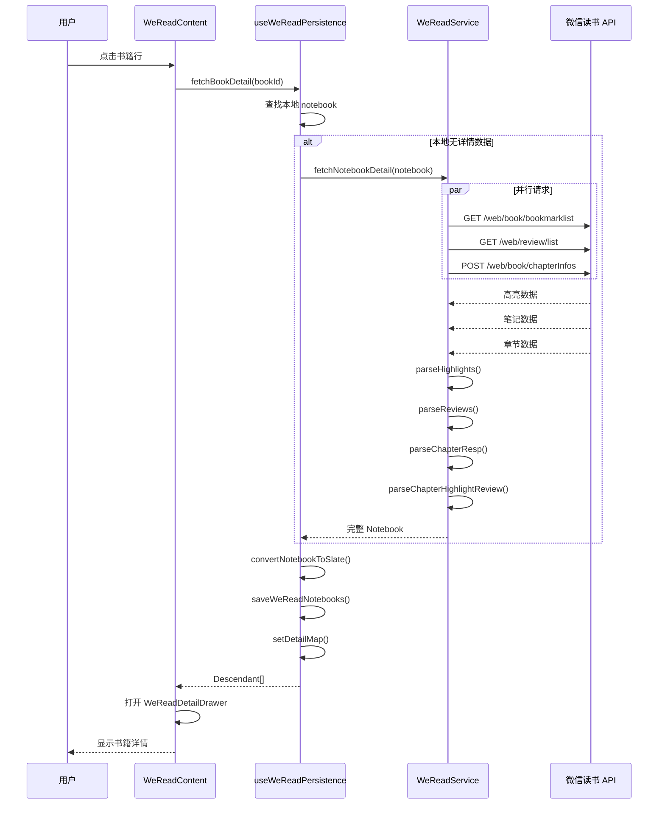

# 微信读书数据获取全流程文档

> 本文档详细分析了微信读书功能的数据获取流程，包括登录、同步、详情获取等核心功能的实现细节。

## 目录

1. [架构概览](#1-架构概览)
2. [登录流程](#2-登录流程)
3. [书籍同步流程](#3-书籍同步流程)
4. [书籍详情获取流程](#4-书籍详情获取流程)
5. [API 接口文档](#5-api-接口文档)
6. [数据模型](#6-数据模型)
7. [Bug 分析](#7-bug-分析)
8. [优化建议](#8-优化建议)
9. [关键文件索引](#9-关键文件索引)

---

## 1. 架构概览

### 1.1 系统架构图



### 1.2 数据流向图



---

## 2. 登录流程

### 2.1 登录流程图



### 2.2 Cookie 关键字段

| Cookie 名称 | 说明                 |
| ----------- | -------------------- |
| `wr_name`   | 用户昵称（URL 编码） |
| `wr_vid`    | 用户唯一标识 ID      |
| `wr_skey`   | Session Key          |
| `wr_rt`     | Refresh Token        |

### 2.3 登录方式

1. **二维码登录**：推荐方式，自动提取 Cookie
2. **手动 Cookie 导入**：用户从浏览器复制 Cookie 字符串

---

## 3. 书籍同步流程

### 3.1 同步流程图



### 3.2 同步管理器配置

```typescript
class WeReadSyncManager {
  batchSize = 100; // 每批次最多 100 本
  batchInterval = 10000; // 批次间隔 10 秒
  maxRetries = 3; // 最大重试次数
}
```

### 3.3 书架数据解析

书架数据通过解析 `/web/shelf` 返回的 HTML 获取：



**ShelfData 结构：**

```typescript
{
  archives: [
    {
      archiveId: number,
      name: string,        // 书架分类名称
      bookIds: string[]    // 该分类下的书籍 ID
    }
  ]
}
```

---

## 4. 书籍详情获取流程

### 4.1 详情获取流程图



### 4.2 数据解析流程

```mermaid
flowchart TD
    subgraph "输入数据"
        A[HighlightResponse]
        B[BookReviewResponse]
        C[ChapterResponse]
    end

    subgraph "解析函数"
        D[parseHighlights]
        E[parseReviews]
        F[parseChapterResp]
        G[parseChapterHighlightReview]
    end

    subgraph "输出数据"
        H[Highlight[]]
        I[Review[]]
        J[Chapter[]]
        K[ChapterHighlightReview[]]
    end

    A & B --> D --> H
    B --> E --> I
    C & A --> F --> J
    J & H & I --> G --> K
```

### 4.3 高亮与笔记关联

高亮和笔记通过 `range` 字段进行关联：

```typescript
// parser.ts 中的关联逻辑
const review = linkedReviews.find(
  (reviewItem) => reviewItem.range === highlightRange,
);
```

---

## 5. API 接口文档

### 5.1 接口列表

| 接口名称       | 方法 | 端点                                                             | 说明                     |
| -------------- | ---- | ---------------------------------------------------------------- | ------------------------ |
| 获取书架       | GET  | `/web/shelf`                                                     | 返回 HTML，包含 SSR 数据 |
| 获取笔记本列表 | GET  | `/api/user/notebook?count=999&synckey=${synckey}`                | 分页获取用户书籍         |
| 获取书籍详情   | GET  | `/web/book/info?bookId=${bookId}`                                | 书籍元数据               |
| 获取阅读进度   | GET  | `/web/book/getProgress?bookId=${bookId}`                         | 阅读进度信息             |
| 获取高亮划线   | GET  | `/web/book/bookmarklist?bookId=${bookId}`                        | 书籍所有划线             |
| 获取笔记评论   | GET  | `/web/review/list?bookId=${bookId}&listType=11&mine=1&synckey=0` | 用户笔记                 |
| 获取章节信息   | POST | `/web/book/chapterInfos`                                         | 批量章节结构             |
| 验证登录状态   | HEAD | `/web/user`                                                      | 轻量级验证               |
| 添加笔记       | POST | `/web/review/add`                                                | 添加评论                 |
| 删除笔记       | POST | `/web/review/delete`                                             | 删除评论                 |
| 删除划线       | POST | `/web/book/removeBookmark`                                       | 删除高亮                 |
| 更新划线       | POST | `/web/book/updateBookmark`                                       | 更新高亮样式             |

### 5.2 请求头配置

```typescript
const DEFAULT_HEADERS = {
  "User-Agent": "Mozilla/5.0 (Windows NT 10.0; Win64; x64) AppleWebKit/537.36",
  Accept: "application/json, text/plain, */*",
  "Accept-Language": "zh-CN,zh;q=0.9,en;q=0.8",
  "Accept-Encoding": "gzip, deflate, br",
  "Content-Type": "application/json",
};
```

### 5.3 错误码说明

| 错误码   | 说明          | 处理方式                   |
| -------- | ------------- | -------------------------- |
| `-2011`  | 登录过期      | 清除登录状态，提示重新登录 |
| `-2012`  | 登录过期      | 清除登录状态，提示重新登录 |
| `-10102` | API 限流      | 暂停请求，延迟后重试       |
| `401`    | HTTP 认证失败 | 清除登录状态               |
| `403`    | HTTP 禁止访问 | 清除登录状态               |

### 5.4 接口响应示例

#### 高亮响应 (HighlightResponse)

```typescript
{
  synckey: 1234567890,
  updated: [
    {
      bookmarkId: "123_456",
      bookId: "12345",
      chapterUid: 1,
      markText: "这是一段划线内容",
      style: 0,
      colorStyle: 1,
      range: "1-100",
      createTime: 1703145600,
      contextAbstract: "上下文摘要...",
      refMpReviewId: "mp_review_123"
    }
  ],
  chapters: [
    {
      chapterUid: 1,
      chapterIdx: 0,
      title: "第一章"
    }
  ],
  book: {
    bookId: "12345",
    title: "书籍名称",
    author: "作者",
    cover: "https://..."
  }
}
```

#### 笔记响应 (BookReviewResponse)

```typescript
{
  synckey: 1234567890,
  totalCount: 10,
  reviews: [
    {
      review: {
        reviewId: "review_123",
        bookId: "12345",
        chapterUid: 1,
        chapterTitle: "第一章",
        content: "这是我的笔记内容",
        abstract: "摘要",
        range: "1-100",
        createTime: 1703145600,
        type: 1,  // 1=章节笔记 4=全书笔记
        refMpInfo: {
          reviewId: "mp_review_123",
          title: "公众号文章标题"
        }
      }
    }
  ],
  hasMore: 0
}
```

---

## 6. 数据模型

### 6.1 核心数据结构

```typescript
// Notebook - 完整笔记本
interface Notebook {
  metaData: Metadata;
  chapterHighlights: ChapterHighlightReview[];
  bookReview: BookReview;
}

// Metadata - 书籍元数据
interface Metadata {
  bookId: string; // 书籍 ID（主键）
  encodeId?: string; // 编码 ID（用于构建阅读链接）
  title: string; // 书名
  author: string; // 作者
  cover: string; // 封面 URL
  intro?: string; // 简介
  category?: string; // 分类
  publisher?: string; // 出版社
  isbn?: string; // ISBN
  totalWords?: number; // 总字数
  rating?: string; // 评分
  noteCount: number; // 笔记数
  reviewCount: number; // 评论数
  lastReadDate: string; // 最近阅读时间
  url: string; // 微信读书链接
  pcUrl?: string; // PC 阅读链接
  bookType: number; // 书籍类型（3=文章）
  publishTime: string; // 发布时间
  archiveName?: string; // 书架分类名称
  archiveId?: number; // 书架分类 ID
  synckeys?: {
    // 增量同步 key
    highlights?: number;
    reviews?: number;
    progress?: number;
  };
  readInfo?: {
    // 阅读进度信息
    readingProgress: number; // 阅读进度
    readingTime: number; // 阅读时长（秒）
    readingBookDate: number; // 开始阅读时间戳
    finishedDate: number; // 完成时间戳
  };
}

// Highlight - 高亮划线
interface Highlight {
  bookmarkId: string; // 高亮 ID
  created: number; // 创建时间戳
  createTime: string; // 创建时间字符串
  chapterUid: number; // 章节 UID
  chapterIdx: number; // 章节索引
  chapterTitle: string; // 章节标题
  markText: string; // 划线文本
  style: number; // 标记样式
  colorStyle: number; // 颜色样式
  reviewContent?: string; // 对此高亮的笔记
  range: string; // 范围标识
  refMpReviewId?: string; // 参考 MP review ID
}

// Review - 笔记评论
interface Review {
  reviewId: string; // 评论 ID
  bookId: string; // 书籍 ID
  created: number; // 创建时间戳
  createTime: string; // 创建时间字符串
  chapterUid?: number; // 章节 UID
  chapterTitle?: string; // 章节标题
  content: string; // 笔记内容
  mdContent?: string; // Markdown 格式内容
  range?: string; // 位置范围
  abstract?: string; // 摘要
  type: number; // 类型：1=章节笔记 4=全书笔记
  refMpInfo?: {
    // 公众号文章信息
    reviewId: string;
    title: string;
  };
}

// ChapterHighlightReview - 章节高亮和笔记
interface ChapterHighlightReview {
  chapterUid?: number;
  chapterIdx?: number;
  chapterTitle: string;
  level?: number; // 章节级别
  isMPChapter?: number; // 是否为公众号章节
  highlights: Highlight[];
  chapterReviews?: Review[];
}

// BookReview - 书籍评论
interface BookReview {
  chapterReviews: ChapterReview[];
  bookReviews: Review[]; // 全书笔记
}
```

### 6.2 数据库表结构

```sql
CREATE TABLE weread_notebook (
  book_id TEXT PRIMARY KEY,
  title TEXT NOT NULL,
  author TEXT,
  cover TEXT,
  intro TEXT,
  category TEXT,
  publisher TEXT,
  isbn TEXT,
  total_words INTEGER,
  rating TEXT,
  book_type INTEGER,
  publish_time TEXT,
  note_count INTEGER DEFAULT 0,
  review_count INTEGER DEFAULT 0,
  last_read_date TEXT,
  url TEXT,
  pc_url TEXT,

  -- 阅读进度相关
  reading_progress REAL DEFAULT 0,
  reading_time INTEGER DEFAULT 0,
  reading_book_date INTEGER DEFAULT 0,
  finished_date INTEGER DEFAULT 0,
  marked_status INTEGER DEFAULT 0,
  total_read_day INTEGER DEFAULT 0,
  continue_read_days INTEGER DEFAULT 0,

  -- 阅读状态：0=未开始，1=进行中，2=已完成
  reading_status INTEGER DEFAULT 0,

  -- synckey 用于增量同步
  synckey_highlights INTEGER,
  synckey_reviews INTEGER,
  synckey_progress INTEGER,

  -- 笔记内容（存储为 JSON）
  chapter_highlights TEXT,
  book_review TEXT,

  created_at INTEGER NOT NULL,
  updated_at INTEGER NOT NULL
);

-- 索引
CREATE INDEX idx_weread_notebook_reading_status ON weread_notebook(reading_status);
CREATE INDEX idx_weread_notebook_updated_at ON weread_notebook(updated_at);
```

---

## 7. Bug 分析

### 7.1 Bug 1: 高亮和笔记关联可能不准确

**位置：** `apps/desktop/src/services/weread/parser.ts:52-54`

**问题描述：**
使用 `range` 字段关联高亮和笔记，但如果同一位置有多个高亮，可能匹配到错误的笔记。

**问题代码：**

```typescript
const review = linkedReviews.find(
  (reviewItem) => reviewItem.range === highlightRange,
);
```

**影响：**

- 多个高亮在相同位置时，笔记可能关联错误
- 用户看到的笔记可能不是对应高亮的

**建议修复：**

```typescript
// 优先使用 bookmarkId 匹配
const review = linkedReviews.find(
  (reviewItem) =>
    reviewItem.bookmarkId === highlight.bookmarkId ||
    reviewItem.range === highlightRange,
);
```

---

### 7.2 Bug 2: parseChapterHighlightReview 产生空章节

**位置：** `apps/desktop/src/services/weread/parser.ts:119-153`

**问题描述：**
无论章节是否有高亮，都会被添加到结果数组中，导致 UI 显示大量空章节。

**问题代码：**

```typescript
chapters.forEach((chapter) => {
  // ...
  result.push({
    chapterUid,
    chapterIdx,
    chapterTitle: title,
    level: chapter.level,
    isMPChapter: chapter.isMPChapter,
    chapterReviews,
    highlights: chapterHighlights, // 可能为空数组
  });
});
```

**影响：**

- 详情页显示大量无内容的章节
- 用户体验差，需要滚动很长才能找到有内容的章节

**建议修复：**

```typescript
// 只添加有内容的章节
if (chapterHighlights.length > 0 || (chapterReviews && chapterReviews.length > 0)) {
  result.push({...});
}
```

---

### 7.3 Bug 3: 重试机制可能导致无限添加

**位置：** `apps/desktop/src/pages/WeRead/hooks/useWeReadPersistence.ts:134-195`

**问题描述：**
如果 API 持续返回错误，`runRetryBatch` 失败时会将 bookId 重新添加到队列，但没有累计重试次数限制。

**问题代码：**

```typescript
} catch (retryError) {
  // 失败时重新添加到队列，没有检查重试次数
  batchIds.forEach((bookId) => {
    if (!existing.has(bookId)) {
      existing.add(bookId);
      retryQueueRef.current.push(bookId);
    }
  });
}
```

**影响：**

- 如果某些书籍始终无法获取，会一直重试
- 浪费 API 配额
- 可能影响其他书籍的同步

**建议修复：**

```typescript
// 添加重试次数追踪
const retryCountRef = useRef<Map<string, number>>(new Map());
const MAX_RETRY_COUNT = 3;

// 在重试前检查
batchIds.forEach((bookId) => {
  const count = retryCountRef.current.get(bookId) || 0;
  if (count < MAX_RETRY_COUNT) {
    retryQueueRef.current.push(bookId);
    retryCountRef.current.set(bookId, count + 1);
  }
});
```

---

### 7.4 Bug 4: Cookie 比较逻辑不完整

**位置：** `apps/desktop/src/services/weread/index.ts:474-488`

**问题描述：**
`maybeUpdateCookies` 只比较数组长度和顺序，如果 Cookie 数量相同但内容不同的情况可能漏检。

**问题代码：**

```typescript
private maybeUpdateCookies(nextCookies: WeReadCookie[]) {
  const current = this.getCookies();
  if (current.length !== nextCookies.length) {
    this.updateCookies(nextCookies);
    return;
  }

  const changed = current.some((cookie, index) => {
    const next = nextCookies[index];
    return cookie.name !== next.name || cookie.value !== next.value;
  });
  // ...
}
```

**影响：**

- 如果服务器返回的 Cookie 顺序变化，可能触发不必要的更新
- 如果只有某些 Cookie 的值变化但顺序相同，可能漏检

**建议修复：**

```typescript
private maybeUpdateCookies(nextCookies: WeReadCookie[]) {
  const currentMap = new Map(this.getCookies().map(c => [c.name, c.value]));
  const nextMap = new Map(nextCookies.map(c => [c.name, c.value]));

  // 检查关键 Cookie 是否变化
  const keyFields = ['wr_skey', 'wr_rt', 'wr_vid'];
  const hasChange = keyFields.some(key =>
    currentMap.get(key) !== nextMap.get(key)
  );

  if (hasChange) {
    this.updateCookies(nextCookies);
  }
}
```

---

### 7.5 Bug 5: parseArticleHighlightReview 结果排序不正确

**位置：** `apps/desktop/src/services/weread/parser.ts:85-117`

**问题描述：**
对于文章类型（bookType === 3），使用 `chapterIdx` 排序，但文章章节可能没有 `chapterIdx` 字段。

**问题代码：**

```typescript
return result.sort((a, b) => (a.chapterIdx ?? 0) - (b.chapterIdx ?? 0));
```

**影响：**

- 文章的章节顺序可能不正确
- 所有没有 `chapterIdx` 的章节会排在最前面

**建议修复：**

```typescript
// 使用 updateTime 或原始顺序排序
return result.sort((a, b) => {
  if (a.chapterIdx !== undefined && b.chapterIdx !== undefined) {
    return a.chapterIdx - b.chapterIdx;
  }
  // 对于文章，保持原始顺序或使用其他字段
  return 0;
});
```

---

## 8. 优化建议

### 8.1 增量同步

**现状：**
每次同步都获取全量书架数据，包括已同步过的书籍。

**建议：**
利用 API 返回的 `synckey` 实现增量同步：

```typescript
// 请求时带上 synckey
const url = `/api/user/notebook?count=999&synckey=${lastSynckey}`;

// 响应会只返回 synckey 之后的变更
```

**预期收益：**

- 减少 API 调用次数
- 加快同步速度
- 降低服务器压力

---

### 8.2 批量请求优化

**现状：**
`fetchMetadataByBookIds` 对每本书单独发起请求。

**问题：**

- 100 本书需要 200 次请求（详情+进度）
- 请求串行执行，耗时长

**建议：**

```typescript
// 方案 1: 并发请求（控制并发数）
const CONCURRENCY = 5;
const results = await pLimit(CONCURRENCY).map(bookIds, (bookId) =>
  this.buildMetadataFromBookId(bookId),
);

// 方案 2: 如果有批量 API，使用批量接口
const url = `/web/book/batchInfo?bookIds=${bookIds.join(",")}`;
```

---

### 8.3 缓存策略优化

**现状：**
详情数据每次打开都可能重新请求。

**建议：**
添加基于 `synckey` 的缓存过期机制：

```typescript
async fetchBookDetail(bookId: string): Promise<Descendant[] | null> {
  const notebook = this.getNotebook(bookId);

  // 检查是否需要刷新
  const needsRefresh = await this.checkNeedsRefresh(notebook);

  if (!needsRefresh && notebook.chapterHighlights.length > 0) {
    return this.detailMap[bookId];
  }

  // 获取新数据...
}

private async checkNeedsRefresh(notebook: Notebook): Promise<boolean> {
  const remoteSynckey = await this.getRemoteSynckey(notebook.metaData.bookId);
  return remoteSynckey !== notebook.metaData.synckeys?.highlights;
}
```

---

### 8.4 错误处理统一化

**现状：**
错误码分散在多处处理（service、hooks、components）。

**建议：**
创建统一的错误处理中间层：

```typescript
// errors/weread-errors.ts
export class WeReadError extends Error {
  constructor(
    message: string,
    public code: number,
    public shouldLogout: boolean = false,
  ) {
    super(message);
  }
}

// 错误处理中间件
export function handleWeReadError(error: unknown): never {
  if (error instanceof WeReadError) {
    if (error.shouldLogout) {
      useSettingStore.getState().clearWeReadCookies();
    }
    throw error;
  }

  // 转换 API 错误码
  const data = (error as any)?.data;
  if (data?.errcode === -2011 || data?.errcode === -2012) {
    throw new WeReadError("登录已过期", data.errcode, true);
  }
  if (data?.errcode === -10102) {
    throw new WeReadRateLimitError();
  }

  throw new WeReadError("未知错误", -1);
}
```

---

### 8.5 并发控制动态调整

**现状：**
固定的批次大小（100）和间隔（10s）。

**建议：**
根据 API 响应动态调整：

```typescript
class AdaptiveSyncManager {
  private batchSize = 100;
  private batchInterval = 10000;

  private adjustRate(response: any) {
    if (response.headers["x-ratelimit-remaining"] < 10) {
      this.batchSize = Math.max(10, this.batchSize * 0.5);
      this.batchInterval = Math.min(60000, this.batchInterval * 2);
    } else {
      this.batchSize = Math.min(100, this.batchSize * 1.2);
      this.batchInterval = Math.max(5000, this.batchInterval * 0.8);
    }
  }
}
```

---

### 8.6 进度持久化与断点续传

**现状：**
同步进度只在内存中，页面刷新后丢失。

**建议：**

```typescript
// 持久化同步状态
interface SyncState {
  totalBooks: number;
  syncedBookIds: string[];
  failedBookIds: string[];
  lastSyncedAt: number;
}

// 保存到数据库
await db.run(
  `
  INSERT OR REPLACE INTO sync_state (id, state)
  VALUES ('weread', ?)
`,
  JSON.stringify(syncState),
);

// 恢复时读取
const savedState = await db.get(
  "SELECT state FROM sync_state WHERE id = ?",
  "weread",
);
if (savedState) {
  this.resumeSync(JSON.parse(savedState.state));
}
```

---

## 9. 关键文件索引

| 功能              | 文件路径                                                           |
| ----------------- | ------------------------------------------------------------------ |
| **核心服务**      | `apps/desktop/src/services/weread/index.ts`                        |
| **同步管理器**    | `apps/desktop/src/services/weread/sync-manager.ts`                 |
| **数据解析器**    | `apps/desktop/src/services/weread/parser.ts`                       |
| **书架解析器**    | `apps/desktop/src/services/weread/shelf-parser.ts`                 |
| **Cookie 处理**   | `apps/desktop/src/services/weread/cookies.ts`                      |
| **MD5 工具**      | `apps/desktop/src/services/weread/md5.ts`                          |
| **类型定义**      | `apps/desktop/src/types/weread.ts`                                 |
| **命令接口**      | `apps/desktop/src/commands/weread.ts`                              |
| **Electron 模块** | `apps/desktop/src-electron/main/modules/weread.ts`                 |
| **笔记本表**      | `apps/desktop/src-electron/main/modules/tables/weread-notebook.ts` |
| **配置表**        | `apps/desktop/src-electron/main/modules/tables/weread-config.ts`   |
| **视图表**        | `apps/desktop/src-electron/main/modules/tables/weread-view.ts`     |
| **主页面**        | `apps/desktop/src/pages/WeRead/index.tsx`                          |
| **持久化 Hook**   | `apps/desktop/src/pages/WeRead/hooks/useWeReadPersistence.ts`      |
| **数据转换 Hook** | `apps/desktop/src/pages/WeRead/hooks/useWeReadData.ts`             |
| **内容转换 Hook** | `apps/desktop/src/pages/WeRead/hooks/useWeReadContent.ts`          |
| **工具栏组件**    | `apps/desktop/src/pages/WeRead/components/WeReadToolbar.tsx`       |
| **内容组件**      | `apps/desktop/src/pages/WeRead/components/WeReadContent.tsx`       |
| **详情抽屉**      | `apps/desktop/src/pages/WeRead/components/WeReadDetailDrawer.tsx`  |
| **元数据扩展**    | `apps/desktop/src/pages/WeRead/extensions/weread-metadata/`        |
| **章节扩展**      | `apps/desktop/src/pages/WeRead/extensions/weread-chapter/`         |
| **书签扩展**      | `apps/desktop/src/pages/WeRead/extensions/weread-bookmark/`        |

---

## 附录：完整数据流示意

```mermaid
graph TB
    subgraph "用户操作"
        U1[登录]
        U2[同步]
        U3[查看详情]
    end

    subgraph "API 调用"
        A1[/web/shelf]
        A2[/web/book/info]
        A3[/web/book/getProgress]
        A4[/web/book/bookmarklist]
        A5[/web/review/list]
        A6[/web/book/chapterInfos]
    end

    subgraph "数据处理"
        D1[ShelfParser]
        D2[parseHighlights]
        D3[parseReviews]
        D4[parseChapterResp]
        D5[parseChapterHighlightReview]
    end

    subgraph "存储"
        S1[(SQLite)]
        S2[Zustand Store]
    end

    subgraph "UI 展示"
        V1[书籍列表]
        V2[书籍详情]
    end

    U1 --> S2
    U2 --> A1 --> D1 --> A2 & A3
    A2 --> S1
    A3 --> S1
    S1 --> V1

    U3 --> A4 & A5 & A6
    A4 --> D2
    A5 --> D3
    A6 --> D4
    D2 & D3 & D4 --> D5 --> S1 --> V2
```

---

_文档生成时间：2025-12-25_
