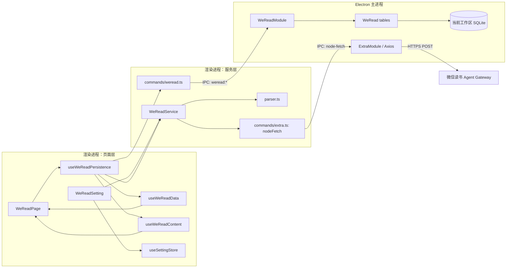
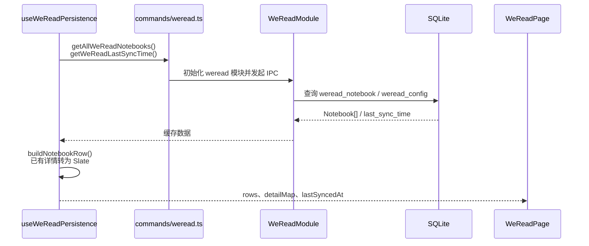
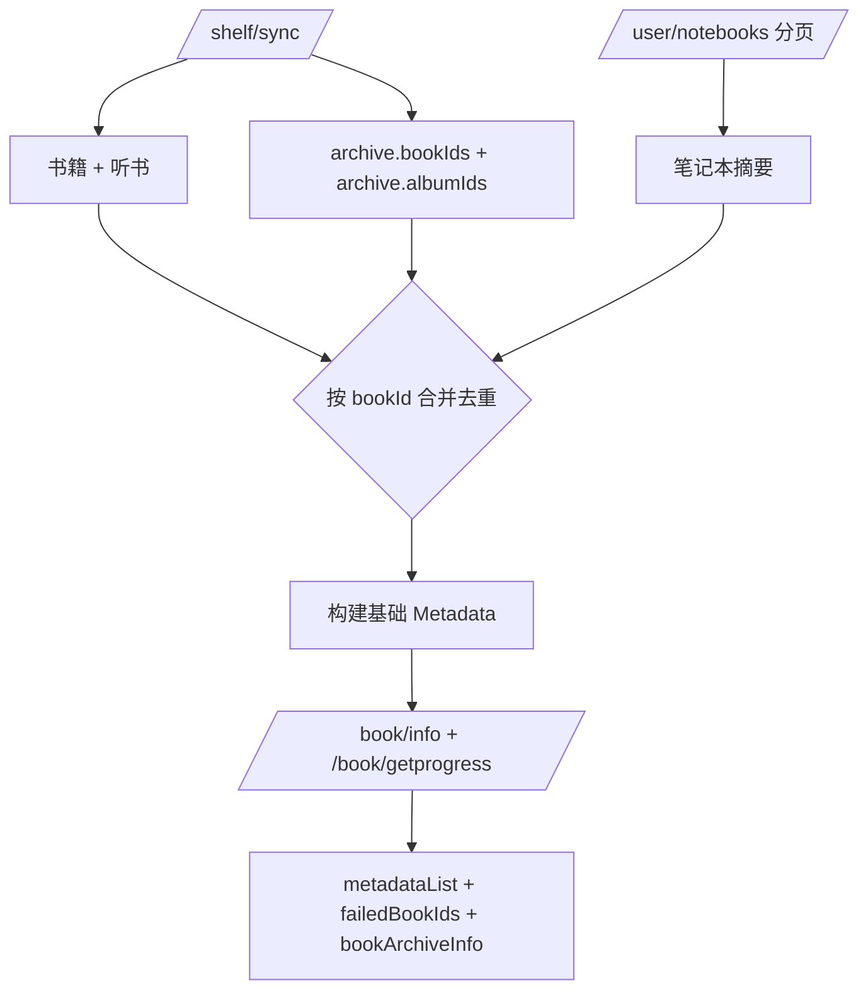
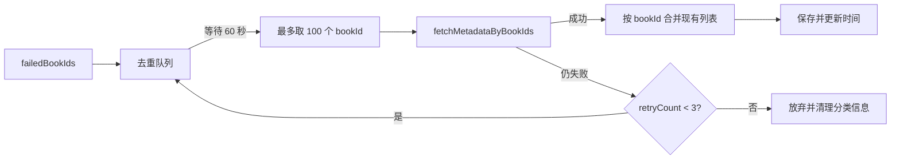
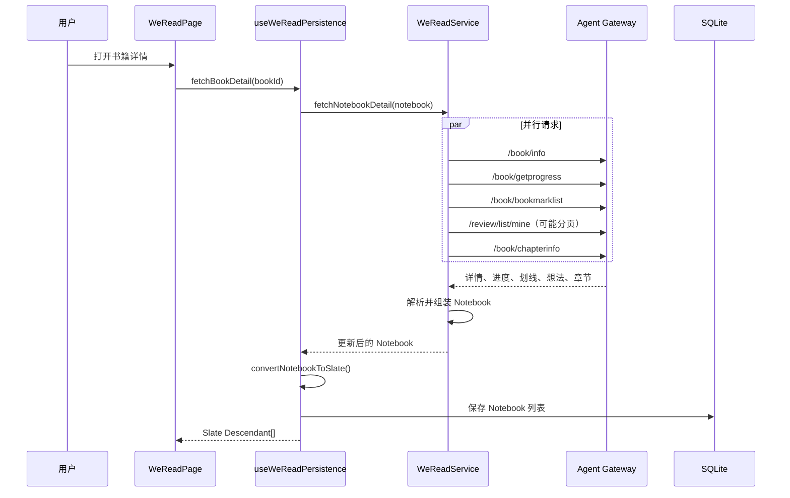
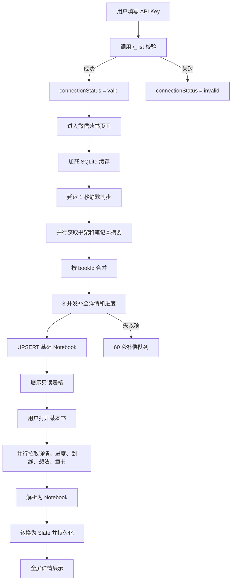

# 微信读书数据流

> 本文基于 2026-09-05 的当前代码实现整理。微信读书已经从 Cookie、二维码登录和 `/web/*` 直连迁移到官方 API Key + Agent Gateway；本文不再描述旧链路。

## 1. 范围与结论

当前微信读书模块包含四条主要数据链路：

1. API Key 保存与会话校验。
2. 书架和笔记本摘要的全量元数据同步。
3. 元数据失败项的后台补偿同步。
4. 用户打开书籍时，按需拉取划线、想法和章节详情。

最重要的架构事实是：

- 鉴权凭证是设置中的 `apiKey`，不存在二维码登录、Cookie 管理或 Cookie 刷新。
- 所有微信读书业务请求都发往 `https://i.weread.qq.com/api/agent/gateway`。
- 渲染进程不直接发网络请求，而是通过通用 `node-fetch` IPC 交给 Electron 主进程中的 Axios 执行。
- 全量同步只拉取书籍元数据；划线、想法和章节在打开某本书时按需拉取。
- SQLite 是持久化缓存，React state 是当前页面的运行时镜像，Zustand 保存 API Key 和连接状态。

## 2. 总体架构



职责划分如下：

| 层级                                | 主要职责                                                          |
| ----------------------------------- | ----------------------------------------------------------------- |
| `WeReadSetting` / `useSettingStore` | 保存 API Key，维护连接状态                                        |
| `WeReadService`                     | 组装网关请求、分页、并发控制、响应归一化、元数据和详情构建        |
| `parser.ts`                         | 将网关响应转换为内部 `Metadata`、`Highlight`、`Review` 和章节结构 |
| `useWeReadPersistence`              | 编排缓存加载、全量同步、失败重试、详情拉取和页面 state            |
| `commands/weread.ts`                | 确保主进程模块就绪并封装 `weread:*` IPC 调用                      |
| `WeReadModule` / tables             | 读写当前工作区的 SQLite 数据库                                    |
| `useWeReadData`                     | 将 `Notebook` 映射为数据库表格行                                  |
| `useWeReadContent`                  | 将 `Notebook` 转换为 Slate 详情内容                               |

## 3. API Key 与连接状态

### 3.1 配置入口

用户在 `pages/Settings/IntegrationSetting/WeReadSetting.tsx` 中填写 API Key。点击“保存并校验”后：

1. `updateWeReadApiKey()` 将去除首尾空格后的值写入 `setting.integration.weread.apiKey`。
2. `enabled` 根据 API Key 是否为空同步更新。
3. `weReadService.validateSession()` 调用网关的 `/_list`。
4. 校验期间状态为 `checking`。
5. 成功后状态为 `valid`，并写入 `lastValidatedAt`；失败后状态为 `invalid`，错误信息写入 `statusReason`。

API Key 的获取页由设置页面通过外部浏览器打开：

```text
https://weread.qq.com/r/weread-skills
```

### 3.2 启动校验

`App.tsx` 挂载 `useWeReadSessionBootstrap()`。满足以下条件时，应用启动后自动校验一次：

- 设置已经初始化；
- API Key 非空；
- 微信读书主进程模块状态为 `READY`；
- `connectionStatus === "unknown"`；
- `lastValidatedAt === 0`。

持久化设置快照会保留 API Key，但会把以下运行时字段归一化：

```text
connectionStatus = "unknown"
lastValidatedAt = 0
statusReason = ""
userInfo.isConnected = false
```

因此，每次重新启动都以 API Key 为依据重新确认连接，而不是复用上次运行时的“已连接”状态。

### 3.3 页面连接判定

微信读书页面只有同时满足以下两个条件才认为已连接：

```typescript
Boolean(weread.apiKey.trim()) && weread.connectionStatus === "valid";
```

本地已有缓存时，即使当前未连接，页面仍可展示缓存行；只是不能执行新的同步。

## 4. 网关请求协议

### 4.1 固定请求格式

`WeReadService.gatewayRequest()` 统一构造请求：

```http
POST https://i.weread.qq.com/api/agent/gateway
Authorization: Bearer <apiKey>
Content-Type: application/json
```

```json
{
  "api_name": "/shelf/sync",
  "skill_version": "1.0.4"
}
```

业务参数与 `api_name`、`skill_version` 一起放在 JSON body 中。`nodeFetch()` 通过 `node-fetch` IPC 把请求交给主进程，主进程使用 Axios 发出请求；这样可以绕过渲染进程的 CORS 限制。

### 4.2 当前使用的 API

| `api_name`           | 参数                              | 用途                       | 调用时机             |
| -------------------- | --------------------------------- | -------------------------- | -------------------- |
| `/_list`             | 无                                | 校验 API Key               | 设置页保存、应用启动 |
| `/shelf/sync`        | 无                                | 获取书籍、听书和书架分类   | 全量元数据同步       |
| `/user/notebooks`    | `count: 100`、可选 `lastSort`     | 获取有笔记书籍的摘要和计数 | 全量同步、失败补偿   |
| `/book/info`         | `bookId`                          | 获取书籍详情               | 元数据补全、详情加载 |
| `/book/getprogress`  | `bookId`                          | 获取阅读进度和时长         | 元数据补全、详情加载 |
| `/book/bookmarklist` | `bookId`                          | 获取划线及响应中的章节信息 | 详情加载             |
| `/review/list/mine`  | `bookid`、`synckey`、`count: 100` | 获取个人想法和书评         | 详情加载             |
| `/book/chapterinfo`  | `bookId`                          | 获取章节列表               | 详情加载             |

`/user/notebooks` 使用最后一项的 `sort` 作为下一页 `lastSort`，直到 `hasMore !== 1` 或本页为空。`/review/list/mine` 使用返回的 `synckey` 翻页；如果新 `synckey` 没有增长，会停止翻页，避免死循环。

### 4.3 响应和错误

网关响应可以同时包含业务数据及以下控制字段：

```typescript
{
  errcode?: number;
  errmsg?: string;
  upgrade_info?: {
    message?: string;
    latest_version?: string;
    current_version?: string;
    upgrade_url?: string;
  };
}
```

当前映射规则：

| 条件                         | 结果                         |
| ---------------------------- | ---------------------------- |
| HTTP `401`、`403`            | `WeReadSessionExpiredError`  |
| HTTP `429`、`499`            | `WeReadRateLimitError`       |
| `errcode === -10102`         | `WeReadRateLimitError`       |
| `errcode === -2011`、`-2012` | `WeReadSessionExpiredError`  |
| 其他非零 `errcode`           | 普通 `Error`                 |
| 存在 `upgrade_info.message`  | 只记录警告，继续返回业务数据 |

## 5. 页面初始化与缓存加载

当当前数据库建立连接或切换时，`useDatabaseChangeEffect()` 触发：



缓存加载与网络连接解耦。加载完成后，如果会话有效，Hook 会延迟 1 秒执行一次静默全量同步；静默同步不显示进度和成功提示，失败只写控制台。每次数据库切换会重置这次静默同步标记。

## 6. 全量元数据同步

手动点击同步时，`syncFromWeRead()` 先检查 `isConnected`，然后调用 `syncAllBooks()`。静默同步和手动同步共用相同的数据获取与保存逻辑。

### 6.1 数据源合并

`getMetadataList()` 并行请求：

- `/shelf/sync`：包含普通书籍、听书专辑和书架分类。
- `/user/notebooks`：包含有笔记书籍的摘要、笔记数、想法数和书签数。

随后以 `bookId` 做并集：



基础元数据的优先级是：

1. 如果书籍出现在 `/user/notebooks`，优先使用笔记本摘要，因为它包含笔记、想法和书签计数。
2. 否则使用 `/shelf/sync` 中的书籍或听书信息。
3. 如果两个数据源都没有可用的基础对象，只能依赖 `/book/info` 和 `/book/getprogress` 从 `bookId` 构建。

书架分类会转为 `archiveId`、`archiveName` 并附加到最终元数据。听书的 `albumId` 作为 `bookId`，`bookType` 为 `2`。

### 6.2 元数据补全

每本书都会并行请求 `/book/info` 和 `/book/getprogress`，再合并字段：

- 书名、作者、封面、类型、出版信息、简介、ISBN、分类、出版社和字数来自 `/book/info`，缺失时保留基础值。
- `newRating > 0` 时除以 100 并保留一位小数。
- 阅读进度、阅读时长、开始时间、完成时间来自 `/book/getprogress`。
- `updateTime` 转换为 `lastReadDate`。
- `progress >= 100` 时 `markedStatus` 设为 `1`。
- 阅读时长优先使用 `recordReadingTime`，否则使用 `readingTime`。
- 网页链接优先保留已有 `webUrl`，否则根据书名生成微信读书搜索链接；没有书名时才生成旧格式 reader URL。

### 6.3 并发、进度和服务层重试

当前常量如下：

```typescript
METADATA_SYNC_CONCURRENCY = 3;
METADATA_SYNC_MAX_ATTEMPTS = 3;
METADATA_SYNC_BATCH_DELAY_MS = 500;
METADATA_SYNC_RETRY_BASE_DELAY_MS = 1000;
```

实现行为是：

- 每批最多并行处理 3 本书。
- 批次之间等待 500 ms。
- 单本书遇到限流时最多尝试 3 次，重试等待为 1 秒、2 秒。
- 会话失效错误直接使该书任务失败。
- 其他错误会继续尝试；最终补全失败但已有基础元数据时，返回基础元数据，而不是把该书记为失败。
- 没有任何可用元数据，或任务以 rejected 结束时，`bookId` 进入 `failedBookIds`。
- `onProgress` 在开始时报告 `0 / total`，之后每完成一本书更新一次。

### 6.4 保存与页面更新

全量同步成功后：

1. 每个 `Metadata` 被包装成只有基础信息的 `Notebook`，其 `chapterHighlights`、`bookReview` 都为空。
2. 新列表在 React state 中以 `replace = true` 替换旧列表。
3. `saveWeReadNotebooks()` 通过 IPC 批量 UPSERT 到 `weread_notebook`。
4. 当前毫秒时间戳写入 `weread_config.last_sync_time`。
5. `applyNotebookList()` 重建表格行、详情映射和 `databaseRefreshKey`。
6. `failedBookIds` 被加入后台补偿队列。

如果 `metadataList` 为空，本次同步不会覆盖本地数据，也不会更新时间。

## 7. 失败项补偿同步

Hook 层还有一套独立于服务层单本重试的延迟队列：



补偿同步的特点：

- 队列按 `bookId` 去重。
- 每 60 秒处理一批，每批最多 100 本。
- 调用 `fetchMetadataByBookIds()` 时会重新获取全部笔记本摘要，再只补全目标 `bookId`。
- 成功项以 `replace = false` 合并到当前列表并持久化。
- 失败项由 `retryCountRef` 和 `MAX_RETRY_COUNT = 3` 控制重新入队。
- 组件卸载时会清理待执行的计时器；队列只存在于内存，不跨应用重启。

## 8. 按需加载书籍详情

基础同步不会批量拉取所有划线和想法。用户每次打开一行详情时，页面都会调用 `fetchBookDetail(bookId)` 实时获取该书内容。

### 8.1 请求流程



### 8.2 划线、想法与章节组装

服务层的组装顺序是：

1. `parseHighlights()` 将书签响应转为 `Highlight[]`。
2. 划线优先按 `range + chapterUid` 匹配想法，找不到时再只按 `range` 匹配。
3. `parseReviews()` 将个人想法响应转为 `Review[]`。
4. `parseChapterResp()` 优先使用 `/book/chapterinfo`；如果章节为空但存在 `refMpInfos`，则构造公众号文章章节。
5. `parseChapterHighlightReview()` 按 `chapterUid` 聚合，只保留有划线或章节想法的章节，并按 `chapterIdx` 排序。
6. `parseChapterReviews()` 将 `type === 1` 归为章节想法，将 `type === 4` 归为全书笔记。

内部 `Notebook` 结构为：

```typescript
interface Notebook {
  metaData: Metadata;
  chapterHighlights: ChapterHighlightReview[];
  bookReview: {
    chapterReviews: ChapterReview[];
    bookReviews: Review[];
  };
}
```

### 8.3 Slate 转换与缓存保护

`convertNotebookToSlate()` 生成：

- 一个 `weread-metadata` 元信息节点；
- 每个有内容的章节对应一个 `weread-chapter` 节点；
- 章节内的划线与同 `range` 想法合并为 `weread-bookmark` 节点；
- 全书笔记先组装为 Markdown，再转换为普通 Slate 节点；
- 没有划线和笔记时追加“该书暂无划线和笔记”。

详情拉取成功但返回空内容时，`preferNonEmptyNotebookDetail()` 会保留已有非空缓存，避免瞬时空响应覆盖有效详情。请求失败时按以下顺序降级：

1. 返回当前 `detailMap[bookId]`；
2. 如果 SQLite 加载出的 Notebook 含详情，将其转换为 Slate；
3. 否则返回 `null`，页面提示暂无详细笔记。

## 9. 表格行映射

`useWeReadData.buildNotebookRow()` 把 `Notebook.metaData` 转成只读数据库表格行：

| 行字段            | 来源或计算规则                                                                           |
| ----------------- | ---------------------------------------------------------------------------------------- |
| `id`              | `bookId`                                                                                 |
| `title`、`author` | 书籍元数据                                                                               |
| `cover`           | 转成单元素图片数组                                                                       |
| `link`            | `webUrl`，其次 `url`                                                                     |
| `reading_status`  | 完成时间或进度 100 为 `finished`；有进度、时长或开始时间为 `reading`；否则 `not_started` |
| `archive`         | `archiveName`                                                                            |
| `publisher`       | 出版社                                                                                   |
| `description`     | 简介，缺失时为“暂无简介”                                                                 |
| `progress`        | 限制在 0 到 100                                                                          |
| `reading_time`    | 秒数除以 60 后四舍五入                                                                   |
| `finished_date`   | Unix 秒转 `YYYY-MM-DD HH:mm`                                                             |

表格不允许增加、删除列或行；视图筛选、排序和列配置由 `useWeReadViews()` 与 `weread_view`、`weread_config` 维护。

## 10. SQLite 持久化

### 10.1 `weread_notebook`

`book_id` 是主键。数据大致分为四组：

| 分组       | 主要列                                                                                                                                              |
| ---------- | --------------------------------------------------------------------------------------------------------------------------------------------------- |
| 书籍元数据 | `title`、`author`、`cover`、`intro`、`category`、`publisher`、`isbn`、`total_words`、`rating`、`book_type`、`publish_time`                          |
| 汇总与分类 | `note_count`、`review_count`、`bookmark_count`、`archive_name`、`last_read_date`、`url`、`pc_url`                                                   |
| 阅读状态   | `reading_progress`、`reading_time`、`reading_book_date`、`finished_date`、`marked_status`、`total_read_day`、`continue_read_days`、`reading_status` |
| 详情与同步 | `synckey_*`、`chapter_highlights`、`book_review`、`created_at`、`updated_at`                                                                        |

`chapter_highlights` 和 `book_review` 以 JSON 文本保存。批量保存使用 `better-sqlite3` transaction，逐个执行 UPSERT。

当前索引包括：

```sql
idx_weread_notebook_title
idx_weread_notebook_reading_status
idx_weread_notebook_last_read_date
idx_weread_notebook_updated_at
```

### 10.2 `weread_config`

键值表，当前微信读书主链路使用：

- `last_sync_time`：最近一次成功保存元数据的毫秒时间戳。
- `active_view_id`：当前激活的数据表视图。

### 10.3 `weread_view`

保存数据表视图的名称、类型、顺序和 JSON 配置。该表只影响展示方式，不参与微信读书远端数据同步。

## 11. 当前实现边界

以下是理解和维护当前代码时需要注意的真实行为：

1. **全量同步不是详情同步。** 全量同步创建的 Notebook 详情为空；打开书籍后才会实时获取划线和想法。
2. **全量同步会清空已同步书籍的详情字段。** 新的基础 Notebook 会通过 UPSERT 写入空的 `chapter_highlights` 和 `book_review`；详情需要再次打开书籍恢复。
3. **内存替换不等于数据库删除。** 全量同步在页面 state 中替换列表，但 `saveMany()` 只 UPSERT，不删除远端已不存在的旧行；重新加载数据库后旧行仍可能出现。
4. **详情保存会重写整个当前列表。** 打开一本书后，Hook 调用 `saveWeReadNotebooks(merged)`，而不是只保存该书。
5. **部分列在冲突更新时不会刷新。** `weread_notebook` 的 UPSERT 更新列表目前不包含 `book_type`、`publish_time`、`url` 和 `pc_url`。
6. **连接失效状态主要由校验流程更新。** `gatewayRequest()` 会抛出会话失效错误；`errors.ts` 中存在统一状态清理函数，但当前请求主链路没有调用它，因此普通同步失败不一定立即把 Zustand 状态改为 `invalid`。
7. **补偿队列不持久化。** 关闭页面或重启应用后，未完成的失败项队列会丢失，之后依赖下一次全量同步重新发现。
8. **遗留文件不在当前主链路。** `services/weread/shelf-parser.ts` 和 `services/weread/sync-manager.ts` 仍在仓库中，但没有被当前 `WeReadService` 导入；不要据此推断现行同步行为。

## 12. 关键文件索引

| 作用                 | 文件                                                                   |
| -------------------- | ---------------------------------------------------------------------- |
| 网关客户端与数据编排 | `apps/desktop/src/services/weread/index.ts`                            |
| 响应解析与网页链接   | `apps/desktop/src/services/weread/parser.ts`                           |
| 错误类型             | `apps/desktop/src/services/weread/errors.ts`                           |
| 微信读书类型         | `apps/desktop/src/types/weread.ts`                                     |
| API Key 设置页       | `apps/desktop/src/pages/Settings/IntegrationSetting/WeReadSetting.tsx` |
| 启动校验 Hook        | `apps/desktop/src/hooks/useWeReadSessionBootstrap.ts`                  |
| 页面入口             | `apps/desktop/src/pages/WeRead/index.tsx`                              |
| 同步和缓存编排       | `apps/desktop/src/pages/WeRead/hooks/useWeReadPersistence.ts`          |
| 表格行映射           | `apps/desktop/src/pages/WeRead/hooks/useWeReadData.ts`                 |
| Slate 内容转换       | `apps/desktop/src/pages/WeRead/hooks/useWeReadContent.ts`              |
| 渲染进程数据库命令   | `apps/desktop/src/commands/weread.ts`                                  |
| 通用网络 IPC 客户端  | `apps/desktop/src/commands/extra.ts`                                   |
| 主进程通用网络模块   | `apps/desktop/src-electron/main/modules/extra.ts`                      |
| 微信读书 IPC 模块    | `apps/desktop/src-electron/main/modules/weread.ts`                     |
| Notebook 表实现      | `apps/desktop/src-electron/main/modules/tables/weread-notebook.ts`     |
| 配置表实现           | `apps/desktop/src-electron/main/modules/tables/weread-config.ts`       |
| 视图表实现           | `apps/desktop/src-electron/main/modules/tables/weread-view.ts`         |
| Schema 源文件        | `packages/db-schema/schema/main/50_learning.sql`                       |
| 索引源文件           | `packages/db-schema/schema/main/90_indexes.sql`                        |

## 13. 一次完整用户路径


