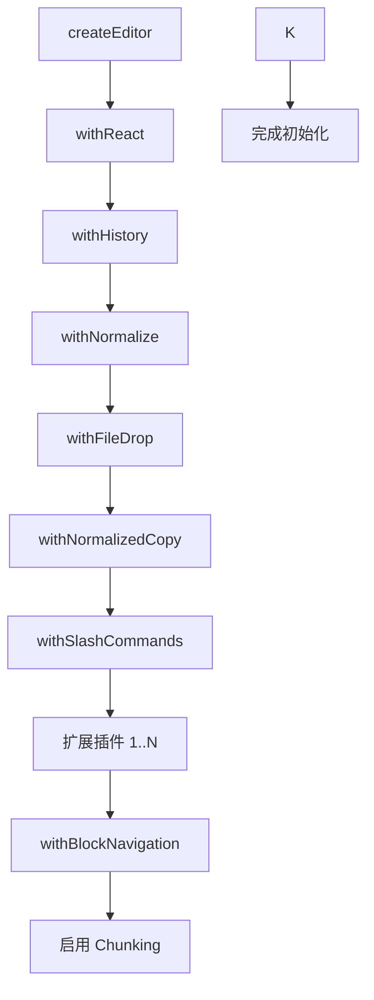
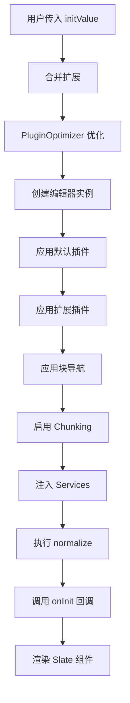

# @tau/editor 架构文档

> 本文档是编辑器内核的深度手册（项目概述、核心架构、扩展系统、开发新扩展、功能模块、Markdown、性能、服务注入、工具函数、Bug 指南）。当前权威边界与公开入口见 [包 README](../README.md)（核心与扩展边界、公开入口两节）；与本手册冲突处以包 README 与代码为准。

# 编辑器技术文档

> 本文档详细介绍了基于 Slate.js 构建的富文本编辑器的完整技术实现，包括核心架构、插件系统、Markdown 导入导出机制，以及如何开发新功能和修复 Bug 的完整指南。

**适用人群**: 前端开发者、技术架构师、新功能开发者

---

## 一、项目概述

### 1.1 技术栈简介

这是一个基于 **Slate.js** 构建的高度可扩展的富文本编辑器，采用现代化的前端技术栈：

| 技术              | 版本     | 用途                  |
| ----------------- | -------- | --------------------- |
| **slate**         | ^0.123.0 | 核心编辑器框架        |
| **slate-react**   | ^0.123.0 | React 绑定层          |
| **slate-history** | ^0.113.1 | 撤销/重做历史记录管理 |
| **React**         | 19.1.x   | UI 框架               |
| **TypeScript**    | -        | 类型安全              |
| **zustand**       | ^4.3.8   | 轻量级状态管理        |
| **antd**          | ^6.0.0   | UI 组件库             |
| **codemirror**    | 5        | 代码编辑器            |
| **katex**         | ^0.16.8  | 数学公式渲染          |
| **mermaid**       | ^10.1.0  | 图表渲染              |
| **unified**       | ^11.0.5  | Markdown 处理         |

### 1.2 核心特性

1. **插件化架构**: 使用高阶函数链式增强编辑器能力
2. **44 个内置扩展 + 应用级业务扩展**: 支持文本、代码、数学、图表、多媒体、布局等多种元素类型；白板、数据库等业务扩展由宿主应用注入
3. **性能优化**: Chunking (分块渲染)、PluginOptimizer (缓存)、Content Visibility
4. **Markdown 双向转换**: 完整的导入导出支持，包括自定义语法
5. **服务注入**: 通过 token 化 ServiceRegistry 解耦外部依赖，宿主应用注入实现
6. **块导航**: Void 元素智能键盘导航
7. **类型安全**: 完善的 TypeScript 类型系统，业务元素类型经声明合并注入

### 1.3 目录结构

```
packages/editor/                          # 编辑器核心包
├── src/
│   ├── index.tsx                         # 主入口，导出编辑器组件
│   ├── index.ts                          # 类型和工具导出
│   ├── types/                            # 类型定义 (40+ 元素类型)
│   │   ├── editor.ts                     # 编辑器核心类型
│   │   ├── custom-element.ts             # 自定义元素联合类型
│   │   ├── text.ts                       # 格式化文本类型
│   │   ├── services.ts                   # 服务接口定义
│   │   └── element/                      # 各类元素的类型定义
│   ├── extensions/                       # 扩展系统 (44个内置扩展)
│   │   ├── index.ts                      # 扩展注册中心
│   │   ├── base.ts                       # 扩展基类
│   │   ├── types.ts                      # IExtension 接口
│   │   ├── paragraph/                    # 段落扩展
│   │   ├── header/                       # 标题扩展
│   │   ├── code-block/                   # 代码块扩展
│   │   ├── audio/                        # 音频扩展
│   │   ├── video/                        # 视频扩展
│   │   └── ...                           # 其他 40+ 内置扩展
│   ├── plugins/                          # 核心插件
│   │   ├── withNormalize.ts              # 规范化插件
│   │   ├── withSlashCommands.ts          # 斜杠命令插件
│   │   └── withBlockNavigation.ts        # 块导航插件
│   ├── utils/                            # 工具函数
│   │   ├── plugin.ts                     # 插件应用工具
│   │   ├── PluginOptimizer.ts            # 插件优化器 (缓存)
│   │   ├── editor.ts                     # 编辑器操作工具
│   │   ├── element.ts                    # 元素判断工具
│   │   ├── insertElement.ts              # 元素插入工具 (940行)
│   │   ├── blockNavigation.ts            # 块导航工具
│   │   └── hotkey.ts                     # 快捷键注册器
│   ├── components/                       # 通用组件
│   │   ├── HoveringToolbar/              # 悬浮工具栏
│   │   ├── BlockPanel/                   # 块面板 (/)
│   │   ├── FormattedText/                # 格式化文本渲染器
│   │   └── ...
│   ├── stores/                           # Zustand 状态管理
│   │   └── useBlockPanelStore.ts         # 块面板状态
│   ├── services/                         # 服务注册表 (ServiceRegistry DI)
│   │   ├── tokens.ts                     # 服务 token 定义
│   │   ├── registry.ts                   # 注册表实现
│   │   └── hooks.ts                      # 服务访问 Hooks
│   ├── hotkeys/                          # 全局快捷键配置
│   └── constants/                        # 常量定义
└── package.json

apps/desktop/src/utils/                   # Markdown 工具 (在应用层)
├── markdown.ts                           # Markdown 导入主函数
├── markdown-helper.ts                    # Markdown 导出主函数
└── markdownSerializerRegistry.ts         # 序列化器注册中心
```

**统计数据**:

- TypeScript/TSX 文件: 485 个
- 内置扩展数量: 44 个（另有应用级业务扩展）
- 元素类型: 46 种内置 + 业务扩展注入
- 核心插件: 7 个
- 代码行数: 20,000+ 行

---

## 二、核心架构

### 2.1 基于 Slate.js 的实现

#### Slate.js 核心概念

Slate.js 是一个完全可定制的富文本编辑器框架，采用不可变数据模型，编辑器内容表示为一棵树：

```
Editor (根节点)
  └─ Element (块级或内联元素)
      └─ Text (叶子节点，包含格式化信息)
```

**自定义类型扩展** (`packages/editor/src/types/editor.ts:22`):

```typescript
export type CustomEditor = BaseEditor & ReactEditor & HistoryEditor & CustomField;

declare module "slate" {
  interface CustomTypes {
    Editor: CustomEditor; // 自定义编辑器类型
    Element: CustomElement; // 内置元素类型 + 应用扩展注入的业务元素
    Text: CustomText; // 格式化文本类型
  }
}

// 自定义编辑器字段
export interface CustomField {
  getService: <T>(id: ServiceIdentifier<T>) => T; // 非 React 代码获取必选服务，未注册时抛错
  tryGetService: <T>(id: ServiceIdentifier<T>) => T | undefined; // 获取可选服务
  handleDrop?: (files: FileList, point: Point) => Promise<void>; // 文件拖放
  getChunkSize?: (node: Node) => number | null; // Chunking 配置
}
```

### 2.2 插件管道模式

#### 插件类型定义

**文件位置**: `packages/editor/src/utils/plugin.ts:5`

```typescript
export type Plugin = (editor: Editor) => Editor;

export const applyPlugin = (editor: Editor, plugins: Plugin[]) => {
  return plugins.reduce((acc, plugin) => plugin(acc), editor);
};
```

插件是一个高阶函数，接收一个编辑器实例，返回增强后的编辑器实例。通过函数组合的方式，可以链式应用多个插件。

#### 编辑器初始化流程

**文件位置**: `packages/editor/src/index.tsx:150-165`

```typescript
// 1. 合并扩展
const finalExtensions: IExtension[] = useMemo(() => {
  if (!extensions) return disableStartExtensions ? [] : startExtensions;
  return disableStartExtensions ? extensions : [...startExtensions, ...extensions];
}, [extensions, disableStartExtensions]);

// 2. 优化扩展数据 (通过 PluginOptimizer 缓存)
const optimizedExtensionData = useMemo(() => {
  return pluginOptimizer.optimizeExtensions(finalExtensions);
}, [finalExtensions]);

// 3. 创建编辑器实例并应用插件
const editor = useCreation(() => {
  // 3.1 应用默认插件
  const processedEditor = applyPlugin(createEditor(), defaultPlugins);

  // 3.2 应用扩展插件
  const finalEditor = applyPlugin(processedEditor, optimizedExtensionData.plugins);

  // 3.3 应用块导航增强
  const enhancedEditor = withBlockNavigation(finalEditor);

  // 3.4 启用 Chunking 优化
  enhancedEditor.getChunkSize = node => (Editor.isEditor(node) ? 100 : null);

  return enhancedEditor;
}, [optimizedExtensionData.plugins]);
```

**默认插件列表** (`packages/editor/src/index.tsx:110`):

```typescript
const defaultPlugins: Plugin[] = [
  withReact, // React 适配层
  withHistory, // 历史记录 (撤销/重做)
  withNormalize, // 数据规范化
  withFileDrop, // 文件拖放
  withNormalizedCopy, // 复制规范化
  withSlashCommands, // 斜杠命令处理
];
```

**流程图**:



### 2.3 数据模型（CustomElement 类型系统）

#### BuiltinElementMap 与 ExternalElementMap

**文件位置**: `packages/editor/src/types/custom-element.ts`

元素类型由两个键值映射交叉组成：核心包通过 `BuiltinElementMap`（46 种内置元素类型）定义通用元素；业务元素（白板、数据库、对话引用、闪卡填空等）由宿主应用通过模块声明合并（declaration merging）注入开放的 `ExternalElementMap`，核心包对业务元素类型零依赖。

```typescript
export interface BuiltinElementMap {
  // 基础文本元素
  paragraph: ParagraphElement; // 段落
  header: HeaderElement; // 标题 (h1-h6)
  blockquote: BlockquoteElement; // 引用块

  // 列表元素
  "bulleted-list": BulletedListElement; // 无序列表
  "numbered-list": NumberedListElement; // 有序列表
  "list-item": ListItemElement; // 列表项
  "check-list": CheckListElement; // 待办清单
  "check-list-item": CheckListItemElement; // 待办项

  // 代码和技术内容
  "code-block": CodeBlockElement; // 代码块
  "html-block": HTMLBlockElement; // HTML 块
  "html-inline": HTMLInlineElement; // 行内 HTML
  "custom-block": CustomBlockElement; // 自定义 React 组件块

  // 数学和图表
  "inline-math": InlineMathElement; // 行内数学公式
  "block-math": BlockMathElement; // 块级数学公式
  mermaid: MermaidElement; // Mermaid 图表
  tikz: TikzElement; // TikZ 图形
  typst: TypstElement; // Typst 排版
  abc: AbcElement; // ABC 音乐记谱
  plantuml: PlantUMLElement; // PlantUML 图

  // 多媒体
  image: ImageElement; // 块级图片
  "inline-image": InlineImageElement; // 行内图片
  "image-gallery": ImageGalleryElement; // 图片画廊
  audio: AudioElement; // 音频
  video: VideoElement; // 视频

  // 布局和容器
  table: TableElement; // 表格
  "table-row": TableRowElement; // 表格行
  "table-cell": TableCellElement; // 表格单元格
  detail: DetailElement; // 折叠详情
  callout: CalloutElement; // 提示框
  "highlight-block": HighlightBlockElement; // 高亮块
  tabs: TabsElement; // 标签页
  "tab-pane": TabPaneElement; // 标签页面板

  // 富文本
  link: LinkElement; // 链接
  underline: UnderlineElement; // 下划线
  "styled-text": StyledTextElement; // 样式文本
  comment: CommentElement; // 注释
  annotation: AnnotationElement; // 注解
  emoji: EmojiElement; // 表情符号
  kbd: KbdElement; // 键盘按键

  // 特殊功能
  "divide-line": DivideLineElement; // 分割线
  "front-matter": FrontMatterElement; // Front Matter
}

// 开放插槽：宿主应用通过 declaration merging 注入业务元素类型
export interface ExternalElementMap {
  [__externalElementMapBrand]: never;
}

export type CustomElement = (BuiltinElementMap & ExternalElementMap)[keyof (BuiltinElementMap &
  ExternalElementMap)];
```

**业务元素类型注入示例**（应用层，`apps/desktop/src/editor-extensions/augmentations.d.ts`）:

```typescript
import type { WhiteboardElement } from "./whiteboard/types";
import type { DatabaseElement } from "./database/types";

declare module "@tau/editor/src/types/custom-element" {
  interface ExternalElementMap {
    whiteboard: WhiteboardElement; // 白板
    database: DatabaseElement; // 数据库视图
  }
}
```

#### InlineElement 行内元素

```typescript
export interface BuiltinInlineElementMap {
  link: LinkElement;
  "inline-math": InlineMathElement;
  underline: UnderlineElement;
  "styled-text": StyledTextElement;
  "html-inline": HTMLInlineElement;
  "inline-image": InlineImageElement;
  kbd: KbdElement;
  emoji: EmojiElement;
  annotation: AnnotationElement;
}

export interface ExternalInlineElementMap {
  [__externalInlineElementMapBrand]: never;
}

export type InlineElement = (BuiltinInlineElementMap &
  ExternalInlineElementMap)[keyof (BuiltinInlineElementMap & ExternalInlineElementMap)];

// 块级元素
export type BlockElement = Exclude<CustomElement, InlineElement>;
```

#### FormattedText 格式化文本

**文件位置**: `packages/editor/src/types/text.ts:5`

```typescript
export interface FormattedText {
  type: "formatted";
  text: string;

  // 基础格式
  bold?: boolean; // 粗体
  italic?: boolean; // 斜体
  underline?: boolean; // 下划线
  strikethrough?: boolean; // 删除线
  code?: boolean; // 行内代码

  // 颜色和高亮
  color?: string; // 浅色模式文字颜色
  darkColor?: string; // 深色模式文字颜色
  highlight?: boolean | HighlightColor; // 高亮背景
}

type HighlightColor = "blue" | "yellow" | "green" | "red" | "purple";
```

#### 元素示例

**段落元素** (`packages/editor/src/types/element/paragraph.ts:3`):

```typescript
export interface ParagraphElement {
  type: "paragraph";
  disableDrag?: boolean; // 禁用拖拽
  children: (FormattedText | InlineElement)[];
}
```

**代码块元素** (`packages/editor/src/types/element/code-block.ts:4`):

```typescript
export interface CodeBlockElement {
  type: "code-block";
  code: string; // 代码内容
  language: string; // 语言标识 (JAVASCRIPT, PYTHON 等)
  uuid: string; // 唯一标识 (用于 CodeMirror 实例映射)
  children: FormattedText[];
}
```

**标题元素** (`packages/editor/src/types/element/header.ts:5`):

```typescript
export interface HeaderElement {
  type: "header";
  level: 1 | 2 | 3 | 4 | 5 | 6;
  collapsed?: boolean; // 是否折叠子内容
  children: (FormattedText | InlineElement)[];
}
```

**音频元素** (`packages/editor/src/types/element/audio.ts:3`):

```typescript
export interface AudioElement {
  type: "audio";
  src: string; // 音频 URL
  uploading?: boolean; // 是否正在上传
  isFromGenerate?: boolean; // 是否由 AI 生成
  audioText?: string; // 音频对应的文本
  children: FormattedText[];
}
```

### 2.4 初始化和渲染流程

#### 完整初始化流程



#### 渲染流程

**Slate 组件结构** (`packages/editor/src/index.tsx:350-360`):

```tsx
<Slate editor={editor} initialValue={initValue} onChange={handleOnChange}>
  <Editable
    renderElement={renderElement} // 渲染块级/内联元素
    renderLeaf={renderLeaf} // 渲染文本叶子节点
    renderChunk={renderChunk} // 渲染 chunk 容器 (性能优化)
    onKeyDown={registerHotKey} // 快捷键处理
    readOnly={readonly}
    spellCheck={false}
  />
  <ImagesOverview /> {/* 图片预览组件 */}
  <HoveringToolbar /> {/* 悬浮工具栏 */}
  <BlockPanel /> {/* 块面板 (/) */}
</Slate>
```

**renderElement 实现** (`packages/editor/src/index.tsx:280`):

```typescript
const renderElement = useMemoizedFn((props: RenderElementProps) => {
  const { type } = props.element;
  const extension = pluginOptimizer.getExtension(type);

  if (extension) {
    return extension.render(props);  // 调用扩展的 render 方法
  }

  return <span>无法识别的类型 {type}</span>;
});
```

**renderLeaf 实现** (`packages/editor/src/index.tsx:290`):

```typescript
const renderLeaf = useMemoizedFn((props: RenderLeafProps) => {
  return (
    <FormattedText leaf={props.leaf} attributes={props.attributes}>
      {props.children}
    </FormattedText>
  );
});
```

**renderChunk 实现** (`packages/editor/src/index.tsx:300`):

```typescript
const renderChunk = ({ attributes, children, lowest }: RenderChunkProps) => {
  const style: CSSProperties = {
    // 仅对最底层 chunk 应用 content-visibility
    contentVisibility: lowest ? "auto" : undefined,
  };
  return <div {...attributes} style={style}>{children}</div>;
};
```

#### 规范化处理

**文件位置**: `packages/editor/src/index.tsx:195`

```typescript
useEffect(() => {
  if (!isNormalized) {
    Editor.normalize(editor, { force: true });
    setIsNormalized(true);
  }
}, [isNormalized, editor]);
```

规范化确保编辑器内容符合 Slate 的数据约束，例如：

- 所有文本节点必须有 `type: "formatted"` 属性
- void 元素后必须有零宽字符以支持光标定位
- 空的块级元素会被清理或添加默认子节点

---

## 三、扩展系统深度解析

### 3.1 IExtension 接口

**文件位置**: `packages/editor/src/extensions/types.ts:10`

```typescript
export default interface IExtension {
  // 元素类型标识 (必须与 CustomElement 中的 type 一致)
  type: string;

  // 返回 Slate 插件列表
  getPlugins: () => Plugin[];

  // 渲染函数 (接收 Slate 的 RenderElementProps)
  render: (props: RenderElementProps) => JSX.Element;

  // 快捷键配置
  getHotkeyConfigs: () => IHotKeyConfig[];

  // 块面板项配置 (斜杠命令)
  getBlockPanelItems: () => IBlockPanelListItem[];

  // 悬浮工具栏元素配置
  getHoveringBarElements: () => IConfigItem[];
}
```

**扩展基类** (`packages/editor/src/extensions/base.ts:5`):

```typescript
export default class Base implements Omit<IExtension, "render"> {
  type = "base";

  getPlugins() {
    return [] as Plugin[];
  }

  getHotkeyConfigs() {
    return [] as IHotKeyConfig[];
  }

  getBlockPanelItems() {
    return [] as IBlockPanelListItem[];
  }

  getHoveringBarElements() {
    return [] as IConfigItem[];
  }
}
```

所有扩展都应该继承 `Base` 类，然后根据需要覆盖相应的方法。

### 3.2 扩展注册和加载

#### 扩展注册

**文件位置**: `packages/editor/src/extensions/index.ts:50`

```typescript
// 1. 创建扩展实例
export const paragraph = new ParagraphExtension();
export const underline = new UnderlineExtension();
export const header = new HeaderExtension();
export const image = new ImageExtension();
export const inlineImage = new InlineImageExtension();
export const imageGallery = new ImageGalleryExtension();
export const bulletedList = new BulletedListExtension();
export const checkList = new CheckListExtension();
export const checkListItem = new CheckListItemExtension();
export const numberedList = new NumberedListExtension();
export const listItem = new ListItemExtension();
export const codeBlock = new CodeBlockExtension();
export const tabs = new TabsExtension();
export const tabPane = new TabPaneExtension();
export const detail = new DetailExtension();
export const link = new LinkExtension();
export const blockquote = new BlockquoteExtension();
export const blockMath = new BlockMathExtension();
export const inlineMath = new InlineMathExtension();
export const callout = new CalloutExtension();
export const table = new TableExtension();
export const tableRow = new TableRowExtension();
export const tableCell = new TableCellExtension();
export const mermaid = new MermaidExtension();
export const tikz = new TikzExtension();
export const typst = new TypstExtension();
export const highlightBlock = new HighlightBlockExtension();
export const customBlock = new CustomBlockExtension();
export const htmlBlock = new HtmlBlockExtension();
export const htmlInline = new InlineHtmlExtension();
export const divideLine = new DivideLineExtension();
export const video = new VideoExtension();
export const audio = new AudioExtension();
export const frontMatter = new FrontMatterExtension();
export const emoji = new EmojiExtension();
export const styledText = new StyledTextExtension();
export const annotation = new AnnotationExtension();
export const kbd = new KbdExtension();
export const abc = new AbcExtension();
export const plantuml = new PlantumlExtension();
export const comment = new CommentExtension();

// 2. 导出默认扩展列表
export const startExtensions = [
  paragraph,
  underline,
  header,
  image,
  inlineImage,
  imageGallery,
  bulletedList,
  checkList,
  checkListItem,
  numberedList,
  listItem,
  codeBlock,
  tabs,
  tabPane,
  detail,
  highlightBlock,
  inlineMath,
  blockMath,
  blockquote,
  callout,
  link,
  comment,
  divideLine,
  mermaid,
  htmlBlock,
  htmlInline,
  kbd,
  table,
  tableRow,
  tableCell,
  tikz,
  typst,
  customBlock,
  styledText,
  audio,
  video,
  frontMatter,
  emoji,
  annotation,
  abc,
  plantuml,
];
```

#### 应用级业务扩展

白板（whiteboard）、数据库（database）等与具体业务相关的扩展**不是核心包内置扩展**，位于应用层：

- **位置**: `apps/desktop/src/editor-extensions/`（whiteboard、database、chat-reference、file-attachment、question-card、content-link、flashcard-blank、document-card-list、project-card-list 等）
- **加载**: 桌面端通过 `apps/desktop/src/stores/useDynamicExtensionsStore.ts` 动态 `import()` 并实例化，在应用启动时（`main.tsx` 的 `initExtensions()`）填充 store
- **注入**: 宿主默认扩展通过 `<EditorProvider extensions={...}>` 按 React 树注入，单个编辑器可通过 `<Editor extensions={...}>` 增补；同一 `type` 按“内置 < Provider < Editor prop”覆盖
- **类型**: 元素类型定义在各扩展目录内（如 `whiteboard/types.ts`），通过 `apps/desktop/src/editor-extensions/augmentations.d.ts` 对核心包开放的 `ExternalElementMap` / `ExternalInlineElementMap` 做模块声明合并（declaration merging），核心包对业务元素类型零依赖

#### 扩展加载和优化

**PluginOptimizer** (`packages/editor/src/utils/PluginOptimizer.ts:10`):

```typescript
class PluginOptimizer {
  // 缓存
  private extensionCache = new Map<string, {...}>();
  private extensionMap = new Map<string, IExtension>();
  private pluginCache = new Map<string, Plugin[]>();
  private hotkeyCache = new Map<string, IHotKeyConfig[]>();
  private blockPanelCache = new Map<string, IBlockPanelListItem[]>();
  private hoveringBarCache = new Map<string, IConfigItem[]>();

  // 优化扩展数据
  optimizeExtensions(extensions: IExtension[]): {
    plugins: Plugin[];
    hotkeyConfigs: IHotKeyConfig[];
    blockPanelItems: IBlockPanelListItem[];
    hoveringBarElements: IConfigItem[];
  } {
    const cacheKey = this.generateCacheKey(extensions);

    // 检查缓存
    if (this.extensionCache.has(cacheKey)) {
      return this.extensionCache.get(cacheKey)!;
    }

    // 构建扩展数据
    const result = this.buildExtensionData(extensions);

    // 保存到缓存
    this.extensionCache.set(cacheKey, result);

    return result;
  }

  // 构建扩展数据
  private buildExtensionData(extensions: IExtension[]) {
    const plugins: Plugin[] = [];
    const hotkeyConfigs: IHotKeyConfig[] = [];
    const blockPanelItems: IBlockPanelListItem[] = [];
    const hoveringBarElements: IConfigItem[] = [];

    for (const extension of extensions) {
      // 缓存插件
      const pluginsKey = `${extension.type}_plugins`;
      if (!this.pluginCache.has(pluginsKey)) {
        this.pluginCache.set(pluginsKey, extension.getPlugins());
      }
      plugins.push(...this.pluginCache.get(pluginsKey)!);

      // 缓存快捷键
      const hotkeyKey = `${extension.type}_hotkey`;
      if (!this.hotkeyCache.has(hotkeyKey)) {
        this.hotkeyCache.set(hotkeyKey, extension.getHotkeyConfigs());
      }
      hotkeyConfigs.push(...this.hotkeyCache.get(hotkeyKey)!);

      // 缓存块面板项
      const blockPanelKey = `${extension.type}_blockPanel`;
      if (!this.blockPanelCache.has(blockPanelKey)) {
        this.blockPanelCache.set(blockPanelKey, extension.getBlockPanelItems());
      }
      blockPanelItems.push(...this.blockPanelCache.get(blockPanelKey)!);

      // 缓存悬浮工具栏项
      const hoveringBarKey = `${extension.type}_hoveringBar`;
      if (!this.hoveringBarCache.has(hoveringBarKey)) {
        this.hoveringBarCache.set(hoveringBarKey, extension.getHoveringBarElements());
      }
      hoveringBarElements.push(...this.hoveringBarCache.get(hoveringBarKey)!);

      // 保存扩展映射 (用于快速查找)
      this.extensionMap.set(extension.type, extension);
    }

    return { plugins, hotkeyConfigs, blockPanelItems, hoveringBarElements };
  }

  // 根据类型获取扩展
  getExtension(type: string): IExtension | undefined {
    return this.extensionMap.get(type);
  }

  // 生成缓存键
  private generateCacheKey(extensions: IExtension[]): string {
    const types = extensions.map(ext => ext.type).sort().join(",");
    return `ext_${this.simpleHash(types)}`;
  }
}

const pluginOptimizer = new PluginOptimizer(); // 每个 Editor 实例独立持有
```

### 3.3 44个内置扩展详解

#### 扩展分类

**基础编辑扩展 (8个)**:

| 扩展            | 类型 | 用途         | 关键特性                           |
| --------------- | ---- | ------------ | ---------------------------------- |
| paragraph       | 块级 | 段落         | 支持行内代码、Markdown 语法        |
| header          | 块级 | 标题 (1-6级) | 支持折叠、Markdown 快捷输入 (`# `) |
| blockquote      | 块级 | 引用块       | 支持嵌套、Markdown 语法 (`> `)     |
| bulleted-list   | 块级 | 无序列表     | 支持嵌套、图标定制                 |
| numbered-list   | 块级 | 有序列表     | 自动编号、支持嵌套                 |
| list-item       | 块级 | 列表项       | 支持 emoji 图标、自定义图标        |
| check-list      | 块级 | 待办清单     | 整体容器                           |
| check-list-item | 块级 | 待办项       | 复选框、支持嵌套                   |

**富文本扩展 (7个)**:

| 扩展        | 类型      | 用途     | 关键特性                                  |
| ----------- | --------- | -------- | ----------------------------------------- |
| link        | 行内      | 超链接   | 支持打开、编辑、复制链接                  |
| underline   | 行内/块级 | 下划线   | 支持颜色、线型 (solid/wavy/dotted/dashed) |
| styled-text | 行内      | 样式文本 | 自定义颜色                                |
| comment     | 行内      | 注释     | 支持查看、删除                            |
| annotation  | 行内      | 注解     | 脚注功能，转换为 Markdown 脚注            |
| emoji       | 行内      | 表情符号 | 原生 emoji 支持                           |
| kbd         | 行内      | 键盘按键 | 键盘按键样式 `<kbd>`                      |

> flashcard-blank（闪卡填空）为应用级业务扩展，位于 `apps/desktop/src/editor-extensions/flashcard-blank`，不属于核心包内置扩展。

**代码和技术内容扩展 (4个)**:

| 扩展         | 类型 | 用途         | 关键特性                            |
| ------------ | ---- | ------------ | ----------------------------------- |
| code-block   | 块级 | 代码块       | 语法高亮、主题切换、折叠、Diff 动画 |
| html-block   | 块级 | HTML 块      | 直接嵌入 HTML                       |
| html-inline  | 行内 | 行内 HTML    | 行内 HTML 片段                      |
| custom-block | 块级 | 自定义组件块 | 嵌入 React 组件                     |

**数学和图表扩展 (7个)**:

| 扩展        | 类型 | 用途         | 关键特性                   |
| ----------- | ---- | ------------ | -------------------------- |
| inline-math | 行内 | 行内数学公式 | KaTeX 渲染，支持 `$...$`   |
| block-math  | 块级 | 块级数学公式 | KaTeX 渲染，支持 `$$...$$` |
| mermaid     | 块级 | Mermaid 图表 | 流程图、时序图、甘特图等   |
| tikz        | 块级 | TikZ 图形    | LaTeX TikZ 图形渲染        |
| typst       | 块级 | Typst 排版   | Typst 语言支持             |
| abc         | 块级 | ABC 音乐记谱 | 音乐记谱法渲染             |
| plantuml    | 块级 | PlantUML 图  | UML 图表                   |

**多媒体扩展 (5个)**:

| 扩展          | 类型 | 用途     | 关键特性                               |
| ------------- | ---- | -------- | -------------------------------------- |
| image         | 块级 | 块级图片 | 支持裁剪、缩放、对齐、描述、下载、复制 |
| inline-image  | 行内 | 行内图片 | 嵌入文本中的图片                       |
| image-gallery | 块级 | 图片画廊 | 多图网格展示                           |
| audio         | 块级 | 音频     | 播放器、进度条、TTS 支持               |
| video         | 块级 | 视频     | 播放器、倍速、元信息                   |

> whiteboard（白板）为应用级业务扩展，位于 `apps/desktop/src/editor-extensions/whiteboard`，不属于核心包内置扩展。

**布局和容器扩展 (8个)**:

| 扩展            | 类型 | 用途       | 关键特性                               |
| --------------- | ---- | ---------- | -------------------------------------- |
| table           | 块级 | 表格       | 容器                                   |
| table-row       | 块级 | 表格行     | 行容器                                 |
| table-cell      | 块级 | 表格单元格 | 单元格编辑                             |
| detail          | 块级 | 折叠详情   | 可展开/折叠、自定义标题                |
| callout         | 块级 | 提示框     | 5种类型 (note/tip/warning/info/danger) |
| highlight-block | 块级 | 高亮块     | 背景高亮显示                           |
| tabs            | 块级 | 标签页     | 多标签页切换                           |
| tab-pane        | 块级 | 标签页面板 | 标签页内的面板容器                     |

**特殊功能扩展 (3个)**:

| 扩展         | 类型 | 用途         | 关键特性         |
| ------------ | ---- | ------------ | ---------------- |
| divide-line  | 块级 | 分割线       | 水平分隔线 `---` |
| front-matter | 块级 | Front Matter | YAML 元数据      |

> `webview` 位于独立的 `packages/editor-webview`，由各宿主共同注入；普通浏览器渲染 iframe，Electron 渲染 webview，不属于核心内置扩展。

> database（数据库视图）、chat-reference（对话引用）等为应用级业务扩展，位于 `apps/desktop/src/editor-extensions/`，不属于核心包内置扩展。

#### 扩展示例详解

**1. 段落扩展 (ParagraphExtension)**

**文件位置**: `packages/editor/src/extensions/paragraph/index.tsx:15`

```typescript
class ParagraphExtension extends Base implements IExtension {
  type = "paragraph";

  override getPlugins() {
    return [
      inlineCode,                          // 支持行内代码 (``)
      normalizeParagraph,                  // 规范化段落结构
      createBlockElementPlugin(this.type), // 标记为块级元素
    ];
  }

  override getHoveringBarElements() {
    return hoveringElements;  // 粗体、斜体、颜色等工具
  }

  render(props: RenderElementProps) {
    return <MemoizedParagraphRenderer {...props} />;
  }
}

// 记忆化渲染器
const MemoizedParagraphRenderer = React.memo(
  ({ element, attributes, children }: RenderElementProps) => {
    return (
      <Paragraph element={element as ParagraphElement} attributes={attributes}>
        {children}
      </Paragraph>
    );
  }
);
```

**行内代码插件** (`packages/editor/src/extensions/paragraph/plugins/inlineCode.ts:5`):

```typescript
export const inlineCode = (editor: Editor) => {
  const { insertText } = editor;

  editor.insertText = text => {
    if (text === "`") {
      const { selection } = editor;
      // 如果有选中文本，应用代码格式
      if (selection && !Range.isCollapsed(selection)) {
        Editor.addMark(editor, "code", true);
        Transforms.collapse(editor, { edge: "end" });
        return;
      }
    }
    insertText(text);
  };

  return editor;
};
```

**悬浮工具栏配置** (`packages/editor/src/extensions/paragraph/hovering-bar-configs/marks.tsx:10`):

```typescript
export const marksConfig: IConfigItem[] = [
  {
    id: "bold",
    element: () => (
      <MarkButton mark="bold" icon={<BoldOutlined />} tooltip="粗体 (Cmd+B)" />
    ),
    order: 0,
  },
  {
    id: "italic",
    element: () => (
      <MarkButton mark="italic" icon={<ItalicOutlined />} tooltip="斜体 (Cmd+I)" />
    ),
    order: 1,
  },
  {
    id: "strikethrough",
    element: () => (
      <MarkButton mark="strikethrough" icon={<StrikethroughOutlined />} tooltip="删除线" />
    ),
    order: 2,
  },
  // ... 更多标记
];
```

**2. 代码块扩展 (CodeBlockExtension)**

**文件位置**: `packages/editor/src/extensions/code-block/index.tsx:20`

````typescript
class CodeBlockExtension extends Base implements IExtension {
  type = "code-block";

  override getPlugins() {
    return [
      insertBreak,                         // 回车键处理
      deleteBackward,                      // 删除键处理
      markdownSyntax,                      // Markdown 语法支持 (```)
      createVoidElementPlugin(this.type),  // 标记为 void 元素
      createBlockElementPlugin(this.type),
    ];
  }

  override getBlockPanelItems() {
    return blockPanelItems;  // 斜杠命令项
  }

  override getHotkeyConfigs() {
    return [
      {
        hotKey: "mod+`",
        action: (editor) => insertCodeBlock(editor, "javascript"),
      },
    ];
  }

  render(props: RenderElementProps) {
    return <CodeBlock {...props} />;
  }
}
````

**CodeMirror 集成** (`packages/editor/src/extensions/code-block/components/CodeBlock/index.tsx:50`):

```typescript
// 全局 Map 存储 CodeMirror 实例
export const codeBlockMap = new Map<string, CodeMirrorEditor>();

const CodeBlock = (props: IExtensionBaseProps<CodeBlockElement>) => {
  const { element, attributes, children } = props;
  const editor = useSlateStatic();
  const readOnly = useReadOnly();

  // CodeMirror 挂载回调
  const onDidMount = (codeMirrorEditor: CodeMirrorEditor) => {
    codeBlockMap.set(element.uuid, codeMirrorEditor);

    // 注册块导航处理器
    const handler: BlockNavigationHandler = {
      focusStart: () => {
        codeMirrorEditor.focus();
        codeMirrorEditor.setCursor(0, 0);
        return true;
      },
      focusEnd: () => {
        codeMirrorEditor.focus();
        const lastLine = codeMirrorEditor.lastLine();
        codeMirrorEditor.setCursor(lastLine, Infinity);
        return true;
      },
    };
    registerBlockNavigation(element, handler);
  };

  return (
    <div {...attributes} contentEditable={false}>
      <CodeMirrorComponent
        value={element.code}
        language={element.language}
        onDidMount={onDidMount}
        onChange={(newCode) => {
          const path = ReactEditor.findPath(editor, element);
          Transforms.setNodes(editor, { code: newCode }, { at: path });
        }}
      />
      {children}
      <AddParagraph element={element} />
    </div>
  );
};
```

**Markdown 语法插件** (`packages/editor/src/extensions/code-block/plugins/markdownSyntax.ts:10`):

````typescript
export const markdownSyntax = (editor: Editor) => {
  const { insertBreak } = editor;

  editor.insertBreak = () => {
    const currentNode = getCurrentTextNode(editor);
    if (!currentNode) {
      insertBreak();
      return;
    }

    const [node, path] = currentNode;
    const parentPath = Path.parent(path);
    const [parentNode] = Editor.node(editor, parentPath);

    // 检测 ``` 模式
    if (parentNode.type === "paragraph") {
      const text = Node.string(parentNode);
      if (text.startsWith("```")) {
        const language = text.slice(3).trim() || "javascript";

        // 删除段落
        Transforms.removeNodes(editor, { at: parentPath });

        // 插入代码块
        insertCodeBlock(editor, language);
        return;
      }
    }

    insertBreak();
  };

  return editor;
};
````

**3. 音频扩展 (AudioExtension)**

**文件位置**: `packages/editor/src/extensions/audio/index.tsx:15`

```typescript
class AudioExtension extends Base implements IExtension {
  type = "audio";

  override getPlugins() {
    return [
      overwrite,                           // 资源管理
      pasteAudio,                          // 粘贴音频文件
      createVoidElementPlugin(this.type),
      createBlockElementPlugin(this.type),
    ];
  }

  override getBlockPanelItems() {
    return blockPanelItems;
  }

  render(props: RenderElementProps) {
    const { element, attributes, children } = props;
    return (
      <Audio element={element as AudioElement} attributes={attributes}>
        {children}
      </Audio>
    );
  }
}
```

**粘贴音频插件** (`packages/editor/src/extensions/audio/plugins/pasteAudio.ts:10`):

```typescript
export const pasteAudio = (editor: Editor) => {
  const { insertData } = editor;

  editor.insertData = async (data: DataTransfer) => {
    const { files } = data;

    if (files && files.length > 0) {
      const file = files[0];
      const [mime] = file.type.split("/");

      if (mime === "audio") {
        // 插入占位符
        const audioNode: AudioElement = {
          type: "audio",
          src: "",
          uploading: true,
          children: [{ type: "formatted", text: "" }],
        };
        insertAudio(editor, audioNode);

        // 获取插入路径
        const { selection } = editor;
        if (!selection) return;
        const path = Path.previous(selection.anchor.path);

        // 上传文件
        try {
          const uploadedResource = await editor.getService(IResourceService).upload(file);
          if (uploadedResource) {
            // 更新节点
            Transforms.setNodes(editor, { src: uploadedResource, uploading: false }, { at: path });
          }
        } catch (error) {
          console.error("Upload failed:", error);
          Transforms.removeNodes(editor, { at: path });
        }

        return;
      }
    }

    insertData(data);
  };

  return editor;
};
```

**资源管理插件** (`packages/editor/src/extensions/audio/plugins/overwrite.ts:10`):

```typescript
export const overwrite = (editor: Editor) => {
  const { apply } = editor;

  editor.apply = op => {
    // 删除音频时，释放资源引用
    apply(op);
  };

  return editor;
};
```

### 3.4 扩展间交互和通信

#### 1. 通过服务注册表 (ServiceRegistry)

编辑器内核通过 token 化的服务注册表获取宿主能力（文件上传、资源管理等），配置型主题和外观由 `EditorProvider config` 提供，内核只定义协议，实现由各宿主应用注入，业务能力（如白板、数据库）不出现在内核类型中。

**Token 定义** (`packages/editor/src/services/tokens.ts`):

```typescript
export const IResourceService = createServiceId<ResourceService>("resourceService");
export const IFileService = createServiceId<FileService>("fileService");
export const IMediaService = createServiceId<MediaService>("mediaService");
// ... 必选服务；另有 ICompilerService、ICustomBlockService 等可选服务
```

**使用方式**:

```typescript
// 在插件（非 React 代码）中
import { IFileService } from "@tau/editor/src";

export const pasteImage = (editor: Editor) => {
  editor.insertData = async (data: DataTransfer) => {
    const file = data.files[0];
    // 调用服务上传文件
    const fileService = editor.getService(IFileService);
    // ...
  };
  return editor;
};

// 在组件中
import { useSlateStatic } from "slate-react";
import { useService, IResourceService } from "@tau/editor/src";

const Image = props => {
  const editor = useSlateStatic();
  const resourceService = useService(IResourceService);

  const handleUpload = async (file: File) => {
    // 更新图片 URL
  };

  // ...
};
```

服务注册的完整机制（注册表、父子注册表、UI 插槽等）参见`服务注入系统`。

#### 2. 通过共享 Map

**代码块示例**:

```typescript
// 导出全局 Map
export const codeBlockMap = new Map<string, CodeMirrorEditor>();
export const codeBlockActionsMap = new Map<
  string,
  {
    toggleFullscreen: () => void;
    canFold: boolean;
  }
>();

// 在组件中注册
const CodeBlock = ({ element }) => {
  const onDidMount = (cm: CodeMirrorEditor) => {
    codeBlockMap.set(element.uuid, cm);
    codeBlockActionsMap.set(element.uuid, {
      toggleFullscreen: () => setFullscreen(!fullscreen),
      canFold: true,
    });
  };

  // ...
};

// 其他地方访问
const cm = codeBlockMap.get(uuid);
if (cm) {
  cm.focus();
}

const actions = codeBlockActionsMap.get(uuid);
if (actions) {
  actions.toggleFullscreen();
}
```

**图片示例**:

```typescript
// 使用 WeakMap 自动清理
export const imageActionsMap = new WeakMap<ImageElement, {
  showOverview: () => void;
  deleteImage: () => void;
  startCrop: () => void;
  showDescEditor: () => void;
  getImageBlob: () => Promise<Blob | null>;
}>();

// 注册
imageActionsMap.set(element, {
  showOverview: () => {...},
  deleteImage: () => {...},
  // ...
});

// 访问
const actions = imageActionsMap.get(element);
if (actions) {
  actions.showOverview();
}
```

#### 3. 通过全局状态管理 (Zustand)

**块面板状态** (`packages/editor/src/stores/useBlockPanelStore.ts:10`):

```typescript
interface IState {
  blockPanelVisible: boolean;
  position: { x: number; y: number };
  inputValue: string;
  list: IBlockPanelListItem[];
  activePath: number[];
  interactionMode: "keyboard" | "pointer";
}

interface IActions {
  filterList: (value: string, allListItem: IBlockPanelListItem[]) => void;
  selectItem: (editor: Editor, targetPath?: number[]) => void;
  reset: () => void;
}

const useBlockPanelStore = create<IState & IActions>((set, get) => ({
  blockPanelVisible: false,
  position: { x: 0, y: 0 },
  inputValue: "",
  list: [],
  activePath: [0],
  interactionMode: "keyboard",

  filterList: (value, allListItem) => {
    const searchText = value.slice(1); // 去掉 '/'

    if (!searchText) {
      set({ list: allListItem });
      return;
    }

    // 递归搜索，扁平化显示所有匹配的叶子节点
    const flattenAndFilter = (items: IBlockPanelListItem[]) => {
      const result: IBlockPanelListItem[] = [];
      items.forEach(item => {
        const matches =
          item.keywords.some(kw => kw.includes(searchText)) || item.title.includes(searchText);

        if (item.children) {
          result.push(...flattenAndFilter(item.children));
        } else if (matches) {
          result.push(item);
        }
      });
      return result;
    };

    set({ list: flattenAndFilter(allListItem) });
  },

  selectItem: (editor, targetPath) => {
    const { list, inputValue, activePath } = get();
    const path = targetPath ?? activePath;
    const item = getItemByPath(list, path);

    if (item?.onClick) {
      // 删除输入的 '/' 字符
      for (let i = 0; i < inputValue.length; i++) {
        editor.deleteBackward("character");
      }
      item.onClick(editor); // 执行插入操作
      get().reset();
    }
  },

  reset: () => {
    set({
      blockPanelVisible: false,
      inputValue: "",
      list: [],
      activePath: [0],
    });
  },
}));
```

**在插件中使用**:

```typescript
export const withSlashCommands = (editor: Editor) => {
  const { insertText } = editor;

  editor.insertText = text => {
    const { blockPanelVisible, inputValue, reset } = useBlockPanelStore.getState();

    if (text === "/") {
      if (!blockPanelVisible) {
        // 显示块面板
        const selection = window.getSelection();
        if (selection && selection.rangeCount > 0) {
          const range = selection.getRangeAt(0);
          const rect = range.getBoundingClientRect();
          useBlockPanelStore.setState({
            blockPanelVisible: true,
            position: { x: rect.left, y: rect.top + rect.height },
            inputValue: "/",
          });
        }
      }
    }

    if (blockPanelVisible) {
      if (text === " ") {
        reset(); // 空格关闭面板
      } else {
        // 更新搜索值
        useBlockPanelStore.setState({ inputValue: inputValue + text });
      }
    }

    insertText(text);
  };

  return editor;
};
```

#### 4. 通过自定义事件

**Custom Block 示例**:

```typescript
export const insertCustomBlock = (editor: Editor) => {
  const node: CustomBlockElement = {
    type: "custom-block",
    content: "",
    children: [{ type: "formatted", text: "" }],
  };

  const path = setOrInsertNode(editor, node);

  // 发送自定义事件
  const focusEvent = new CustomEvent("preview-editor-focus", {
    detail: node,
  });
  document.dispatchEvent(focusEvent);
};

// 监听事件
useEffect(() => {
  const handleFocus = (e: CustomEvent) => {
    const node = e.detail;
    // 处理聚焦逻辑
  };

  document.addEventListener("preview-editor-focus", handleFocus);

  return () => {
    document.removeEventListener("preview-editor-focus", handleFocus);
  };
}, []);
```

---

## 四、如何开发新扩展

### 4.1 开发步骤（9步清单）

**完整的扩展开发流程**:

- [ ] **步骤 1**: 创建扩展目录结构
- [ ] **步骤 2**: 定义元素类型接口
- [ ] **步骤 3**: 实现扩展类 (继承 Base)
- [ ] **步骤 4**: 创建 React 组件
- [ ] **步骤 5**: 实现 Slate 插件 (可选)
- [ ] **步骤 6**: 配置块面板项 (可选)
- [ ] **步骤 7**: 配置快捷键 (可选)
- [ ] **步骤 8**: 配置悬浮工具栏 (可选)
- [ ] **步骤 9**: 注册扩展

### 4.2 完整示例：Chart 扩展

> 注：chart 扩展本体已从核心包移除（并入 RETIRED_TYPES 退役），本节保留其九步流程演示价值，目录与注册写法以现存的 plantuml / tikz 等扩展为准。

假设我们要创建一个图表扩展，支持折线图、柱状图、饼图。

#### 步骤 1: 创建目录结构

```bash
mkdir -p packages/editor/src/extensions/chart
mkdir -p packages/editor/src/extensions/chart/components/Chart
mkdir -p packages/editor/src/extensions/chart/plugins
mkdir -p packages/editor/src/extensions/chart/block-panel-items
mkdir -p packages/editor/src/extensions/chart/hotkeys
```

目录结构:

```
extensions/chart/
├── index.tsx                    # 扩展主文件
├── components/
│   └── Chart/
│       ├── index.tsx            # React 组件
│       └── index.module.less    # 样式
├── plugins/
│   └── index.ts                 # 插件导出
├── block-panel-items/
│   └── index.ts                 # 块面板项配置
└── hotkeys/
    └── index.ts                 # 快捷键配置
```

#### 步骤 2: 定义元素类型

**文件**: `packages/editor/src/types/element/chart.ts`

```typescript
import { Descendant } from "slate";

export interface ChartElement {
  type: "chart";
  chartType: "line" | "bar" | "pie";
  data: ChartData[];
  config?: ChartConfig;
  children: Descendant[];
}

export interface ChartData {
  label: string;
  value: number;
}

export interface ChartConfig {
  title?: string;
  width?: number;
  height?: number;
  colors?: string[];
}
```

**导出类型** (`packages/editor/src/types/element/index.ts`):

```typescript
export type { ChartElement, ChartData, ChartConfig } from "./chart";
```

**添加到联合类型** (`packages/editor/src/types/custom-element.ts`):

```typescript
import type { ChartElement } from "./element/chart";

export type CustomElement =
  | ParagraphElement
  | CodeBlockElement
  // ... 其他类型
  | ChartElement; // 新增
```

#### 步骤 3: 实现扩展类

**文件**: `packages/editor/src/extensions/chart/index.tsx`

```typescript
import { RenderElementProps } from "slate-react";
import Base from "../base";
import IExtension from "../types";
import type { ChartElement } from "../../types";
import Chart from "./components/Chart";
import blockPanelItems from "./block-panel-items";
import hotkeys from "./hotkeys";
import { createBlockElementPlugin, createVoidElementPlugin } from "../../utils";

class ChartExtension extends Base implements IExtension {
  type = "chart";

  override getPlugins() {
    return [
      createBlockElementPlugin(this.type),
      createVoidElementPlugin(this.type),
    ];
  }

  override getBlockPanelItems() {
    return blockPanelItems;
  }

  override getHotkeyConfigs() {
    return hotkeys;
  }

  render(props: RenderElementProps) {
    const { element, attributes, children } = props;
    return (
      <Chart element={element as ChartElement} attributes={attributes}>
        {children}
      </Chart>
    );
  }
}

export default ChartExtension;
```

#### 步骤 4: 创建 React 组件

**文件**: `packages/editor/src/extensions/chart/components/Chart/index.tsx`

```typescript
import React, { useMemo } from "react";
import { RenderElementProps } from "slate-react";
import { useSlateStatic, useReadOnly, ReactEditor } from "slate-react";
import { Transforms } from "slate";
import { IExtensionBaseProps } from "../../../../extensions/types";
import type { ChartElement } from "../../../../types";
import AddParagraph from "../../../../components/AddParagraph";
import {
  LineChart,
  Line,
  BarChart,
  Bar,
  PieChart,
  Pie,
  XAxis,
  YAxis,
  CartesianGrid,
  Tooltip,
  Legend,
  ResponsiveContainer,
} from "recharts";
import styles from "./index.module.less";

const Chart: React.FC<IExtensionBaseProps<ChartElement>> = (props) => {
  const { attributes, element, children } = props;
  const editor = useSlateStatic();
  const readOnly = useReadOnly();

  // 渲染图表
  const renderChart = () => {
    const { chartType, data, config } = element;
    const { width = 600, height = 400, colors = ["#8884d8"] } = config || {};

    switch (chartType) {
      case "line":
        return (
          <ResponsiveContainer width={width} height={height}>
            <LineChart data={data}>
              <CartesianGrid strokeDasharray="3 3" />
              <XAxis dataKey="label" />
              <YAxis />
              <Tooltip />
              <Legend />
              <Line type="monotone" dataKey="value" stroke={colors[0]} />
            </LineChart>
          </ResponsiveContainer>
        );

      case "bar":
        return (
          <ResponsiveContainer width={width} height={height}>
            <BarChart data={data}>
              <CartesianGrid strokeDasharray="3 3" />
              <XAxis dataKey="label" />
              <YAxis />
              <Tooltip />
              <Legend />
              <Bar dataKey="value" fill={colors[0]} />
            </BarChart>
          </ResponsiveContainer>
        );

      case "pie":
        return (
          <ResponsiveContainer width={width} height={height}>
            <PieChart>
              <Pie
                data={data}
                dataKey="value"
                nameKey="label"
                cx="50%"
                cy="50%"
                outerRadius={100}
                fill={colors[0]}
                label
              />
              <Tooltip />
            </PieChart>
          </ResponsiveContainer>
        );

      default:
        return <div>不支持的图表类型</div>;
    }
  };

  // 编辑数据
  const handleEditData = () => {
    // 打开编辑对话框或侧边栏
    // 这里简化处理，实际应该有个 Modal 或 Drawer
    const newData = prompt("输入 JSON 格式的数据:");
    if (newData) {
      try {
        const parsedData = JSON.parse(newData);
        const path = ReactEditor.findPath(editor, element);
        Transforms.setNodes(editor, { data: parsedData }, { at: path });
      } catch (e) {
        alert("JSON 格式错误");
      }
    }
  };

  return (
    <div {...attributes} contentEditable={false} className={styles.chartWrapper}>
      <div className={styles.chartContainer}>
        {element.data.length > 0 ? (
          renderChart()
        ) : (
          <div className={styles.placeholder}>
            暂无数据，点击编辑按钮添加数据
          </div>
        )}
      </div>

      {!readOnly && (
        <div className={styles.toolbar}>
          <button onClick={handleEditData}>编辑数据</button>
          <button
            onClick={() => {
              const path = ReactEditor.findPath(editor, element);
              Transforms.setNodes(
                editor,
                { chartType: "line" },
                { at: path }
              );
            }}
          >
            折线图
          </button>
          <button
            onClick={() => {
              const path = ReactEditor.findPath(editor, element);
              Transforms.setNodes(
                editor,
                { chartType: "bar" },
                { at: path }
              );
            }}
          >
            柱状图
          </button>
          <button
            onClick={() => {
              const path = ReactEditor.findPath(editor, element);
              Transforms.setNodes(
                editor,
                { chartType: "pie" },
                { at: path }
              );
            }}
          >
            饼图
          </button>
        </div>
      )}

      {children}
      <AddParagraph element={element} />
    </div>
  );
};

export default Chart;
```

**样式文件** (`packages/editor/src/extensions/chart/components/Chart/index.module.less`):

```less
.chartWrapper {
  margin: 16px 0;
  padding: 16px;
  border: 1px solid #e8e8e8;
  border-radius: 4px;
  background: #fff;
}

.chartContainer {
  display: flex;
  justify-content: center;
  align-items: center;
  min-height: 300px;
}

.placeholder {
  color: #999;
  font-size: 14px;
}

.toolbar {
  display: flex;
  gap: 8px;
  margin-top: 12px;
  padding-top: 12px;
  border-top: 1px solid #e8e8e8;

  button {
    padding: 4px 12px;
    border: 1px solid #d9d9d9;
    border-radius: 4px;
    background: #fff;
    cursor: pointer;

    &:hover {
      border-color: #40a9ff;
      color: #40a9ff;
    }
  }
}
```

#### 步骤 5: 实现插件 (可选)

由于图表是 void 元素，不需要特殊的插件逻辑。如果需要粘贴处理或其他增强，可以实现：

**文件**: `packages/editor/src/extensions/chart/plugins/index.ts`

```typescript
import { Editor } from "slate";

export const pasteChart = (editor: Editor) => {
  const { insertData } = editor;

  editor.insertData = (data: DataTransfer) => {
    const text = data.getData("text/plain");

    // 尝试解析为 JSON
    try {
      const parsed = JSON.parse(text);
      if (Array.isArray(parsed) && parsed.every(item => item.label && item.value)) {
        // 插入图表
        const { insertChart } = require("../../../utils/insertElement");
        insertChart(editor, {
          chartType: "bar",
          data: parsed,
        });
        return;
      }
    } catch (e) {
      // 不是图表数据，继续默认处理
    }

    insertData(data);
  };

  return editor;
};
```

#### 步骤 6: 配置块面板项

**文件**: `packages/editor/src/extensions/chart/block-panel-items/index.ts`

```typescript
import { BarChart } from "lucide-react";
import { IBlockPanelListItem } from "../../../types";
import { insertChart } from "../../../utils/insertElement";

const items: IBlockPanelListItem[] = [
  {
    icon: BarChart,
    title: "图表",
    keywords: ["chart", "图表", "tubiao", "line", "bar", "pie"],
    description: "插入数据图表 (折线图、柱状图、饼图)",
    onClick: editor => {
      insertChart(editor, {
        chartType: "line",
        data: [
          { label: "A", value: 10 },
          { label: "B", value: 20 },
          { label: "C", value: 15 },
        ],
      });
    },
  },
];

export default items;
```

#### 步骤 7: 配置快捷键 (可选)

**文件**: `packages/editor/src/extensions/chart/hotkeys/index.ts`

```typescript
import { IHotKeyConfig } from "../../../types";
import { insertChart } from "../../../utils/insertElement";
import { isCollapsed } from "../../../utils/editor";

const hotkeys: IHotKeyConfig[] = [
  {
    hotKey: "mod+shift+c",
    action: editor => {
      if (!isCollapsed(editor)) return;

      insertChart(editor, {
        chartType: "line",
        data: [],
      });
    },
  },
];

export default hotkeys;
```

#### 步骤 8: 添加插入工具函数

**文件**: `packages/editor/src/utils/insertElement.ts` (在现有文件中添加)

```typescript
export const insertChart = (
  editor: Editor,
  params: {
    chartType: "line" | "bar" | "pie";
    data: ChartData[];
    config?: ChartConfig;
  }
) => {
  const chart: ChartElement = {
    type: "chart",
    ...params,
    children: [{ type: "formatted", text: "" }],
  };
  return setOrInsertNode(editor, chart);
};
```

#### 步骤 9: 注册扩展

**文件**: `packages/editor/src/extensions/index.ts`

```typescript
// 导入扩展
import ChartExtension from "./chart";

// 创建实例
export const chart = new ChartExtension();

// 添加到默认扩展列表
export const startExtensions = [
  paragraph,
  // ... 其他扩展
  chart, // 新增
];
```

> 通用扩展注册到核心包 `startExtensions`；业务扩展（白板、数据库这类与具体业务耦合的块）应放在应用层 `apps/desktop/src/editor-extensions/`，经 `<Editor extensions={...}>` prop 注入，不要加入核心包。

### 4.3 最佳实践和注意事项

#### 必须遵守的规则

**1. 属性传递**:

```typescript
// ✅ 正确：必须传递 attributes 到根 DOM 元素
<div {...attributes} contentEditable={false}>
  {/* 内容 */}
  {children}
</div>

// ❌ 错误：没有传递 attributes
<div contentEditable={false}>
  {/* 内容 */}
  {children}
</div>
```

**2. 渲染 children**:

```typescript
// ✅ 正确：即使是 void 元素也必须渲染 children
<div {...attributes} contentEditable={false}>
  {/* 内容 */}
  {children}
</div>

// ❌ 错误：没有渲染 children
<div {...attributes} contentEditable={false}>
  {/* 内容 */}
</div>
```

**3. 可编辑性控制**:

```typescript
// Void 元素必须设置 contentEditable={false}
<div {...attributes} contentEditable={false}>
  {/* 内容不可编辑 */}
  {children}
</div>

// 容器元素不需要设置 (默认继承)
<blockquote {...attributes}>
  {/* 内容可编辑 */}
  {children}
</blockquote>
```

**4. 插件顺序**:

```typescript
override getPlugins() {
  return [
    // 自定义行为插件在前
    pasteHandler,
    markdownSyntax,
    resourceManagement,

    // Block/Inline/Void 插件在后
    createBlockElementPlugin(this.type),
    createVoidElementPlugin(this.type),
  ];
}
```

**5. 类型安全**:

```typescript
// ✅ 正确：在 types/element/ 中定义类型
// types/element/chart.ts
export interface ChartElement {
  type: "chart";
  // ...
}

// ✅ 正确：添加到联合类型
// types/custom-element.ts
export type CustomElement = ... | ChartElement;

// ✅ 正确：在 render 中进行类型断言
render(props: RenderElementProps) {
  return <Chart element={props.element as ChartElement} {...props} />;
}
```

#### 性能优化建议

**1. 使用 React.memo**:

```typescript
const MemoizedChart = React.memo(Chart);

render(props: RenderElementProps) {
  return <MemoizedChart {...props} />;
}
```

**2. 避免在 render 中创建新对象**:

```typescript
// ❌ 错误：每次渲染都创建新对象
render(props) {
  const style = { padding: "16px" };
  return <div style={style}>{...}</div>;
}

// ✅ 正确：使用常量或 useMemo
const CHART_STYLE = { padding: "16px" };

render(props) {
  return <div style={CHART_STYLE}>{...}</div>;
}
```

**3. 使用 useMemoizedFn**:

```typescript
import { useMemoizedFn } from "ahooks";

const Chart = (props) => {
  // ✅ 正确：使用 useMemoizedFn 缓存回调
  const handleEditData = useMemoizedFn(() => {
    // ...
  });

  return <button onClick={handleEditData}>编辑</button>;
};
```

#### 常见陷阱

**1. 忘记渲染 children**:

```typescript
// ❌ 错误：会导致 Slate 报错 "Cannot resolve a DOM node from Slate node"
<div {...attributes}>{/* 忘记渲染 children */}</div>

// ✅ 正确
<div {...attributes}>{children}</div>
```

**2. 忘记传递 attributes**:

```typescript
// ❌ 错误：会破坏编辑器功能 (选区、拖拽等)
<div>{children}</div>

// ✅ 正确
<div {...attributes}>{children}</div>
```

**3. 在插件中直接修改 state**:

```typescript
// ❌ 错误：直接修改节点
export const myPlugin = (editor: Editor) => {
  editor.insertText = text => {
    const node = getCurrentNode(editor);
    node.text += text; // 错误！不可变数据模型
  };
};

// ✅ 正确：使用 Transforms API
export const myPlugin = (editor: Editor) => {
  editor.insertText = text => {
    const path = getCurrentPath(editor);
    Transforms.insertText(editor, text, { at: path });
  };
};
```

**4. 忘记添加到类型系统**:

```typescript
// ❌ 错误：TypeScript 会报错
// CustomElement 联合类型中没有 ChartElement

// ✅ 正确：添加到联合类型
export type CustomElement = ... | ChartElement;
```

**5. Void 元素没有设置 contentEditable={false}**:

```typescript
// ❌ 错误：用户可以编辑内容，导致数据不一致
<div {...attributes}>
  
  {children}
</div>

// ✅ 正确：设置 contentEditable={false}
<div {...attributes} contentEditable={false}>
  
  {children}
</div>
```

#### 推荐的插件功能

**1. Markdown 语法支持**:

```typescript
export const markdownSyntax = (editor: Editor) => {
  const { insertBreak } = editor;

  editor.insertBreak = () => {
    const currentNode = getCurrentTextNode(editor);
    if (!currentNode) {
      insertBreak();
      return;
    }

    const [node, path] = currentNode;
    const parentPath = Path.parent(path);
    const [parentNode] = Editor.node(editor, parentPath);

    // 检测特定模式并转换
    if (parentNode.type === "paragraph") {
      const text = Node.string(parentNode);
      if (text.match(/^::chart\s*$/)) {
        // 删除段落
        Transforms.removeNodes(editor, { at: parentPath });
        // 插入图表
        insertChart(editor, { chartType: "line", data: [] });
        return;
      }
    }

    insertBreak();
  };

  return editor;
};
```

**2. 粘贴处理**:

```typescript
export const pasteHandler = (editor: Editor) => {
  const { insertData } = editor;

  editor.insertData = async (data: DataTransfer) => {
    const { files } = data;

    // 处理特定 MIME 类型
    if (files && files.length > 0) {
      const file = files[0];
      if (file.type === "application/json") {
        try {
          const text = await file.text();
          const parsed = JSON.parse(text);
          if (isChartData(parsed)) {
            insertChart(editor, { chartType: "bar", data: parsed });
            return;
          }
        } catch (e) {
          // 继续默认处理
        }
      }
    }

    insertData(data);
  };

  return editor;
};
```

**3. 资源管理**:

```typescript
export const resourceManagement = (editor: Editor) => {
  const { apply } = editor;

  editor.apply = op => {
    // 删除节点时清理资源
    if (op.type === "remove_node" && op.node.type === "chart") {
      const chartElement = op.node as ChartElement;
      // 清理相关资源
      editor.getService(IResourceService).decrementRef(chartElement.id);
    }

    // 插入节点时创建资源引用
    if (op.type === "insert_node" && op.node.type === "chart") {
      const chartElement = op.node as ChartElement;
      editor.getService(IResourceService).create({
        id: chartElement.id,
        type: "chart",
        data: chartElement.data,
      });
    }

    apply(op);
  };

  return editor;
};
```

**4. 规范化处理**:

```typescript
export const normalize = (editor: Editor) => {
  const { normalizeNode } = editor;

  editor.normalizeNode = entry => {
    const [node, path] = entry;

    if (node.type === "chart") {
      const chartElement = node as ChartElement;

      // 确保有默认数据
      if (!chartElement.data || chartElement.data.length === 0) {
        Transforms.setNodes(
          editor,
          {
            data: [
              { label: "示例 A", value: 10 },
              { label: "示例 B", value: 20 },
            ],
          },
          { at: path }
        );
        return;
      }

      // 确保 children 有默认值
      if (!chartElement.children || chartElement.children.length === 0) {
        Transforms.insertNodes(editor, { type: "formatted", text: "" }, { at: [...path, 0] });
        return;
      }
    }

    normalizeNode(entry);
  };

  return editor;
};
```

---

## 五、核心功能模块

### 5.1 命令系统（insertElement）

**文件位置**: `packages/editor/src/utils/insertElement.ts` (940 行)

#### 核心函数

**setOrInsertNode - 智能插入**:

```typescript
export const setOrInsertNode = (
  editor: Editor,
  node: BlockElement,
  options: InsertElementOptions = {}
) => {
  if (!isCollapsed(editor)) return;

  const [match] = Editor.nodes(editor, {
    match: n => n.type === "paragraph",
    mode: "lowest",
  });

  if (!match) return;

  // 如果当前段落为空,则替换;否则新建
  if (isParagraphAndEmpty(editor)) {
    return replaceNode(editor, node, n => n.type === "paragraph", options);
  } else {
    Transforms.insertNodes(editor, node, options);
    return Path.next(match[1]);
  }
};
```

#### 插入函数清单

**基础元素插入**:

```typescript
// 标题 (h1-h6)
insertHeader(editor: Editor, level: 1 | 2 | 3 | 4 | 5 | 6)

// 引用块
insertBlockquote(editor: Editor)

// 列表
insertBulletList(editor: Editor)
insertNumberedList(editor: Editor)
insertCheckList(editor: Editor)

// 分割线
insertDivideLine(editor: Editor)
```

**代码和技术内容**:

```typescript
// 代码块
insertCodeBlock(editor: Editor, language: string = "javascript", code: string = "")

// HTML
insertHTMLBlock(editor: Editor)
insertInlineHtmlElement(editor: Editor, html: string, openEdit?: boolean)

// 自定义组件块
insertCustomBlock(editor: Editor)
```

**数学和图表**:

```typescript
// 数学公式
insertBlockMath(editor: Editor)
wrapInlineMath(editor: Editor)

// 图表
insertMermaid(editor: Editor)
insertTikz(editor: Editor)
insertTypst(editor: Editor)
insertPlantUML(editor: Editor)
insertGraphviz(editor: Editor)
insertAbc(editor: Editor)
insertChart(editor: Editor)
```

**多媒体**:

```typescript
// 图片
insertImage(editor: Editor, params: {
  url: string;
  alt?: string;
  uuid?: string;
  pasteUploading?: boolean;
})

// 图片画廊
insertImageGallery(editor: Editor)

// 音频
insertAudio(editor: Editor, params: {
  src: string;
  uploading?: boolean;
})

// 视频
insertVideo(editor: Editor, params: {
  src: string;
  uploading?: boolean;
  playbackRate?: number;
})
```

**布局和容器**:

```typescript
// 表格
insertTable(editor: Editor, rows: number, cols: number)

// 提示框
insertCallout(editor: Editor, type: "note" | "tip" | "warning" | "info" | "danger")

// 折叠详情
insertDetails(editor: Editor)

// 高亮块
insertHighlightBlock(editor: Editor, color: string = "red")

// 多列布局
insertMultiColumnsContainer(editor: Editor, columns: number = 2)

// 标签页
insertTabs(editor: Editor)
```

**特殊功能**:

```typescript
// Web 视图（位于 packages/editor-webview，height 默认 400）
insertWebview(editor: Editor, payload: { url: string; sourceType?: WebLinkSourceType })
```

**行内元素包装**:

```typescript
// 链接
wrapLink(editor: Editor, url: string, open: boolean = false)
unwrapLink(editor: Editor)

// 下划线
wrapUnderline(editor: Editor)
unwrapUnderline(editor: Editor)

// 样式文本
wrapStyledText(editor: Editor)
unwrapStyledText(editor: Editor)

// 注释
wrapComment(editor: Editor)
unwrapComment(editor: Editor, path: Path)

// 注解
insertAnnotation(editor: Editor, content: string)
```

#### 插入函数示例

**insertHeader**:

```typescript
export const insertHeader = (editor: Editor, level: 1 | 2 | 3 | 4 | 5 | 6) => {
  const header: HeaderElement = {
    type: "header",
    level,
    children: [{ type: "formatted", text: "" }],
  };
  setOrInsertNode(editor, header, { select: true });
};
```

**insertCodeBlock**:

```typescript
export const insertCodeBlock = (
  editor: Editor,
  language: string = "javascript",
  code: string = ""
) => {
  const uuid = getUuid();

  const codeBlock: CodeBlockElement = {
    type: "code-block",
    code,
    language: language.toUpperCase(),
    uuid,
    children: [{ type: "formatted", text: "" }],
  };

  setOrInsertNode(editor, codeBlock);

  // 聚焦 CodeMirror
  setTimeout(() => {
    const codeMirrorEditor = codeBlockMap.get(uuid);
    if (codeMirrorEditor) {
      codeMirrorEditor.focus();
      codeMirrorEditor.setCursor(0, 0);
    }
  }, 100);
};
```

**insertTable**:

```typescript
export const insertTable = (editor: Editor, rows: number, cols: number) => {
  const tableRowElements: TableRowElement[] = Array.from({ length: rows }).map(() => ({
    type: "table-row",
    children: Array.from({ length: cols }).map(() => ({
      type: "table-cell",
      children: [{ type: "formatted", text: "" }],
    })),
  }));

  const table: TableElement = {
    type: "table",
    children: tableRowElements,
  };

  const insertPath = setOrInsertNode(editor, table);

  // 选中第一个单元格
  if (insertPath) {
    const firstCellPath = [...insertPath, 0, 0];
    Transforms.select(editor, {
      anchor: Editor.start(editor, firstCellPath),
      focus: Editor.start(editor, firstCellPath),
    });
  }
};
```

**wrapLink**:

```typescript
export const wrapLink = (editor: Editor, url: string, open: boolean = true) => {
  if (!isCollapsed(editor)) {
    const link: LinkElement = {
      type: "link",
      url,
      open,
      children: [],
    };

    Transforms.wrapNodes(editor, link, { split: true });

    // 移动光标到链接后
    Transforms.collapse(editor, { edge: "end" });
  }
};

export const unwrapLink = (editor: Editor) => {
  Transforms.unwrapNodes(editor, {
    match: n => n.type === "link",
  });
};
```

### 5.2 快捷键系统

#### 快捷键注册器

**文件位置**: `packages/editor/src/utils/hotkey.ts:10`

```typescript
import isHotkey from "is-hotkey";
import { Editor } from "slate";
import { IHotKeyConfig } from "../types";

export const registerHotKey = (
  editor: Editor,
  event: React.KeyboardEvent<HTMLDivElement>,
  configs: IHotKeyConfig[]
) => {
  for (const config of configs) {
    const { hotKey, action } = config;

    // 支持单个或多个快捷键
    if (typeof hotKey === "string") {
      if (isHotkey(hotKey, event)) {
        action(editor, event);
      }
    } else {
      for (const key of hotKey) {
        if (isHotkey(key, event)) {
          action(editor, event);
        }
      }
    }
  }
};
```

#### 全局快捷键配置

**文件位置**: `packages/editor/src/hotkeys/formattedText.ts:10`

```typescript
import { IHotKeyConfig } from "../types";
import { Editor } from "slate";

// Mark 类型
type Mark = "bold" | "italic" | "underline" | "strikethrough" | "highlight" | "code";

// 创建 mark 操作
const markAction = (mark: Mark) => {
  return (editor: Editor, event: React.KeyboardEvent) => {
    const marks = Editor.marks(editor);

    if (marks && marks[mark]) {
      Editor.removeMark(editor, mark);
    } else {
      Editor.addMark(editor, mark, true);
    }

    event.preventDefault();
  };
};

export const formattedText: IHotKeyConfig[] = [
  { hotKey: "mod+b", action: markAction("bold") }, // 粗体
  { hotKey: "mod+i", action: markAction("italic") }, // 斜体
  { hotKey: "mod+u", action: markAction("underline") }, // 下划线
  { hotKey: "mod+shift+s", action: markAction("strikethrough") }, // 删除线
  { hotKey: "mod+m", action: markAction("highlight") }, // 高亮
  { hotKey: "mod+e", action: markAction("code") }, // 行内代码
];
```

**说明**:

- `mod` 在 Mac 上表示 `Cmd`，在 Windows/Linux 上表示 `Ctrl`
- `shift`, `alt`, `ctrl` 等修饰键也支持

#### 扩展快捷键示例

**标题快捷键** (`packages/editor/src/extensions/header/hotkeys/levelChange.ts:4`，`alt+=`/`alt+-` 调整标题层级，无 mod+alt+数字插入快捷键):

```typescript
import { Editor, Element as SlateElement, Transforms } from "slate";
import { HeaderElement, IHotKeyConfig } from "../../../types";

export const levelChange: IHotKeyConfig[] = [
  {
    hotKey: "alt+=",
    action: (editor, event) => {
      // 如果是 header，增加 level（level 数值减小）
      // 如果是 paragraph，转换为 h6
      // ...
    },
  },
  {
    hotKey: "alt+-",
    action: (editor, event) => {
      // 如果是 header，减小 level（level 数值增大），h6 时转回 paragraph
      // ...
    },
  },
];
```

**代码块快捷键** (`packages/editor/src/extensions/code-block/hotkeys/insert.ts:5`):

```typescript
import { IHotKeyConfig } from "../../../types";
import { insertCodeBlock } from "../../../utils/insertElement";
import { isCollapsed } from "../../../utils/editor";

export const insert: IHotKeyConfig[] = [
  {
    hotKey: "mod+`",
    action: editor => {
      if (!isCollapsed(editor)) return;
      insertCodeBlock(editor, "javascript");
    },
  },
];
```

### 5.3 块面板（BlockPanel）

#### 块面板组件

**文件位置**: `packages/editor/src/components/BlockPanel/index.tsx:20`

**功能**: 输入 `/` 触发块面板，显示所有可插入的元素类型。

```typescript
const BlockPanel = () => {
  const editor = useSlate();
  const { blockPanelVisible, position, list, activePath, interactionMode } =
    useBlockPanelStore();

  if (!blockPanelVisible) return null;

  return (
    <Portal>
      <div
        className={styles.blockPanel}
        style={{
          left: `${position.x}px`,
          top: `${position.y}px`,
        }}
      >
        <List
          list={list}
          activePath={activePath}
          interactionMode={interactionMode}
          onSelect={(path) => {
            const { selectItem } = useBlockPanelStore.getState();
            selectItem(editor, path);
          }}
        />
      </div>
    </Portal>
  );
};
```

#### 块面板状态管理

**文件位置**: `packages/editor/src/stores/useBlockPanelStore.ts:10`

```typescript
interface IState {
  blockPanelVisible: boolean;
  position: { x: number; y: number };
  inputValue: string;
  list: IBlockPanelListItem[];
  activePath: number[];
  interactionMode: "keyboard" | "pointer";
}

interface IActions {
  filterList: (value: string, allListItem: IBlockPanelListItem[]) => void;
  selectItem: (editor: Editor, targetPath?: number[]) => void;
  moveUp: () => void;
  moveDown: () => void;
  reset: () => void;
}

const useBlockPanelStore = create<IState & IActions>((set, get) => ({
  blockPanelVisible: false,
  position: { x: 0, y: 0 },
  inputValue: "",
  list: [],
  activePath: [0],
  interactionMode: "keyboard",

  // 过滤列表 (模糊搜索)
  filterList: (value, allListItem) => {
    const searchText = value.slice(1).toLowerCase(); // 去掉 '/'

    if (!searchText) {
      set({ list: allListItem, activePath: [0] });
      return;
    }

    // 递归搜索，扁平化显示所有匹配的叶子节点
    const flattenAndFilter = (items: IBlockPanelListItem[]) => {
      const result: IBlockPanelListItem[] = [];
      items.forEach(item => {
        const matchesKeyword = item.keywords.some(kw => kw.toLowerCase().includes(searchText));
        const matchesTitle = item.title.toLowerCase().includes(searchText);
        const matches = matchesKeyword || matchesTitle;

        if (item.children) {
          result.push(...flattenAndFilter(item.children));
        } else if (matches) {
          result.push(item);
        }
      });
      return result;
    };

    const filtered = flattenAndFilter(allListItem);
    set({ list: filtered, activePath: filtered.length > 0 ? [0] : [] });
  },

  // 选择项并执行
  selectItem: (editor, targetPath) => {
    const { list, inputValue, activePath } = get();
    const path = targetPath ?? activePath;
    const item = getItemByPath(list, path);

    if (item?.onClick) {
      // 删除输入的 '/' 字符
      for (let i = 0; i < inputValue.length; i++) {
        editor.deleteBackward("character");
      }

      // 执行插入操作
      item.onClick(editor);

      // 重置状态
      get().reset();
    }
  },

  // 键盘导航
  moveUp: () => {
    const { list, activePath } = get();
    const newPath = getPreviousPath(list, activePath);
    set({ activePath: newPath, interactionMode: "keyboard" });
  },

  moveDown: () => {
    const { list, activePath } = get();
    const newPath = getNextPath(list, activePath);
    set({ activePath: newPath, interactionMode: "keyboard" });
  },

  // 重置
  reset: () => {
    set({
      blockPanelVisible: false,
      inputValue: "",
      list: [],
      activePath: [0],
      interactionMode: "keyboard",
    });
  },
}));
```

#### withSlashCommands 插件

**文件位置**: `packages/editor/src/plugins/withSlashCommands.ts:10`

```typescript
export const withSlashCommands = (editor: Editor) => {
  const { insertText, deleteBackward } = editor;

  editor.insertText = text => {
    const { blockPanelVisible, inputValue, reset, filterList } = useBlockPanelStore.getState();
    const allListItem = pluginOptimizer.getAllBlockPanelItems();

    if (text === "/") {
      if (!blockPanelVisible) {
        // 显示块面板
        const selection = window.getSelection();
        if (selection && selection.rangeCount > 0) {
          const range = selection.getRangeAt(0);
          const rect = range.getBoundingClientRect();
          useBlockPanelStore.setState({
            blockPanelVisible: true,
            position: { x: rect.left, y: rect.top + rect.height + 4 },
            inputValue: "/",
          });
          filterList("/", allListItem);
        }
      }
    }

    if (blockPanelVisible) {
      if (text === " ") {
        reset(); // 空格关闭面板
      } else if (text === "/") {
        // 如果已经显示,忽略第二个 /
      } else {
        // 更新搜索值
        const newInputValue = inputValue + text;
        useBlockPanelStore.setState({ inputValue: newInputValue });
        filterList(newInputValue, allListItem);
      }
    }

    insertText(text);
  };

  editor.deleteBackward = unit => {
    const { blockPanelVisible, inputValue, reset, filterList } = useBlockPanelStore.getState();

    if (blockPanelVisible) {
      if (inputValue.length <= 1) {
        reset(); // 删除到只剩 / 时关闭
      } else {
        // 更新搜索值
        const newInputValue = inputValue.slice(0, -1);
        useBlockPanelStore.setState({ inputValue: newInputValue });
        const allListItem = pluginOptimizer.getAllBlockPanelItems();
        filterList(newInputValue, allListItem);
      }
    }

    deleteBackward(unit);
  };

  return editor;
};
```

#### 块面板项配置示例

**音频块面板项** (`packages/editor/src/extensions/audio/block-panel-items/index.ts:5`):

```typescript
import { AudioLines } from "lucide-react";
import { IBlockPanelListItem } from "../../../types";
import { insertAudio } from "../../../utils/insertElement";

const items: IBlockPanelListItem[] = [
  {
    icon: AudioLines,
    title: "音频",
    keywords: ["audio", "音频", "yinpin", "sound"],
    description: "插入音频播放器",
    onClick: editor => {
      insertAudio(editor, { src: "", uploading: false });
    },
  },
];

export default items;
```

**代码块面板项** (`packages/editor/src/extensions/code-block/block-panel-items/index.ts:5`):

````typescript
import { Code } from "lucide-react";
import { IBlockPanelListItem } from "../../../types";
import { insertCodeBlock } from "../../../utils/insertElement";

const items: IBlockPanelListItem[] = [
  {
    icon: Code,
    title: "代码块",
    keywords: ["code", "代码", "daima", "```"],
    description: "插入代码块",
    children: [
      {
        icon: Code,
        title: "JavaScript",
        keywords: ["javascript", "js"],
        description: "JavaScript 代码",
        onClick: editor => insertCodeBlock(editor, "javascript"),
      },
      {
        icon: Code,
        title: "TypeScript",
        keywords: ["typescript", "ts"],
        description: "TypeScript 代码",
        onClick: editor => insertCodeBlock(editor, "typescript"),
      },
      {
        icon: Code,
        title: "Python",
        keywords: ["python", "py"],
        description: "Python 代码",
        onClick: editor => insertCodeBlock(editor, "python"),
      },
      // ... 更多语言
    ],
  },
];

export default items;
````

### 5.4 悬浮工具栏（HoveringToolbar）

#### 悬浮工具栏组件

**文件位置**: `packages/editor/src/components/HoveringToolbar/index.tsx:20`

**功能**: 选中文本时显示悬浮工具栏，提供格式化选项。

```typescript
const HoveringToolbar = memo((props: IHoveringToolbarProps) => {
  const { configs } = props;
  const editor = useSlate();
  const selection = useSlateSelection();
  const [isHoveringBarShow, setIsHoveringBarShow] = useState(false);
  const [position, setPosition] = useState({ top: 0, left: 0 });
  const ref = useRef<HTMLDivElement>(null);

  // 计算位置
  useEffect(() => {
    const isCollapsed = selection && Range.isCollapsed(selection);
    const isEmpty = selection && Editor.string(editor, selection) === "";

    // 没有选中文本时隐藏
    if (!selection || isCollapsed || isEmpty) {
      setIsHoveringBarShow(false);
      return;
    }

    // 计算工具栏位置
    const domSelection = window.getSelection();
    if (domSelection && domSelection.rangeCount > 0 && ref.current) {
      const domRange = domSelection.getRangeAt(0);
      const rect = domRange.getBoundingClientRect();
      const el = ref.current;

      setPosition({
        top: rect.top + window.scrollY - el.offsetHeight - 8,
        left: rect.left + window.scrollX - el.offsetWidth / 2 + rect.width / 2,
      });
      setIsHoveringBarShow(true);
    }
  }, [selection, editor]);

  if (!isHoveringBarShow) return null;

  // 按 order 排序
  const sortedConfigs = [...configs].sort((a, b) => a.order - b.order);

  return (
    <Portal>
      <div
        ref={ref}
        className={styles.hoveringToolbar}
        style={{
          top: `${position.top}px`,
          left: `${position.left}px`,
        }}
      >
        {sortedConfigs.map((config) => {
          const { element: Element, id } = config;
          return <Element key={id} />;
        })}
      </div>
    </Portal>
  );
});
```

#### 悬浮工具栏配置示例

**标记按钮** (`packages/editor/src/extensions/paragraph/hovering-bar-configs/marks.tsx:10`):

```typescript
import { BoldOutlined, ItalicOutlined, StrikethroughOutlined } from "@ant-design/icons";
import { IConfigItem } from "../../../types";

// 标记按钮组件
const MarkButton = ({ mark, icon, tooltip }) => {
  const editor = useSlate();
  const marks = Editor.marks(editor);
  const isActive = marks && marks[mark];

  const handleClick = () => {
    if (isActive) {
      Editor.removeMark(editor, mark);
    } else {
      Editor.addMark(editor, mark, true);
    }
  };

  return (
    <Tooltip title={tooltip}>
      <Button
        type={isActive ? "primary" : "default"}
        icon={icon}
        onClick={handleClick}
      />
    </Tooltip>
  );
};

export const marksConfig: IConfigItem[] = [
  {
    id: "bold",
    element: () => <MarkButton mark="bold" icon={<BoldOutlined />} tooltip="粗体 (Cmd+B)" />,
    order: 0,
  },
  {
    id: "italic",
    element: () => <MarkButton mark="italic" icon={<ItalicOutlined />} tooltip="斜体 (Cmd+I)" />,
    order: 1,
  },
  {
    id: "strikethrough",
    element: () => <MarkButton mark="strikethrough" icon={<StrikethroughOutlined />} tooltip="删除线" />,
    order: 2,
  },
  // ... 更多标记
];
```

**链接工具** (`packages/editor/src/extensions/link/hovering-bar-configs/index.ts:5`):

```typescript
import LinkHoveringItem from "../components/LinkHoveringItem";

export default [
  {
    id: "link",
    order: 6,
    element: LinkHoveringItem,
  },
];
```

**LinkHoveringItem 组件**:

```typescript
const LinkHoveringItem = () => {
  const editor = useSlate();
  const [linkElement] = Editor.nodes(editor, {
    match: (n) => n.type === "link",
  });

  const isInLink = !!linkElement;

  const handleWrapLink = () => {
    const url = prompt("输入链接 URL:");
    if (url) {
      wrapLink(editor, url, true);
    }
  };

  const handleUnwrapLink = () => {
    unwrapLink(editor);
  };

  if (isInLink) {
    return (
      <Tooltip title="取消链接">
        <Button icon={<UnlinkOutlined />} onClick={handleUnwrapLink} />
      </Tooltip>
    );
  }

  return (
    <Tooltip title="添加链接">
      <Button icon={<LinkOutlined />} onClick={handleWrapLink} />
    </Tooltip>
  );
};
```

### 5.5 块导航机制

#### 块导航接口

**文件位置**: `packages/editor/src/utils/blockNavigation.ts:10`

```typescript
export interface BlockNavigationMeta {
  reason: "delete" | "arrow" | "enter"; // 触发原因
  direction: "forward" | "backward"; // 导航方向
}

export interface BlockFocusContext {
  editor: Editor;
  element: SlateElement;
  meta: BlockNavigationMeta;
}

export interface BlockNavigationHandler {
  focusStart?: (context: BlockFocusContext) => boolean;
  focusEnd?: (context: BlockFocusContext) => boolean;
}

// 全局注册表
const blockNavigationRegistry = new WeakMap<SlateElement, BlockNavigationHandler>();

// 注册块导航处理器
export const registerBlockNavigation = (element: SlateElement, handler: BlockNavigationHandler) => {
  blockNavigationRegistry.set(element, handler);
};

// 注销块导航处理器
export const unregisterBlockNavigation = (element: SlateElement) => {
  blockNavigationRegistry.delete(element);
};
```

#### withBlockNavigation 插件

**文件位置**: `packages/editor/src/plugins/withBlockNavigation.ts:10`

```typescript
export const withBlockNavigation = (editor: Editor) => {
  const { deleteBackward, deleteForward, insertBreak } = editor;

  // 删除键处理
  editor.deleteBackward = unit => {
    const handled = tryNavigatePrevious(editor, "delete", true);
    if (handled) return;
    deleteBackward(unit);
  };

  // 前向删除键处理
  editor.deleteForward = unit => {
    const handled = tryNavigateNext(editor, "delete", true);
    if (handled) return;
    deleteForward(unit);
  };

  // 回车键处理
  editor.insertBreak = () => {
    const handled = tryNavigatePrevious(editor, "enter", false);
    if (handled) return;
    insertBreak();
  };

  return editor;
};

// 尝试导航到上一个块
const tryNavigatePrevious = (
  editor: Editor,
  reason: BlockNavigationReason,
  shouldDelete: boolean
): boolean => {
  const { selection } = editor;
  if (!selection || !Range.isCollapsed(selection)) return false;

  const currentElement = getClosestCurrentElement(editor);
  if (!currentElement) return false;

  const [element, path] = currentElement;

  // 检查是否在元素开头
  const isAtStart = Editor.isStart(editor, selection.anchor, path);
  if (!isAtStart) return false;

  // 获取前一个兄弟块
  const previousEntry = getSiblingBlockEntry(editor, path, "backward");
  if (!previousEntry) return false;

  const [previousElement, previousPath] = previousEntry;

  // 如果需要删除当前元素
  if (shouldDelete && editor.isVoid(element)) {
    Transforms.removeNodes(editor, { at: path });
  }

  // 聚焦前一个元素的末尾
  return focusElementByNavigator(editor, previousElement, "end", {
    reason,
    direction: "backward",
  });
};

// 尝试导航到下一个块
const tryNavigateNext = (
  editor: Editor,
  reason: BlockNavigationReason,
  shouldDelete: boolean
): boolean => {
  // 类似的逻辑，方向相反
  // ...
};
```

#### 聚焦元素

**文件位置**: `packages/editor/src/utils/blockNavigation.ts:100`

```typescript
export const focusElementByNavigator = (
  editor: Editor,
  element: SlateElement,
  position: "start" | "end",
  meta: BlockNavigationMeta
): boolean => {
  const handler = blockNavigationRegistry.get(element);

  // 如果有自定义处理器，调用它
  if (handler) {
    const context = { editor, element, meta };
    if (position === "start" && handler.focusStart) {
      return handler.focusStart(context);
    }
    if (position === "end" && handler.focusEnd) {
      return handler.focusEnd(context);
    }
  }

  // void 元素不能默认聚焦
  if (editor.isVoid(element)) {
    return false;
  }

  // 默认聚焦行为
  const path = ReactEditor.findPath(editor, element);
  const point = position === "start" ? Editor.start(editor, path) : Editor.end(editor, path);

  Transforms.select(editor, point);
  return true;
};
```

#### 使用示例：代码块导航

**文件位置**: `packages/editor/src/extensions/code-block/components/CodeBlock/index.tsx:100`

```typescript
const CodeBlock = ({ element }) => {
  const codeMirrorRef = useRef<CodeMirrorEditor | null>(null);

  // 注册块导航处理器
  useEffect(() => {
    if (!codeMirrorRef.current) return;

    const handler: BlockNavigationHandler = {
      focusStart: ({ editor, element, meta }) => {
        const cm = codeMirrorRef.current;
        if (!cm) return false;

        cm.focus();
        cm.setCursor(0, 0);
        return true;
      },

      focusEnd: ({ editor, element, meta }) => {
        const cm = codeMirrorRef.current;
        if (!cm) return false;

        cm.focus();
        const lastLine = cm.lastLine();
        const lastLineLength = cm.getLine(lastLine).length;
        cm.setCursor(lastLine, lastLineLength);
        return true;
      },
    };

    registerBlockNavigation(element, handler);

    return () => {
      unregisterBlockNavigation(element);
    };
  }, [element]);

  // ...
};
```

**效果**:

- 光标在代码块上方,按向下箭头,聚焦代码块开头
- 光标在代码块下方,按向上箭头,聚焦代码块末尾
- 在代码块开头按删除键,删除代码块并聚焦上一个元素
- 在代码块末尾按回车键,聚焦下一个元素

---

## 六、Markdown 导入导出

### 6.1 序列化器注册机制

#### MarkdownSerializerRegistry 类

**文件位置**: `apps/desktop/src/utils/markdownSerializerRegistry.ts:135`

```typescript
export class MarkdownSerializerRegistry {
  private serializers: MarkdownSerializer[] = [];
  private blockTypes: Set<string> = new Set();
  private footnoteCounter = 0;
  private footnoteDefinitions: Map<number, string> = new Map();

  constructor() {
    this.registerDefaultSerializers();
  }

  // 注册序列化器
  register(serializer: MarkdownSerializer): void {
    const existingIndex = this.serializers.findIndex(s => s.type === serializer.type);
    if (existingIndex >= 0) {
      this.serializers[existingIndex] = serializer;
    } else {
      this.serializers.push(serializer);
    }

    if (serializer.isBlock) {
      this.blockTypes.add(serializer.type);
    }
  }

  // 获取序列化器
  getSerializer(type: string): MarkdownSerializer | undefined {
    return this.serializers.find(s => s.type === type);
  }

  // 判断是否为块级元素
  isBlock(element: CustomElement): boolean {
    return this.blockTypes.has(element.type);
  }

  // 脚注管理
  resetFootnotes(): void {
    this.footnoteCounter = 0;
    this.footnoteDefinitions.clear();
  }

  addFootnote(content: string): number {
    this.footnoteCounter++;
    this.footnoteDefinitions.set(this.footnoteCounter, content);
    return this.footnoteCounter;
  }

  getFootnoteDefinitions(): string {
    if (this.footnoteDefinitions.size === 0) return "";
    const definitions = Array.from(this.footnoteDefinitions.entries())
      .map(([id, content]) => `[^${id}]: ${content}`)
      .join("\n");
    return `\n\n${definitions}`;
  }
}
```

### 6.2 导出流程（编辑器 → Markdown）

**文件位置**: `apps/desktop/src/utils/markdown-helper.ts:21`

```typescript
export const getMarkdown = (value: Descendant[]): string => {
  // 1. 重置脚注状态
  markdownSerializerRegistry.resetFootnotes();

  // 2. 遍历所有顶级元素,转换为 Markdown
  const content = value
    .map((element, index) => {
      const isBlockElement = markdownSerializerRegistry.isBlock(element as CustomElement);
      const str = elementToMarkdown(element as CustomElement, null);
      const isLast = index === value.length - 1;

      if (str) {
        return isBlockElement ? `${str}${isLast ? "\n" : "\n\n"}` : str;
      }
      return "";
    })
    .join("");

  // 3. 添加脚注定义
  const footnoteDefinitions = markdownSerializerRegistry.getFootnoteDefinitions();
  return content + footnoteDefinitions;
};
```

### 6.3 导入流程（Markdown → 编辑器）

**文件位置**: `apps/desktop/src/utils/markdown.ts:1596`

**使用的库**:

- unified v11.0.5 - 统一文本处理框架
- remark-parse - Markdown 解析
- remark-gfm - GitHub Flavored Markdown
- remark-cjk-friendly / remark-cjk-friendly-gfm-strikethrough - CJK 友好的加粗/倾斜与删除线解析
- remark-math - 数学公式支持
- remark-directive - 自定义指令语法
- remark-frontmatter - YAML front matter

```typescript
export const importFromMarkdown = (markdown: string, ignoreTypes: string[] = []): Descendant[] => {
  footnoteDefinitionsMap.clear();

  // 历史版本曾为绕过 CJK 加粗解析问题在 markdown 中驻留零宽空格，导入时剥离净化；
  // importFromMarkdownWithPositions 因位置映射绑定原始串，不做剥离
  const sanitized = markdown.replace(/\u200B/g, "");
  const parseResult = unified()
    .use(remarkParse)
    .use(remarkRehype, { allowDangerousHtml: true })
    .use(remarkHtmlProcessor)
    .use(remarkGfm)
    .use(remarkCjkFriendly)
    .use(remarkCjkFriendlyGfmStrikethrough)
    .use(remarkMath)
    .use(remarkDirective)
    .use(remarkFrontmatter, ["yaml"])
    .parse(sanitized);

  collectFootnoteDefinitions(parseResult.children);

  const editor: Descendant[] = [];
  dfs(parseResult.children, editor, [...ignoreTypes, "footnoteDefinition"], parseResult);

  let afterNormalize = normalizeEditorContent(editor);

  if (afterNormalize.length === 0) {
    return [{ type: "paragraph", children: [{ type: "formatted", text: "" }] }];
  }

  return afterNormalize;
};
```

### 6.4 自定义语法支持

#### Container Directive (容器指令)

语法: `:::name{attributes}...:::`

```markdown
:::note{title="重要提示"}
这是一个提示框
:::

:::video{src="video.mp4" width="800"}
:::
```

#### Text Directive (文本指令)

语法: `:name[content]{attributes}`

```markdown
:color[彩色文本]{color=#ff0000 darkColor=#ff6666}
:highlight[高亮文本]{color=yellow}
:underline[下划线]{color=blue lineType=wavy}
```

#### 特殊代码块

```markdown
\`\`\`mermaid
graph TD
A --> B
\`\`\`

\`\`\`tikz
\begin{tikzpicture}
\draw (0,0) circle (1);
\end{tikzpicture}
\`\`\`
```

### 6.5 如何为新元素添加 Markdown 支持

**步骤 1**: 注册序列化器

```typescript
// 在 markdownSerializerRegistry.ts 中添加
{
  type: "my-element",
  isBlock: true,
  toMarkdown: (element, childrenStr) => {
    return `:::my-element{prop="${element.prop}"}\n${childrenStr}\n:::`;
  }
}
```

**步骤 2**: 添加导入逻辑

```typescript
// 在 markdown.ts 的 markdownToDescendant() 中添加
if (node.type === "containerDirective" && node.name === "my-element") {
  return {
    type: "my-element",
    prop: node.attributes.prop || "",
    children: [],
  };
}
```

---

## 七、性能优化

### 7.1 Chunking 优化

将编辑器顶层内容分成 100 个节点一组的 chunks，限制表格等复杂文档离屏测量时的样式计算范围：

```typescript
editor.getChunkSize = (node) => Editor.isEditor(node) ? 100 : null;

const renderChunk = ({ attributes, children, lowest }) => {
  const style = {
    contentVisibility: lowest ? "auto" : undefined,
  };
  return <div {...attributes} style={style}>{children}</div>;
};
```

### 7.2 PluginOptimizer 缓存

```typescript
const optimizedExtensionData = useMemo(() => {
  return pluginOptimizer.optimizeExtensions(finalExtensions);
}, [finalExtensions]);
```

### 7.3 组件记忆化

```typescript
const MemoizedComponent = React.memo(Component);

const handleClick = useMemoizedFn(() => {
  // 回调函数引用不变
});
```

---

## 八、服务注入系统

### 8.1 ServiceRegistry 服务注册表

内核通过 token 化的服务注册表获取宿主能力，内核只定义服务协议 token，实现由各宿主应用通过 `createServiceRegistry` 注册，并与配置和扩展一起由 `<EditorProvider>` 注入。

```typescript
// Token 定义（packages/editor/src/services/tokens.ts）
export const IResourceService = createServiceId<ResourceService>("resourceService");
export const IFileService = createServiceId<FileService>("fileService");
export const IMediaService = createServiceId<MediaService>("mediaService");
// ... 必选服务；另有 ICompilerService、ICustomBlockService 等可选服务
```

### 8.2 使用方式

```typescript
// 注入（应用根部）
const registry = createServiceRegistry(...registrations);
<EditorProvider registry={registry}>
  <Editor />
</EditorProvider>

// React 组件中使用
const resourceService = useService(IResourceService);

// 插件（非 React 代码）中使用
const fileService = editor.getService(IFileService);
const compilerService = editor.tryGetService(ICompilerService);
```

完整机制参见`服务注入系统`。

---

## 九、核心工具函数

### 9.1 元素操作

```typescript
isLeafNode(node);
isElementNode(node);
isParagraphElement(node);
isBlockElementEmpty(element);
```

### 9.2 元素插入 (940行)

```typescript
setOrInsertNode(editor, node, options);
insertHeader(editor, level);
insertCodeBlock(editor, language, code);
insertTable(editor, rows, cols);
wrapLink(editor, url);
```

### 9.3 块导航

```typescript
registerBlockNavigation(element, handler);
focusElementByNavigator(editor, element, position, meta);
getSiblingBlockEntry(editor, path, direction);
```

---

## 十、Bug 修复和功能迭代指南

### 10.1 常见问题

**元素无法渲染**:

- 检查类型是否添加到 `CustomElement`
- 检查扩展是否注册
- 检查 `attributes` 和 `children` 是否正确传递

**插件不生效**:

- 检查插件是否在 `getPlugins()` 中返回
- 检查插件顺序

**快捷键不响应**:

- 检查快捷键配置格式
- 检查 `action` 函数实现

### 10.2 调试技巧

```typescript
// 查看编辑器内容
console.log(JSON.stringify(editor.children, null, 2));

// 查看选区
console.log(editor.selection);

// 查看操作
editor.apply = op => {
  console.log("Operation:", op);
  apply(op);
};
```

---

## 附录

### A. 核心文件索引

**编辑器核心**:

| 文件                                          | 行数 | 说明     |
| --------------------------------------------- | ---- | -------- |
| `packages/editor/src/index.tsx`               | 400+ | 主入口   |
| `packages/editor/src/extensions/index.ts`     | 130+ | 扩展注册 |
| `packages/editor/src/utils/insertElement.ts`  | 940  | 插入工具 |
| `packages/editor/src/types/custom-element.ts` | 100+ | 类型定义 |

**Markdown 工具**:

| 文件                                                   | 行数 | 说明     |
| ------------------------------------------------------ | ---- | -------- |
| `apps/desktop/src/utils/markdown.ts`                   | 1837 | 导入     |
| `apps/desktop/src/utils/markdown-helper.ts`            | 568  | 导出     |
| `apps/desktop/src/utils/markdownSerializerRegistry.ts` | 915  | 序列化器 |

### B. 快速参考

**插入元素**:

```typescript
insertHeader(editor, 1);
insertCodeBlock(editor, "javascript");
insertTable(editor, 3, 3);
```

**快捷键**:

- `Cmd+B` - 粗体
- `Cmd+I` - 斜体
- `Cmd+\`` - 代码块
- `/` - 块面板

**块面板搜索**:

```
/heading → 标题
/code → 代码块
/table → 表格
```

### C. 扩展列表 (44个内置 + 应用级业务扩展)

**基础**: paragraph, header, blockquote, list, check-list
**代码**: code-block, html-block, html-inline, custom-block
**数学图表**: inline-math, block-math, mermaid, tikz, typst, abc, plantuml, chart
**多媒体**: image, inline-image, image-gallery, audio, video
**布局**: table, detail, callout, tabs, tab-pane, multi-column, highlight-block
**特殊**: divide-line, front-matter, kbd, emoji, annotation, comment, styled-text, underline, link；`webview` 位于独立的 `packages/editor-webview`
**应用级业务扩展** (apps/desktop/src/editor-extensions/): whiteboard, database, chat-reference, file-attachment, question-card, content-link, inline-ai-assistant, flashcard-blank, document-card-list, project-card-list

---
